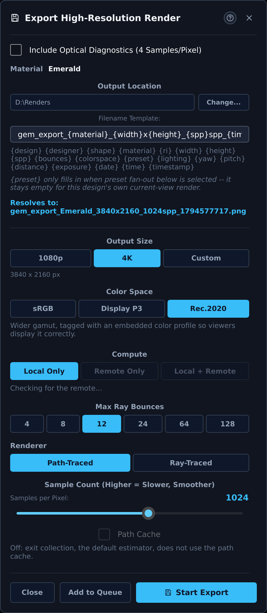

# 9. Rendering and Export

## What You Will Do

This chapter covers exporting a still image of the rendered stone: sizes,
sample counts, filename templates, choosing local or remote computation,
and what the app's "preview then handoff" behaviour means while you work.

## Opening the Export Dialog

### Choose The Renderer

The live and Edit viewports offer **Path-Traced** and **Ray-Traced**. Path-Traced is the
spectral model and accumulates samples. Ray-Traced is a deterministic RGB approximation:
one d-line refractive index, or three indices with **Fire**, with **Anti-Aliasing** set to
Off, 4×, 8× or 16×. The first tap is visible before the remaining taps finish. No denoiser
is used for Ray-Traced.

The export dialog has its own **Renderer** choice. Ray-Traced exports use AA taps and
Fire in place of the Path-Traced sample count. Local CPU, supported GPU and protocol-44
remote computation honor that choice; the engine and options are frozen in queued jobs.
Changing engines starts a new accumulation, so spectral samples never mix with AA taps.

Ray-Traced approximates frost, omits polarization, birefringent doubling,
inclusion haze, zoning, edge rounding, oriented inclusions, surface finish, abraded edges and play-of-color, and drops paths beyond the bounce
cap. Its body color follows the material's absorption spectrum in 10 nm bands over each
light path's full length inside the stone, so a colored stone deepens with depth as it
does in Path-Traced; the ordinary and extraordinary rays share the light evenly instead of
being traced as two polarized rays. Optical metrics, tilt curves and diagnostics
keep their own analytic model; choosing Ray-Traced does not change their calculation.
The sampling, convergence and denoise descriptions below refer to Path-Traced.

**Color Patterns** (Chapter 29), the zones of different colors in a custom material,
render in the Path-Traced views only: Path-Traced, Solid + Path-Traced, Live Render with the
Path-Traced engine, render jobs and remote workers that support zoning. Ray-Traced
shows the material's base color.

From the Live Render viewport (Chapter 2), open **Export High-Resolution
Render**. The dialog has these sections.



**Remembered settings.** The dialog opens with the settings of your last export: the
output size, sample count, bounces, color space, compute choice and transfer. Starting
an export, adding it to the queue or just closing the dialog remembers the values, so the
next dialog starts there, also after the program was closed. These are the *output defaults* of the Parameters dock's **Render &
Output** tab, which lists them (Chapter 2); the dialog's own controls are per-export
overrides on top of them. The Tilt Video export keeps its own set the same way, including
the angles, step, frame rate, axes and its other switches (Chapter 14).

**Which material.** A line near the top of the dialog names the material the export
will use. It is the design's material, unless you are previewing another one (Chapter 6,
"Preview As..."), in which case the amber **Previewing** badge appears there too and the
export uses the preview material. Press **Back to Design** in the badge to export the
design's own.

### Stone Shadow

"Stone Shadow" follows the scene's lighting into still exports and saved-lighting
fan-outs. Before tracing, "Computing the stone shadow…" reports the Final quality
precompute, which can be canceled. The remote worker builds the same map locally;
no map bytes cross the connection. The path cache reports in every build that it
cannot serve the stone shadow and uses ordinary tracing; beam tracing does the same,
but only in a build with the `beam` feature. Spectral GPU rendering uses
the megakernel when supported and otherwise falls back to CPU. Tilt videos do not
show the stone shadow yet.

### Tray Reflection

"Tray Reflection" turns the tray under the stone into a glossy surface. Its slider runs from
0 % (off, the default) to 100 %, and the value is the surface's reflectance looking straight
at it. About 4 % looks like black acrylic or glass: with the Black backdrop it gives the
classic jewelry-photo look. 100 % is a mirror. The more glancing the view, the more the
surface reflects, as a real glossy surface does. What it does not reflect is the ordinary
tray, the matte paper, including the Stone Shadow when that is on.

The reflection is traced for real. The stone appears mirrored in the surface, and light
reaches the pavilion from below. The surface is perfectly smooth, unpolarized and endless,
like the tray itself, and it lies where the Stone Shadow's tray lies, at the culet. The
shadow map does not include the mirror's own reflected light, and Ray-Traced facets with a
frosted finish do not see it.

It has the Stone Shadow's scope: a studio light with a backdrop. With an HDR map, As Lit or
"Contrast view (ASET-style)" the row is dimmed and shows the Stone Shadow row's notes
("(not used with an HDR map)", "(needs a backdrop)", "(not used with this light)"); a stone
that is not closed gives "Tray reflection needs a closed, nondegenerate stone." It works together with the Stone Shadow, and both can be on.
It follows the scene's lighting into still exports and saved-lighting fan-outs, and the
remote worker builds the mirror itself from one number. Because the reflected paths
cannot be kept, the path cache reports "Path cache off: the tray reflection needs paths
the cache does not keep." and beam tracing (in a build with the `beam` feature) reports
"Beam tracing off: the tray reflection is traced without beams."; both use ordinary tracing.
Spectral GPU rendering uses the graphics card when it can run the reflection and otherwise
says "Tray reflection is traced on the CPU on this graphics card."; Ray-Traced GPU rendering
always shows it. Tilt views and tilt videos
do not show the reflection ("Tilt views don't show the tray reflection."). A still with the
reflection on is saved as a format 4 render job (format 5 when the stone has color zones, format 6 with a
turned HDR map, format 7 with the stone moved within the picture, format 8 with a Stone Pose; Chapter 23).

### Stone Pose

An export, an extra preset image and a queued job draw the stone in the **Stone Pose** of the Live
Render view (Chapter 2): the same tilt, turn and spin, with the shadow and the mirror image
that go with it. This holds when the export is started from the Edit tab too: the Edit view
is never posed, but the export takes the pose the Live Render view has, so a posed export
started beside an unposed Edit view is not a surprise. When the stone is posed, the dialog
shows the line "Stone Pose: tilt 75°, turn 20°, spin 0°" (with the actual angles), and a queued
job's row in the render queue carries the same line. A job keeps its pose as `stone_pose` and is
saved as a format 8 render job, so an older program refuses it instead of drawing the stone as
designed (Chapter 23). A remote worker draws the same pose. Tilt videos always show the stone as
designed, and an export with **Include Optical Diagnostics** is refused while the stone is
posed (below).

### Output Location

A read-only field shows the folder your image will be saved to (or
"Chosen on first export..." if you have never exported before), with a
**Change...** button that opens a normal folder picker. The app only asks
once; after that it remembers your choice.

Below it, a **Filename Template** field lets you build the exported file's
name out of placeholders. Typing any of the following into the field
inserts that piece of information at that spot:

```
{design} {designer} {shape} {material} {ri} {width} {height} {spp}
{bounces} {colorspace} {preset} {lighting} {yaw} {pitch} {distance}
{exposure} {date} {time} {timestamp}
```

The default template is `gem_export_{material}_{width}x{height}_{spp}spp_{timestamp}`.
`.png` is added automatically if you don't type it yourself, and if a file
of that name already exists, the app adds `(2)`, `(3)`, and so on rather
than overwriting anything.

### Output Size

Choose **1080p**, **4K**, or **Custom** (16–8192 pixels per side, entered
directly).

### Color Space

Choose **sRGB** (the default, and what almost every viewer expects),
**Display P3**, or **Rec.2020**. The latter two are wider-gamut options and
carry an embedded color profile, so a viewer that understands it displays
the extra color range correctly rather than looking washed out or overly
saturated.

### Compute

Choose **Local Only**, **Remote Only**, or **Local + Remote**. If a usable
remote (coordinator) is already configured and reachable, **Local + Remote**
is selected for you by default; otherwise the remote options are shown
greyed out with the reason underneath (see Chapter 10 for what those
reasons mean and how to fix them).

### Transfer

Shown once the remote is available and Compute includes it: **Full Data**
(the remote's raw samples are merged with your own) or **Final Picture
Only** (the remote renders and tone-maps the whole image and sends one
finished PNG — much less data than Full Data). With **Compute: Local +
Remote**, your own CPU/GPU is not left idle even on Final Picture Only: a
toggle in the Render & Output tab's Compute section, "Final-Picture Exports: This Machine Renders a Share Too"
(on by default), traces a share of the samples locally and uploads it for
the coordinator to fold in before tone-mapping — turn it off if you'd
rather this machine sit out the export. The starting choice for Transfer
itself is the remote's own default ("Export Transfer (Default)" in the
Remote Coordinator form); see Chapter 10, "Transfer: Full Data or Final
Picture". The tilt video's export section has the same row.

With **Full Data**, the export does not hand the remote its whole share in one
go. It cuts the samples into requests and sizes each from the speed the
remote has shown so far: about 22 seconds of work per request for a single
worker, and up to about 90 seconds for a coordinator, which splits every
request across its own renderer and its joined workers and keeps them all
busy (one request never carries more than 65,536 samples, so a very fast
remote simply gets full-size requests back to back). The first request is a
short timing probe. For a coordinator the speed is measured over the whole
request, connection, upload and result transfer included, so the probe reads
low and the sizes settle on what the link and the remote really deliver
within a few requests.

### Max Ray Bounces

The same rung ladder as the live view (4/8/12/24/64/128), for this export only — it
starts at your last export's choice and is independent of the viewport's bounce
count. At 64 or 128, a note reminds
you this is noticeably slower on GPU hardware than on CPU.

### Sample Count

The **Sample Count (Higher = Slower, Smoother)** slider runs from 8 up to 32768 samples
per pixel; each step doubles the count (and the time). Higher counts mean a
smoother, less noisy image at the cost of render time. At the very top of
the range (16384/32768), the app warns this "can take hours, especially at
large output sizes."

### Adaptive Sampling

Adaptive sampling is an optional build feature (`adaptive-sampling`) and is not in the
standard build. To get it, build the app with `cargo build -p pleochroma-cut --features
adaptive-sampling`; the command line and the worker have the same feature (`-p pleochroma-cli
--features adaptive-sampling`, `-p pleochroma-worker --features adaptive-sampling`), and the
`beam` feature includes it. In the standard build the Adaptive Sampling box is not shown, in
the export dialog and in the tilt video section, and neither is the **Adaptive Sampling in the
Viewport** switch in Preferences (Chapter 17). Saved choices are kept and written back
unchanged. A render job that asks for adaptive sampling still loads and renders in the
standard build, at its own samples per pixel. Its progress note says "Adaptive sampling off:
this build has no adaptive sampling." On the command line, `--adaptive`, `--target-noise`,
`--min-spp`, `--noise-metric` and `--gpu-convergence` are unknown flags without the feature.
A worker or coordinator of the standard build refuses an adaptive pass as an unsupported
request (Chapter 10). The rest of this section describes a build with the `adaptive-sampling`
feature.

Under the slider, the **Adaptive Sampling** check box saves time on a picture where some
parts are clean long before others. Adaptive sampling stops each part of the picture once
it is clean enough; the samples setting becomes the most any part gets. A flat background
or a calm facet stops early, while a sparkling facet keeps going up to the full count. The
dialog's hint says it in one line: "The samples setting becomes the maximum."

With the box ticked, a **Target Noise** list appears with three choices:

- **Fine** stops a part only when it is very clean. It saves the least time.
- **Standard** is the choice for most pictures, and the one the dialog starts with.
- **Draft** stops sooner. It is quick, and a little grainier.

Some parts always get a minimum number of samples before they may stop, so a small sample
count leaves little to save. The box and the list are remembered like the other export
settings: the dialog opens with your last choice, and **Add to Queue** saves the choice in
the job.

Adaptive sampling is for the Path-Traced renderer. With Ray-Traced selected the box is
greyed out and says "Adaptive sampling is for the path tracer." A picture drawn with it
renders on this computer only for now, so choose **Local Only** under Compute.
When it finishes, a short message tells how many samples it saved.

### Exit Collection

The app renders a stone with exit collection. Instead of following each sample down one
randomly chosen branch at every surface, it gathers the light of the paths that leave the
stone, so the same number of samples gives a cleaner picture. With a fixed number of samples
a render takes somewhat longer per sample, and the picture is much cleaner. There is nothing
to switch on or off, and the remote workers use it too (Chapter 10).

Some frames fall back to the classic estimator, which picks one branch at random at each
surface. The app does this by itself, for that frame only, where exit collection does not
apply: with an HDR map as the light, with Daylight + Sun, for a stone with tools, for a
rough or ground surface, and with Tray Reflection. These frames look as they did before and
are noisier at the same samples.

### Path Cache

The path cache and beam tracing are off while the app renders with exit collection, because
exit collection does not use them. The **Path Cache** controls (and, in a build with the
`beam` feature, the export's **Beam Tracing** controls) are shown only when the path cache can
be used; otherwise they are not shown. A job that asks for the cache, for example a queued job
or a command-line run, is drawn without it and says "Path cache off: exit
collection, the default estimator, does not use it." (in a build with the `beam` feature,
beams say the same). The rest of this section describes the cache with the classic (branching)
estimator.

Below Adaptive Sampling, the **Path Cache** check box is a quick preview for trying lights
on a view you keep. Every ray that enters the stone follows the same path of reflections and
refractions however the room is lit, so the app can work that path out once, keep it, and
shade the stone from it. The dialog's hint says it in one line: "A preview for re-lighting a
kept view: facet edges are approximate. Used only when the cache is kept; uses memory and
disk space." Working the paths out takes longer than drawing the picture once without them,
so the cache pays only when the same view is drawn again. It stores the paths at a few fixed
points in each pixel, so facet edges and small glints come out a little too sharp. Use it to
compare lightings, and draw the picture you keep without it.

The cache is used only together with **Keep for Re-Renders**. With **Path Cache** ticked and
**Keep for Re-Renders** off, the picture is drawn as without the cache, and a line under the
progress bar says "Path cache: not used, it only pays when the cache is kept and the view is
rendered again (tick the keep box under Path Cache, or pass --persist-cache)".

Before it starts, the app estimates how large the cache will be and tells you under the
progress bar, for example "Path cache: about 11 GB, in system RAM". When part of
the stone's light takes paths the cache does not keep, the line also says how often a sample
traces such a path again, for example "Path cache: about 1.2 GB, 31.0 % of samples traced
again, in video memory". It keeps the cache in
video memory when it fits, else in system memory, and if it fits in neither, the picture
is drawn without it and the same line says why. The cache is used only where it can be
right: it is left off, with a message that names the reason, for a stone that scatters
light (opal, moonstone, a hazy body, oriented inclusions), for frosted facets and for a
stone with a concave tier.

With the box ticked, **Keep for Re-Renders** writes the cache to disk when the picture
is done. Rendering the same stone again, at the same size and from the same side, then
starts from the kept cache, and you can change the lighting and the exposure freely, as
they are not part of it. Changing the design, the material, the crystal axis, the
view or the size makes a new cache. Kept caches live in the cache folder that
**Preferences** shows (Chapter 17), which is also where you clear them. The box and
**Keep for Re-Renders** are remembered like the other export settings, and **Add to
Queue** saves them in the job.

The path cache is for the Path-Traced renderer. With Ray-Traced selected the box is
greyed out and says "The path cache is for the path tracer." It combines with Adaptive
Sampling.

### Beam Tracing (Faceted Stones)

Beam tracing is retired. It stays in the code as an optional build feature and is not in
the standard build. To get it, build the app with `cargo build -p pleochroma-cut --features
beam`; the command line and the worker have the same feature (`-p pleochroma-cli
--features beam`, `-p pleochroma-worker --features beam`). Every beam setting is off by
default. In the standard build the Beam Tracing boxes are not shown, in the export dialog
and in the tilt video section, and neither are the two beam switches in Preferences
(Chapter 17). A render job that asks for beams still loads and renders in
the standard build, without beams. Its progress note says "Beam tracing off: this build has
no beam tracer." A job that also asks for the path cache and keeps it uses the cache. The rest
of this section describes a build with the `beam` feature.

Next to the Path Cache, the **Beam Tracing (Faceted Stones)** check box draws the stone
in a different way. Instead of firing many single rays, the app follows the light
through the stone as whole beams: a beam enters a facet, splits where it meets the
next facets, and carries on until it leaves the stone. Everything a beam covers is
worked out in one go, so a faceted stone settles much faster than ray by ray. The dialog's
hint says it in one line: "Follows the light through a faceted stone as beams, so the
stone settles much faster. The picture matches the path-traced one." It does match: the
result equals the path-traced picture within its noise, only with far less noise on the
stone for the same time. The rest of the picture, the background and anything the beams
leave out, is finished with the usual samples, so the **Samples per Pixel** setting still
applies.

Beams apply where the stone is a plain faceted solid: a convex stone with flat, polished
facets and sharp edges. The app leaves them off, and draws the stone as it would without
the box, when the material rounds its edges, when the stone has tools or concave tiers,
when it scatters light (opal, moonstone, a hazy body) or has oriented inclusions, when its
facets are frosted or its polish is rough, or when the camera has depth of field. When
that happens a line under the progress bar names the reason, for example "Beam tracing
off: the material rounds its edges". When beams are used, the same line reports them, for
example "Beams: 142318 leaves, 0.8 % residual", which says how many pieces of the stone were
drawn from beams and how small a share was left to ordinary samples. Every built-in
material has sharp edges, so beams are available with all of them.

The reasons the line can give, word for word: "Beam tracing off: the material scatters
light", "...the stone has oriented inclusions", "...the material has a play-of-color look",
"...the stone has frosted facets", "...the polish has roughness", "...the stone has abraded
edges", "...the stone has concave tiers", "...the stone is concave", "...the camera has
depth of field", "...the material rounds its edges", "...the facets do not close the stone"
and, for a build without the beam tracer, "...this build has no beam tracer". Some lightings
and effects make the stone fall back with no note at all. With Ray-Traced selected the line
reads "Beam tracing needs the Path-Traced engine". In every case the picture is the one you
would get with the box unticked.

With both **Beam Tracing** and **Path Cache** ticked, the beams draw the stone where they
apply, a line tells you "Beam tracing renders this stone; the path cache is not used for it", and a kept path cache still serves
any stone the beams cannot. If you also asked for the GPU-resident convergence check, the
line says "Beam tracing checks convergence on the host; GPU-resident convergence is not
used". Beam tracing combines with Adaptive Sampling.

With a remote worker chosen (Chapter 10), the beam tiles of the stone are drawn on the
workers as well: this computer and each worker render whole tiles, beams and the samples that
finish them, and the finished tiles are put together in tile order. If a worker is lost, its
tiles are drawn by the others and a note says so ("The remote worker stopped"). **Final
Picture Only** transfer is not used for a beam picture: the tiles come back as finished data,
as they do for Adaptive Sampling. With no worker set up the stone is drawn on this computer
and the line says "Beam tracing renders on this computer". Every worker must run the same
version as the app (Chapter 10).

Beam tracing is for the Path-Traced renderer. With Ray-Traced selected the box is greyed
out and says "Beam tracing needs the Path-Traced renderer." The box is remembered like the
other export settings, and **Add to Queue** saves it in the job.

#### Keep Beams for Re-Renders

This box exists only in a build with the `beam` feature (see the start of this section),
and it is not shown in the standard build. The standard build never reads kept beams. Kept
beams share the path cache folder (`render_cache`, Chapter 11) and its disk limit with the
kept path caches, so the standard build's limit and **Clear Path Cache** can delete them.

Once **Beam Tracing** is ticked, a second box appears under it, **Keep Beams for
Re-Renders**. The beams of a stone do not depend on the lighting, only on the stone, its
material and its pose. With the box ticked, the app saves them to the path cache folder
(Chapter 11) when the picture is done. Drawing the same view again, even with other
lighting, another exposure or another saved lighting from **Also Render With Saved
Lighting**, then starts from the saved beams instead of working them out again, and the
picture is the same as a fresh one. Moving the stone, changing the design or the material,
or changing the beam settings makes a new set of beams. Saved beams share the folder and the
**Path Cache Disk Limit** of Preferences (Chapter 17) with the kept path caches, and the
oldest are deleted first when the limit is reached; a damaged file is simply drawn again.
When a picture starts from saved beams, the line under the progress bar ends with "Loaded from
the kept beams." Saved beams are kept and used on this computer: with a remote worker chosen,
the line says "Keeping the beams renders on this computer." A stone that cannot use beams saves nothing. If a build of the app cannot store beams, the
box is greyed out with a note, and the beams stay in memory for the one picture. The box is
remembered, and **Add to Queue** saves it in the job.

For a tilt video (Chapter 14) there is no extra box: **Keep Path Cache for This Video**
also keeps the beams of every frame. Every frame is a new pose, so the frames share no beams.

The live Ray-Traced view can use the same stored light paths in one other way. With
**Instant Lighting Changes in the Ray-Traced View** ticked in Preferences (Chapter 17), a
Ray-Traced view that has stood still and finished keeps the stone's light paths in memory,
and changing the lighting preset, the light direction or the exposure then re-lights the
stone at once instead of tracing it again. This is also what makes flicking through the
lighting presets of one stone instant. The re-lit stone follows the path tracer's
physics, so it can differ slightly from the Ray-Traced look, and the background is still
drawn by the Ray-Traced renderer. Exports are not affected: a Ray-Traced export is drawn
as always, and a path-traced export keeps its own cache as described above.

The live Ray-Traced view can also draw the stone from beams, but only in a build with the
`beam` feature; the two Preferences it needs are not shown in the standard build. With
**Beam Tracing in Still Views** and **Instant Lighting Changes With Beams** both ticked in
Preferences (Chapter 17), a
Ray-Traced view that has stood still and
finished builds the beams of the stone in the background and then shows the stone from
them. Changing the lighting preset, the light direction, the exposure, the glare or the head
shadow keeps the beams and draws the stone again from them under the new lighting as soon as
the Ray-Traced picture of that lighting is finished. This view mode is a defined image of
its own: the stone comes from the beams and has no noise, and the background and the stone's
outline come from the Ray-Traced renderer. The very small share of light the beams leave out
is left out here too, as the Ray-Traced renderer leaves out what is too faint to count. It is
not a path-traced picture, so it can differ slightly from the Ray-Traced look and from the
Path-Traced view. Moving the stone, changing the design, the material or the window size, or
switching the renderer drops the beams. A stone that cannot use beams (Chapter 9, above) is
drawn as always, and with the Preference off nothing changes. The beams are kept in memory
only (up to 4 GB) and never saved. Exports are not affected.

The Path-Traced view has its own pair of Preferences for the same purpose: **Beam Tracing in
Still Views** and **Instant Lighting Changes With Beams** (Chapter 17). They too exist only
in a build with the `beam` feature.

### Also Render With Saved Lighting

If you have saved lighting marked as usable for export (Chapter 2, the Lighting &
Environment tab's **Saved Lighting**), you can tick any number of them here to render one
extra image per ticked lighting alongside your current view. Each extra image uses
that saved lighting's whole look: rig, light direction, exposure, surface glare,
backdrop (the lit tray under the stone), head shadow and HDR map (a lighting saved without a map renders without one).
Export time multiplies with how many you select. A lighting that uses an HDR
environment map is marked "HDR".

### While It Renders

A live thumbnail updates roughly twice a second so you can judge
composition and how far along the image is — this preview is always shown
in ordinary sRGB regardless of which color space you chose for the final
file, so do not judge final color from it. A progress bar and percentage
track completion; **Cancel Export** stops the job early (files already finished are
kept). **Run in Background** closes the dialog and leaves the export running: the
header's export indicator shows its progress, and clicking it opens the dialog again.
When no export is running the footer offers **Close**, **Add to Queue** and
**Start Export**.

### Add to Queue

Next to **Start Export** sits **Add to Queue**. It does not render anything now.
It saves your settings and a frozen copy of the stone as a render job, to be
rendered later, one job at a time, from **File → Render Jobs...**. **Start Export**
works as before and renders at once.

With presets ticked, each picture becomes its own job. Jobs are kept in your
library and can be paused, resumed and exported as a script. See Chapter 23.

### Which Stone Is Drawn

An export always draws the **finished** gem. The Edit tab's Cut slider (Chapter 13)
can show the stone part-way through the cutting, and the Live Render view follows it
(a badge over the picture says so and has a **Show Finished** button), but that is only
for looking. The high-resolution export, the extra preset images, the tilt video, the
tilt curves and their hover pictures, and every render done by a remote worker for an
export all draw the whole design, even while the slider is on an earlier step. The live
picture, including the part a remote worker traces for it, keeps following the slider.

An export draws the stone from the live view's camera, framing included: a stone you moved
within the picture (Chapter 2) keeps its place there, in the tilt video and in a queued job
too. A picture of another shape keeps the stone's distance from the centre, measured in
picture heights, so in a narrower picture a stone moved far to one side can reach the edge.

## The Stone's Color in a Render

You can show a stone in another color without making a custom material. The design's own
color is set in the **Stone** tab's **COLOR** tiles, announced as Body Color (Chapter 6): **Default** (the
material's own color, Material Default), the color variants of the material and your own saved variants
(Chapter 6, "Color Variants and Pleochroism"), nine ready-made colors (Clear, Blue, Red,
Green, Violet, Yellow, Pink, Teal and Amber) for a material that has one color in every
direction, and the **Custom** tile, which opens the color editor (Chapter 6, Color) so you
can choose any color, one for each direction of a birefringent crystal. That is always the
design's own color: one undo step, and the design counts as changed.

The **Color** control (a pill with a color dot, in the Stone tab; it is no longer in the Live
Render toolbar) offers the same list. For the design open in the editor, a pick becomes the design's own color; the control
then shows the variant's own name and swatch ("Rubellite", "Custom Color") instead of
"Material Default". A pleochroic material lists no generic presets there either, and a stone
with an old single color on such a material shows a **Legacy** row with the note "Legacy Color:
No Pleochroism. Pick a variant or a Custom Color to set a color for each direction." The
Custom Color row opens the same per-direction editor as the Stone tab, for the design and
for a view-only color.

Two situations let you try a color without touching a design. In both, the color is a
view-only choice:

- **While previewing another material** (Chapter 6, "Preview As..."), the **Preview Color**
  control in the Stone tab changes only the picture. **Back to Design** clears it.
- **A catalogue row you are only browsing.** The Stone tab's **Color** changes this view
  only. The catalogue entry is never changed, and the app remembers the choice the next
  time it starts. Pick **Material Default** to clear it.

Whatever color the view shows is the color everything rendered from it uses: the live
picture, the metrics beside it, the tilt curves, high-resolution exports (including the
extra saved-lighting images), the tilt video, and renders done by remote workers. So an
export always matches the picture you were looking at.

A few details:

- The control is greyed out for a material that defines its own color (a custom material
  whose color comes from a physical recipe). Its hover note says so. The color is never
  replaced.
- A custom color is matched to the closest color the material model can show, so the
  result can differ a little from the exact color you picked. The button reads
  "Matching..." for a moment while that happens.
- A color is a what-if: the stone keeps its material's refractive index and dispersion,
  and a variant or a per-direction Custom Color keeps the material's pleochroism, one color
  for each direction of the crystal. Only a one-color material (and an old single color, shown
  as "Legacy Color: No Pleochroism" on a pleochroic material) absorbs evenly in every direction.
- A custom color shows as the **Custom** tile of the Stone tab's COLOR section, and choosing the **Default** tile (Material
  Default) puts the material's own color back. Undo brings the custom color back.

## Stone Effects and Width in a Render

The stone's width and its four material effects (Inclusion Haze, Crystal Axis,
Frosted Girdle, Edge Rounding) belong to the design (Chapter 2, the Stone tab). Every
render uses the open design's values: the live picture, exports, saved-lighting images,
the tilt video and render jobs. A render job freezes them with the stone, so a queued
job renders the way the stone looked when you queued it, whatever you change afterwards. The newer effects (Inclusions, Surface Finish, Abraded Edges and Play-of-Color, Chapters 26 to 28) belong to the design in the same way. Your Faceting Machine preference, which gives the scratch direction of a polish (Chapter 17), is frozen into a queued job with the stone.
A catalogue row you are only browsing is drawn with the girdle diameter its design file
sets (the default width of 7 mm when it sets none) and no effects, unless you set
view-only effects in the Stone tab. The library's preview thumbnails and tilt curves use
that same width, and the material the design file names, so a design looks the same in
its thumbnail, its tilt curves, the detail view and an export (Chapter 2).

## Lighting That a Design Remembers

A design can remember the lighting you like for it. The lighting is kept in your
library on this computer, never in the design file, so copying the file does not
copy it and saving never changes it.

To save it, set the lighting up the way you want in the live view, then open the
**Lighting & Environment** tab of the Parameters dock and look under **This Design**
(**Lighting This Design Opens With**). Press **Use This Lighting for This Design**. This
saves the lighting rig, the light's position and height, the exposure, the surface
glare, the head shadow, the backdrop (a lit tray) and, if one is loaded, the HDR environment map. It
does not save the camera. (Lighting saved by an older version has no head shadow; it
opens with the default 16° one.) The button is
greyed out until a design is open (a new design, a file you opened, or a design you
loaded from the catalogue), and the line above it says so.

Press the button again at any time to replace what is saved. **Forget for This
Design** removes it and brings your normal lighting back.

When you open a design that has saved lighting in the editor (Open, Open Recent,
Load Selected or New), the live view uses it and a note says "Using this design's
saved lighting." When you then open a design that has none, the note says "Back to
your normal lighting." and the lighting you had before comes back. The saved
lighting never changes your normal lighting. Browsing a row in the catalogue list
does not apply it.

**Why browsing does not apply it.** A row you click in the catalogue list is only a
preview. It is drawn under the lighting you have set, not under that design's saved
lighting, so you can flip through many designs and compare them under one lighting.
The saved lighting comes back when you open the design in the Edit tab, because that
is when you are working on it, and it is keyed by that design's id.

A few details:

- While a design's own lighting is showing, you can still move the light, change
  the exposure or pick another lighting. Those changes last until you open another
  design. Press **Use This Lighting for This Design** to keep them.
- Applying one of your **Saved Lighting** entries counts as choosing your normal
  lighting, so it stays when you open other designs. The design keeps the lighting
  it saved.
- If the saved lighting uses a lighting rig this version of the app does not have,
  the app tells you once and uses your normal lighting. If the saved HDR
  environment map file has moved or cannot be read, the rest of the lighting is
  used, the current environment is kept, and the app tells you why.
- A large HDR map takes a moment to load when the design opens, and when the library
  is busy (an import is running, say) the saved lighting itself can take a moment to
  be read. If you load or clear an HDR map yourself in either moment, your choice
  wins: the saved map does not replace it, and **Use This Lighting for This Design**
  saves the map you chose. The rest of the saved lighting is still applied.
- The saved lighting belongs to the design's id, which Chapter 11 explains. A file
  that has never been saved gets the same id each time you open it, so it finds its
  lighting again.

## Custom Materials on a Remote Worker

A remote worker receives the whole material with every request, not just its name. For
a custom material that includes its **dispersion**: the Sellmeier or Cauchy
coefficients you typed in the Material Editor (Chapter 6). The worker therefore traces
the same color play you see on your own computer, and nothing has to be installed or
configured on the worker for it.

## What "Preview Then Handoff" Means While You Work

While you are dragging the camera or the light, the app is not trying to
produce a polished picture — it draws a cheap, rough local preview so
movement stays responsive. The moment you stop moving (about six-tenths of
a second of no input), if a remote coordinator is set up, the app starts a
fresh settled image and brings the remote in — nothing from the rough local
sketch is mixed into it. With **Live Compute: Local + Remote** your own
computer and the remote both keep adding samples to that one image until
together they reach **Target Samples**; with **Remote Only** the remote does
all of it. The remote sends back updates every "cadence" interval (half a
second by default), always sending at least a small update at least once
every two seconds even if there's nothing new worth showing. With **Live
Transfer: Final Picture** (set per remote, Chapter 10) it instead sends finished, denoised pictures of the
whole image and your own computer pauses (Chapter 10). If you grab the camera
again before it finishes, the app throws away the in-progress settled image
and drops straight back to the cheap local preview — the moving preview and
the settled image never blend.

An **HDR environment map** goes to the remote only if the remote reports that
it can render HDR scenes (Chapter 10); otherwise the live view and exports
render that scene on your own computer, with a one-time note.

**Motion Preview Resolution** (Off / Half / Quarter, in the Render & Output tab) controls how
coarse that moving-camera preview is: a smaller fraction renders faster but
looks blockier while you are actively orbiting or panning.

## What the "Worker Silent" Messages Mean

If you see a message like "Remote render failed: worker silent for 8s," it
means the app sent your remote worker something to compute and heard
nothing back — not even a routine status update — for the stated number of
seconds. For an ordinary render this limit is 8 seconds; for the very
first response after starting a fresh job it is more generous, 30 seconds,
to allow for a slow warm-up on a busy or cold machine. While a large finished
picture is crossing a slow link, the limit is extended by the time that picture
needs at a slow-link speed of about 4 MiB per second, so a big 4K frame in flight
is not mistaken for silence.

This is not necessarily a sign of anything broken. With **Local + Remote**
selected, the app automatically falls back to finishing the work locally
and tells you it happened — you do not lose the samples the remote worker
had already completed. With **Remote Only** selected, there is no local
fallback, and the export or preview simply fails; switch to **Local +
Remote** or **Local Only** and try again.

If this keeps happening, check that the worker machine is turned on,
reachable on your network, and that its render-serving program is still
running — see Chapter 10.

## Next Steps

Continue to Chapter 10 to set up and troubleshoot a remote coordinator, or
Chapter 11 to understand the app's save formats. Chapter 23 shows how to
collect exports as render jobs and render them one after another.


## Optical diagnostics

In Live Render, choose **Optical Diagnostics**, then **Enable Optical Diagnostics**. This adds a separate camera-aligned analytical layer. It works over local CPU, GPU, combined and remote beauty images. It follows the currently displayed Cut-slider geometry. It is off initially and does not change radiance, beauty sampling, denoising, standard HUD scores or saved catalogue thumbnails.

Start with one layer. Cyan diagonal lines show **Windowing (/)**, magenta crosses show **Extinction (X)**, and green dots show **Brilliance (Dots)**. Select several to mix their hit-ray fractions. Gold stipple is **Fire (Dispersion Potential)**, independent of the three base fractions. Opacity starts at 45%; **Reset to 45%** restores it. **Diagnostic Map on Neutral Stone** replaces unselected stone regions with neutral grey. The interface high-contrast preference also selects brighter diagnostic colors. Patterns and text identify effects without relying on hue.

The legend reports **visible-area diagnostic shares**: count divided by samples that hit the stone. Unknown/entry-blocked observations remain in that denominator. Silhouette alpha follows hit coverage; misses stay transparent. The ordinary metrics HUD samples a girdle-scaled disc with an angular aperture, so its percentages can differ. These are ray counts, not radiance percentages or brightness in nits.

Windowing means a refracted exit at a surface whose outward normal has vertical component below -0.05. It can follow internal reflections. Brilliance means an upward d-line exit that passes the existing illumination threshold and observer-shadow test. Extinction includes shadow, insufficient illumination, side exits, missing subsequent intersections and the ten-bounce budget. Budget exhaustion is an estimate, not proof of physical absorption or permanent darkness.

Fire replays qualifying returns at 486.1 and 656.3 nm, alongside the 589.3 nm d-line. Both companions must leave through the same facet after the same reflection count. The local value is angular separation times Fresnel-transmittance product and exit-cosine weights, divided by all hit samples. The fixed model-1 display range is **0 to 0.1 weighted degrees**. It has no per-image normalization or aggregate metric floor. Zero dispersion remains zero. Uncomputed and rejected Fire paths are distinct from qualifying zero contributions. Fire is dispersion potential, not a measurement of every colored flash in the spectral picture.

Scintillation is a fifth, separate checkbox. Violet diamonds mark pixels where the stone sparkles: the pixel's center ray is traced again at five viewing angles within plus or minus 3 degrees of yaw, and the more often its return flips between them, the higher the flicker; that is blended 60/40 with the local contrast of the brilliance share over a 5 by 5 pixel neighborhood. The result is a fixed 0 to 100 scale (no per-image normalization) drawn as the diamonds' opacity, and it is traced only while the checkbox is on. The summary line then adds **Visible-Area Scintillation (Map)**, which is not the HUD's Scintillation value: the HUD samples a parallel ray fan against the camera axis, this map samples the visible area judged from each pixel's own viewing direction. Hovering a pixel reads its index and how many of the five poses returned light. Exported stills, videos and job files carry the choice, and the companion legend gains a line naming it.

Orbiting and incompatible frames hide the old layer. A 128-pixel-long-edge one-sample draft appears after settling; a 320-pixel, four-sample map refines it. The status records the actual grid and samples. Coarse maps use nearest-neighbor display. Opacity/layer changes reuse compatible data; enabling uncomputed Fire or Scintillation requests its extra traces. **Refresh Diagnostic Map** can recompute a matching paused view without restarting beauty accumulation. A changed scene while paused waits for a matching beauty frame. Solid mode suspends diagnostics; its existing hatching is a critical-angle risk indication. ASET already has a false-color legend, so this additional layer is unavailable there.

Hover a stone region with the panel open to read fractions, Fire qualification, the center-ray entry surface and exit surface, reflection count and termination reason. Border pixels can contain mixed subpixel surfaces. Entry and leakage-exit facets are different roles. Tier labels are shown only when a generation-bound mapping matches the captured geometry; otherwise the surface is explicitly labelled with its numeric ID and unavailable tier label. Concave tool IDs are resolved independently of planar IDs.

These are geometric diagnostics. Persistent notices identify body absorption/zoning, polarization/birefringence, scattering and frosted/rounded interfaces that the analytical model does not reproduce. Studio/HDR use the standard analytical observer cone. Surface glare is outside the internal path classes. Material-resolution errors, unsolved/stale geometry and invalid numerical inputs are unavailable states; no substitute Diamond or valid zero map is produced.

### Diagnostic exports

Still exports stay clean unless **Include Optical Diagnostics (4 Samples/Pixel)** is checked. The selection, opacity, palette and mode freeze with the export scene, including preset fan-out and queued jobs. Each diagnostic still traces four deterministic samples at its actual output dimensions in bounded row tiles, then composites after beauty processing. The tiles are traced on all available processor cores; the picture is identical whatever the number of cores. While it runs, the progress bar fills a second time (the first half is the beauty render) and a note says "Tracing Optical Diagnostics". The PNG's `.optical.txt` companion records model version, pose, material, lighting policy, selected effects, units, sampling and limitations without source/profile paths. It is written after the PNG, so a failed picture leaves no orphan legend. Target RGB profile conversion applies to the palette too. Transparent beauty alpha is preserved.

An export that cannot produce a diagnostic pass is refused before anything renders: ASET lighting without an HDR map, a stone without facets, or no layer (Scintillation counts as one) and no **Diagnostic Map on Neutral Stone** selected. A posed stone is refused too, with "Optical Diagnostics cannot be combined with a Stone Pose": reset the pose or leave **Include Optical Diagnostics** off. The same check covers every preset of a fan-out, queued jobs and job files run from the command line (which fail as an input problem).

The built-in **Optical Diagnostics at a Viewing Angle** tutorial demonstrates enabling, choosing effects, orbiting, reading a region and explicitly exporting with the legend.
