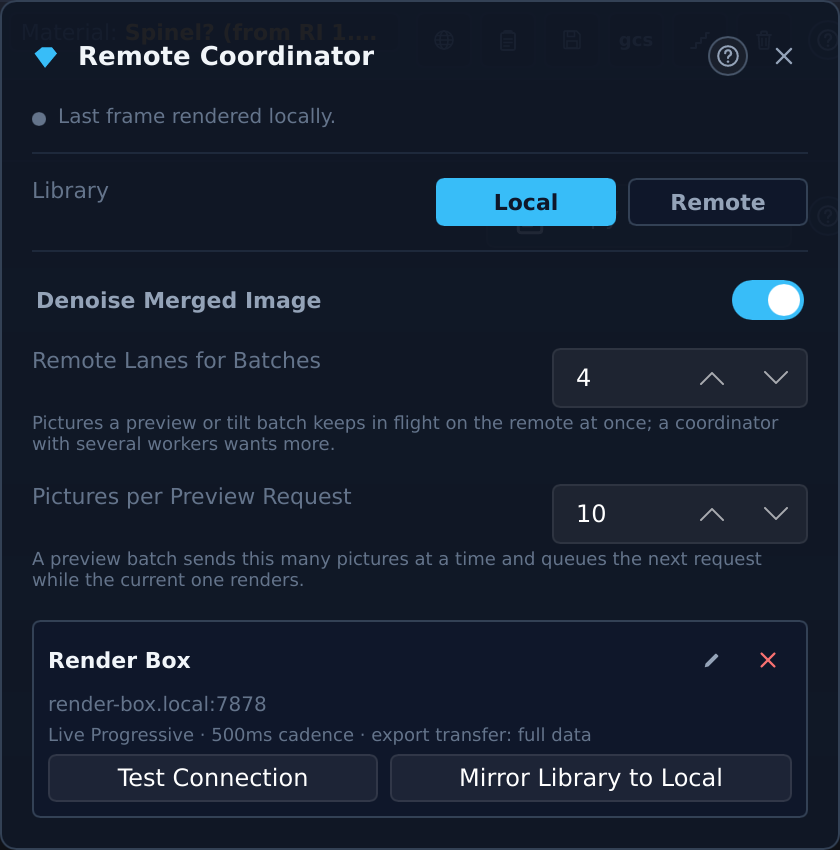

# 10. Remote Worker Setup

## What You Will Do

This chapter covers connecting the app to its one remote: a **coordinator**
(`pleochroma-worker serve`, a server that other machines — "workers" — join,
and that renders on its own hardware too when started with `--render`). You
will get certificates, set up the remote, test the connection, choose how
results travel home (full data or final picture), choose how many pictures a
catalogue batch keeps in flight on it, browse its design library, and
troubleshoot a connection that has gone quiet.

The coordinator's operator sets it up with the worker software's own README
(`apps/pleochroma-worker/README.md`: "Setting up a coordinator with joined
workers"). Since 0.12.0 the coordinator also has a window of its own, with a wizard,
pairing by QR code or link and remote administration; Chapter 30 covers it. The app connects to the coordinator's **viewer** port — 7878 unless
the operator chose another — never to the workers themselves.

The app talks to exactly **one** remote. If you have several render
machines, let them join a coordinator and point the app at the
coordinator; it spreads the work over them. (Settings saved by an older
version that listed several workers keep the **first** one — the one the
app was already rendering with — and drop the rest; the log names what was
dropped.)

## Update the App and Every Worker Together

The app and its workers must run the same version. The current version of the wire protocol
is 45, which carries the coordinator roles for remote administration, Stone Shadow, Tray Reflection, the HDR map's turn, the stone estimator, the stone's place in the picture and its Stone Pose (Chapter 2). Each worker builds its own map: a Preview map for the live
viewport, a Final map for everything else (exports, jobs, final images, batches and adaptive
passes); map bytes are never sent over the wire. The Tray Reflection travels as one number
(the surface's head-on reflectance), and each worker builds the mirror from the stone itself. A worker can render whole beam tiles of a
beam-traced stone (Chapter 9), and the finished tiles come back to the app; this
needs protocol 38 or later. A worker on an older version, such as one
still running protocol 44, is **refused** when the app connects, for every remote render
whether beam tracing is on or not. After you update the app, update every worker (and every
coordinator that workers join) to the same release and restart them, then use **Test
Connection** to check each one.

Every worker must be on protocol 45 (version 0.12.1). The app sends the estimator with the scene
(Chapter 9, "Exit Collection"), and a worker renders with the estimator the app sends, never
with one of its own, so a picture shared between this computer and the workers is drawn with
one estimator.

Beam tracing is retired and is an optional build feature (`beam`). A worker or coordinator
built without it answers every beam-tile request with "unsupported request" (code 5) and
keeps the connection; a standard coordinator does not forward beam tiles. A beam build of
the app then draws those tiles on this computer or on another worker, as it does for a lost
worker (Chapter 9), and with Remote Only the export fails.
A beam build and a standard build of one version still pair at the handshake (protocol 45).

Adaptive sampling is an optional build feature too (`adaptive-sampling`, which a `beam` build
includes). A worker or coordinator built without it answers every adaptive live-pass request
with "unsupported request" (code 5) and keeps the connection; a standard coordinator does not
forward live passes. A viewer then traces those tiles on this computer when Compute is Local +
Remote, and with Remote Only the export reports the failure. The request stays in the wire
protocol of every build, so an adaptive build and a standard build of one version still pair.

## Why Use a Remote Worker

Both Path-Traced and Ray-Traced images can be sent to protocol-44 peers. Ray-Traced
work carries its engine, AA count and Fire option with the resolved scene; tap ranges
travel as sample ranges and are never merged with Path-Traced samples. Display-only
Ray-Traced pictures are tone-mapped without the spectral denoiser. Older peers are
refused during the handshake; update the viewer, coordinator and joined workers together.
A peer that renders the backdrop by an older rule (a lit tray seen through the
stone's windows, Chapter 2) would produce samples that cannot be merged with new ones,
so it is refused the same way.

Rendering — especially a high-resolution export, or a live view with many
samples per pixel — is faster on a more powerful machine. A remote worker
lets you point this app at another computer (or a render server) on your
network and have it do some or all of the rendering work, while you keep
working here.


## Certificates

A remote worker requires a certificate bundle: a folder containing exactly
three files — `ca.pem`, `client.pem`, `client.key`. This is exactly what
the worker software's own certificate-issuing command produces; you cannot
substitute other certificate files. There are two ways to get this folder
into the app.

### Option A: Enter the Folder Manually

If you already have a bundle folder (someone gave it to you, or you
generated it yourself on the worker side), type or paste its path into the
**Certificate bundle folder** field, or click **Browse...** to pick it
with a folder dialog.

### Option B: Redeem an Enrollment Token

If instead you have an **enrollment address** and a short-lived **token**
(starting `GW1-...`) from whoever manages the worker:

1. Choose **File > Remote Rendering...** to open the **Remote Coordinator**
   panel, then **Set Up Remote Coordinator** (or the edit icon of the one
   already configured).
2. Paste the enrollment address into **Enrollment address (host:port, from
   "cert issue-token")**.
3. Paste the token into **Token (GW1-...)**.
4. Click **Redeem**.

On success you'll see "Token redeemed -- certificate folder filled in,"
and the Certificate bundle folder field fills in automatically — you never
need to find or type that folder yourself. Tokens are single-use and
expire 180 seconds after being issued, so redeem one promptly; if you see
"This token was not accepted -- it may be mistyped, already used, or
expired... Ask for a fresh one and try again," that's what happened.

**If you ever see a security warning during enrollment** — text along the
lines of "did not present the certificate authority this token was issued
for... this is not an ordinary connection problem" — stop and do not
retry against a different address on your own judgement. This specific
message means the worker you reached is not the one your token was issued
for, which could mean a wrong address, or something intercepting the
connection. Confirm the correct address with whoever gave you the token
before trying again.

## Setting Up the Remote Coordinator



**The quick way: a pairing link.** If the coordinator has a window, this needs no
address and no certificate folder. On the coordinator choose **Connect a computer**
(Chapter 30, "Pairing Another Computer") and copy the link it shows. In the app open
**File > Remote Rendering...**, which opens the **Remote Coordinator** dialog. Under
**Connect with a Pairing Link** paste the link into **Paste pairing link** and press
Enter or **Review**. Nothing connects yet: the dialog shows "Pair with *name*?" with the
coordinator's address, and, if a coordinator is already set up here, an amber line "This
replaces *the old one*". **Pair** (or **Replace and Pair**) connects; **Cancel** forgets
the link. The link works once and for three minutes, it is used once and is not kept, and
the certificates arrive with the pairing. A coordinator paired this way reads "Paired with
a pairing link. It is found again if its address changes."; after a search for a moved
coordinator the dialog says, for example, "Studio PC moved to 192.168.1.40.". Both
computers must be on the same network.

**By hand.** Without a link, fill in the form in the **Remote Coordinator** panel:

- **Name** — a label for your own reference (e.g. "Office coordinator").
- **Address (host:port)** — the coordinator's viewer port, e.g.
  `render-server:7878`.
- **Certificate bundle folder** (see above).
- **Live Transfer** — one choice for how the remote's share comes back while you look
  at the stone: **Progressive (Full Data)** streams improving previews,
  **Full Data, When Finished** waits for the finished samples, and **Final Picture
  (Denoised)** sends only finished, denoised frames. The Render & Output tab shows it
  read-only in its Compute section, with an **Open Remote Settings...** link to this form.
- **Cadence (ms)** — how often the remote sends an updated preview during
  a live render (default 500ms; the remote may enforce a slower floor than
  you ask for).
- **Preview Scale** — Full, Half, Quarter (the default), or a custom
  percentage, for how large a preview image the remote streams back while
  you're actively moving the camera.
- **Export Transfer (Default)** — Full Data or Final Picture Only; the
  starting choice of the export dialog's and the tilt video's **Transfer**
  row (see below).

Click **Save**. The panel then shows the configured remote with **Test
Connection**, **Mirror Library to Local**, an edit icon and a remove
(**×**) button. Removing it makes every render local again.

## Transfer: Full Data or Final Picture

How the remote's result travels back to you is a separate choice from
*where* the rendering happens:

- **Full Data** (the default) — the remote sends raw radiance, and your own
  CPU/GPU keep contributing samples to the same image (Local + Remote).
  This works with every remote.
- **Final Picture Only** — the remote renders the whole image, tone-maps
  and (live view) denoises it itself — with the same denoiser and tone curve
  this app uses — and sends finished pictures: far less data over a slow home
  link. For a still export or tilt video (not the live view), your own CPU/GPU
  can still pitch in: **Final-Picture Exports: This Machine Renders a Share
  Too**, in the Render & Output tab's Compute section next to Live Compute (on by default, greyed
  out without a remote configured), has your computer trace a reserved tail
  of the sample budget alongside the remote — but only when that export's
  Compute choice is Local + Remote — and upload its share for the coordinator
  to fold in before tone-mapping. If your share doesn't arrive in time, the
  coordinator quietly renders that tail itself instead, so a slow or
  interrupted local machine never stalls or breaks the export. Every current
  coordinator offers Final Picture Only, whether it renders itself or through
  joined workers. If a remote answers that it cannot, the app falls back to
  full data once, with a note, and does not ask that remote again until you
  reconnect or re-save it.

Either way the data is compressed losslessly on the wire when both sides
support it (they negotiate this themselves; there is nothing to set).

Where the choice lives:

- **Export dialog** and **tilt video** — a **Transfer** row (shown when a
  remote is available and the Compute choice includes it). Each exported
  PNG (or video frame) is written by this app, with the same color
  profile an all-local export would carry. If the final picture fails
  under Local + Remote, the image is rendered with full data instead; under
  Remote only it fails.
- **Live view** — the remote's **Live transfer** (above), shown in the Render & Output
  tab next to Live Compute. With **Final picture** the settled image is the remote's alone:
  your own GPU/CPU pause after the handoff (as with Remote only), because
  finished 8-bit frames cannot be combined with your own samples.

## Testing the Connection

Click **Test Connection**. While it runs, the button shows "Testing...".
On success you'll see something like "Compatible -- coordinator (3
workers) (protocol v45)" (or "CPU, 16 threads" / a GPU description for a
coordinator that renders on its own with `--render` and has no workers
joined yet, or "library only (no render capacity)" if the remote only
serves the design library — a coordinator with no joined workers and no
`--render` lane). The "Last frame rendered by" line names
the coordinator the same way, and keeps up when workers join or leave it.
On failure, the message explains why — a TLS/certificate problem, a
connection failure, an invalid address, or that the remote cannot render
at all.

**A worker at capacity.** Every `pleochroma-worker serve` process caps how many
connections it will handle at once (`--max-connections`, default 64 — an
operator setting, not something this app exposes). A connection past that
cap is not left to hang: the worker still accepts it and immediately sends
back a clear refusal, which shows up here as a failure message naming that
the worker is already at capacity. This is unrelated to a worker "going
silent" (see below) — a capacity refusal is immediate and definitive, not a
timeout. If you see it, either wait for one of the worker's existing
connections to finish, or ask whoever manages the worker to raise
`--max-connections`.

A coordinator also caps the memory its in-progress jobs may use
(`--max-job-memory-mib`). A render refused for that reason reports
"coordinator busy" and is handled like any other failed remote request:
with Local + Remote it finishes on your own computer.

## Browsing the Remote's Library, and Mirroring It Locally

The panel's **Library** row switches between **Local** and **Remote**:

- **Remote** switches the catalogue panel (Chapter 2) to show the remote's
  design library instead of your own local one. A badge next to the status
  line always shows which library you're currently browsing.
- **Mirror Library to Local** pulls the remote's entire design library
  down into your own local database, with its own progress bar and a
  **Cancel Mirror** button while it runs.

While browsing a remote library, **Load Selected** (Chapter 3) fetches
that design's original `.asc` cutting-instructions file straight from the
worker and loads it into the editor, the same as a local design — you no
longer need to mirror it locally first just to open it for editing. This
only works for a design that actually has a `.asc` file attached on the
worker's side; one that doesn't (nothing was ever uploaded for it) shows
an error explaining there is nothing to load rather than silently loading
a placeholder. Mirroring to local first is still worthwhile if you want an
offline copy or plan to edit the same design repeatedly without a network
round trip each time.

## Catalogue Batches on the Remote

The catalogue's batch tools — **Generate Previews** (one design, a filtered
set or the whole library) and **Compute Tilt Curves** (Chapters 2 and 14) —
send their work to the remote too, whenever Live Compute is **Remote Only** or
**Local + Remote**. A preview is one small picture per view and a tilt sweep
is one request per design, and a remote renders one of them in a fraction of
the time the request needs to travel there and back. So the app does not send
one and wait for the answer before the next: it keeps **several pictures in
flight on the remote at once**, each rendered whole by one of the
coordinator's machines, and writes each as it arrives.

How many is the **Remote Lanes for Batches** setting in the Remote
Coordinator panel (1 to 32, default 4). It is saved the moment you change it
and read when a batch starts, so a batch already running keeps the count it
began with. A coordinator with several joined workers wants more lanes than
one with a single machine; beyond roughly one lane per worker slot a higher
number only queues pictures on the coordinator. If the remote fails pictures
repeatedly, each lane backs off on its own (and with **Local + Remote** your
own computer renders the pictures the remote could not, exactly as before).
With **Local Only**, no lane is used.

**Batched previews.** Against a single worker (not a coordinator), Generate
Previews does not send one picture per request. Each lane keeps one connection
open for the whole run and sends the pictures in **requests of several at once**
(both views of a design together), and sends the next request while the current
one is still rendering, so the worker's graphics card always has work queued
instead of idling between pictures. The worker returns each finished picture
(the same picture your own computer would have made), and the app saves it as it
arrives. **Pictures per Preview Request** in the same panel sets the request size
(1 to 32, default 10). Because the batching already keeps a graphics card busy,
a worker with a graphics card uses **2 lanes** unless you have set the lane count
yourself; a CPU worker or a coordinator keeps the default of 4. A coordinator
does not take batches: against one, previews are sent one picture at a time as
before. Tilt-curve batches are not batched.

## Denoise and Sample Budget

One setting applies to remote rendering generally, not per-worker:

- **Denoise Merged Image** — a toggle for whether the combined
  local+remote image gets denoised (grain removed) before display. With
  a **Live Transfer** of **Final Picture** the remote denoises its pictures itself,
  the same way.

There is no separate remote sample budget any more: the live view's
**Target Samples** (Chapter 9) is the one target for the whole settled
image. With **Local + Remote**, your computer and the worker split that
budget between them as they go — each takes the next free batch of
samples, so a fast worker simply does more of the work — and the image
is finished once the two together reach the target.

**HDR environments.** A scene lit by an HDR environment map renders
remotely when the remote says it supports HDR scenes: the app sends the
map's file once (the remote keeps a copy on disk and asks again only if it
has lost it), and the remote lights the stone with exactly the same map. A
map that was not loaded from a file, or is larger than 256 MiB, is never
sent. If the remote does not support HDR — for example because its operator
has no working asset cache (see the worker README's "HDR environment maps")
— the live view renders that scene on your own computer (a one-time note
says so), and exports do the same, so the whole image is always lit by one
environment.

**One remote.** Load-balancing over several machines is the
coordinator's job: add workers to the coordinator, not to this app. By
default the coordinator spreads exports over all its idle workers but keeps
the live view on a single lane for the quickest response; its operator can
change that.

## When a Worker "Goes Silent"

If the app sends work to your remote worker and gets no response at all —
not even a routine status update — for too long, you'll see a message
mentioning "worker silent for &lt;N&gt;s." The wait allowed is 8 seconds for an
ordinary render already underway, or a more generous 30 seconds for the
very first response of a brand-new job (to allow for a slow warm-up on a
busy or newly started machine). While a large finished picture is on its way
over a slow link, the app adds the time that picture needs at about 4 MiB per
second, so a big frame in flight is not counted as silence.

A coordinator that loses every worker able to finish a job reports "All
remote workers were lost"; the app treats that exactly like a silent
remote.

This does not necessarily mean anything is broken:

- With **Local + Remote** selected (Chapter 9), the app automatically
  finishes the job locally and tells you it happened, keeping every sample
  the remote worker had already completed.
- With **Remote Only** selected, there is no local fallback — the render
  or export simply fails, and you'll need to either fix the worker or
  switch to a mode that includes local computation.

**What to check** if this keeps happening:

1. Is the worker machine turned on and awake (not asleep/hibernating)?
2. Is it still reachable on your network (same network, VPN still
   connected, no firewall change)?
3. Is the worker's serving process still running there?

Once you've confirmed the worker is reachable again, just retry — with
Local + Remote selected, the app will pick it back up on the next attempt
without any further configuration.

## Running the Coordinator or a Render Computer as a Linux Service

A coordinator or a render computer that stays on all the time should start by
itself at boot and run under its own user, not under your login. This section
sets that up on Linux, with **systemd** (most distributions) or **OpenRC**
(Gentoo). The templates are in the worker's folder
`apps/pleochroma-worker/packaging/`; its `README.md` lists every file and where
it goes. Run the commands as root, or put `sudo` in front of them.

The service runs the program with `--headless`, so it never opens a window. A
program built with the window needs that flag; without it the program prints a
deprecation warning. Use the flag in every command that a service runs.

### 1. Create the Service User and Its Folders

On most distributions:

```
useradd --system --user-group --home-dir /var/lib/pleochroma --shell /usr/sbin/nologin pleochroma
```

On Gentoo the login-less shell is `/sbin/nologin`:

```
useradd --system --user-group --home-dir /var/lib/pleochroma --shell /sbin/nologin pleochroma
```

Then make the folders. Only the service user may read them, because the
certificate authority's private key lives there:

```
install -d -o pleochroma -g pleochroma -m 0700 /var/lib/pleochroma
install -d -o pleochroma -g pleochroma -m 0700 /var/lib/pleochroma/pki
install -d -o pleochroma -g pleochroma -m 0700 /var/lib/pleochroma/worker-cert
```

Use `pki` on a coordinator and `worker-cert` on a render computer; a computer
that does both makes both. The coordinator keeps its design library
(`facet_diagrams.sqlite`, or the file you name with `--db`), its `jobs` folder and
its `asset-cache` folder next to the library, so put the library file into
`/var/lib/pleochroma` too and let the service user own it:

```
install -o pleochroma -g pleochroma -m 0600 facet_diagrams.sqlite /var/lib/pleochroma/
```

### 2. Install the Program

Copy the program you built (`cargo build -p pleochroma-worker --release`, with
`--features gpu` to render on a graphics card) to `/usr/local/bin`:

```
install -m 0755 pleochroma-worker /usr/local/bin/pleochroma-worker
```

A coordinator that does not render itself needs no `worker` feature. A render
computer (`join`) and a coordinator started with `--render` need it.

### 3. Set Up the Certificates as the Service User

Run the certificate commands as the service user, so every file belongs to it.
`-H` sets its home folder; the full paths make the starting folder irrelevant.

On a coordinator, create the certificate authority and the server certificate.
Give the server certificate every name or address that the app and the workers
will use:

```
sudo -H -u pleochroma pleochroma-worker --headless cert init --dir /var/lib/pleochroma/pki
sudo -H -u pleochroma pleochroma-worker --headless cert issue-server --dir /var/lib/pleochroma/pki --host render-server --ip 192.168.1.20
```

While the coordinator runs with TLS, it issues the server certificate again by
itself when the computer's network addresses change, so a new address from DHCP
does not need a new `issue-server`.

On a render computer, get a worker certificate once. On the coordinator,
request a token (see "Pairing a Phone or Another Computer" below, with
`--role worker` and `--admin-addr 127.0.0.1:7881`), then on the render computer
redeem it within 180 seconds:

```
sudo -H -u pleochroma pleochroma-worker --headless cert claim --token GW1-XXXXX-XXXXX-... --addr render-server:7881 --out /var/lib/pleochroma/worker-cert
```

Instead of a token you can copy a bundle made on the coordinator with
`cert issue-client --role worker`; its three files (`ca.pem`, `client.pem`,
`client.key`) go into `/var/lib/pleochroma/worker-cert`, owned by `pleochroma`.

### 4. Graphics Card Access

To render on a graphics card the service user needs the device files in
`/dev/dri`. Look at their groups, then add the user to them:

```
ls -l /dev/dri
usermod -aG video,render pleochroma
```

Some systems have only `video`; use the groups that `ls -l` shows. A service
reads its groups when it starts, so restart it after the change. The systemd
templates have the matching line `SupplementaryGroups=video render`, commented
out; remove the `#` if you use it. A program built without the `gpu` feature
needs none of this.

On a computer with an AMD graphics card the program switches on its workaround
for Mesa's RADV driver by itself (about 10 % slower, correct pictures), and
leaves NVIDIA and Intel cards alone. To force it on or off, uncomment the
`PLEOCHROMA_RADV_WORKAROUND` line in the template and set it to `on` or `off`.

### 5. Install and Start the Service

Edit the placeholders first: the address (`--bind` for a coordinator, the
coordinator's worker address for a render computer) and the certificate folders.
A coordinator uses the ports 7878 (viewers), 7879 (viewer enrollment), 7880
(joining workers) and 7881 (worker enrollment); open them in the firewall as
far as you need them. A render computer opens no port, because `join` dials out.

**systemd:**

```
cp pleochroma-coordinator.service /etc/systemd/system/
systemctl daemon-reload
systemctl enable --now pleochroma-coordinator
systemctl status pleochroma-coordinator
```

For a render computer use `pleochroma-worker.service` and the name
`pleochroma-worker`.

**OpenRC:**

```
install -m 0755 pleochroma-coordinator /etc/init.d/pleochroma-coordinator
install -m 0644 pleochroma-coordinator.confd /etc/conf.d/pleochroma-coordinator
rc-update add pleochroma-coordinator default
rc-service pleochroma-coordinator start
```

For a render computer use `pleochroma-worker` and `pleochroma-worker.confd`. In
OpenRC the arguments are in the file in `/etc/conf.d`, not in the init script.

When you stop the coordinator, it shuts down cleanly and exits with status 0. A
render computer's `join` has no shutdown step of its own: the stop signal ends
it at once. Both start again at boot, and a render computer reconnects by itself
when the coordinator restarts.

### 6. Read the Logs

systemd keeps them in the journal:

```
journalctl -u pleochroma-coordinator -f
```

OpenRC writes files into `/var/log/pleochroma/`: `coordinator.log` and
`coordinator.err` (`worker.log` and `worker.err` for a render computer).

```
tail -f /var/log/pleochroma/coordinator.log
```

The default level is `info`. For more detail set `RUST_LOG=debug` in the
template, as the commented line shows. The program also logs the addresses it
listens on, including the enrollment ports.

### Pairing a Phone or Another Computer

A server with a screen can show the coordinator window instead, which pairs by QR code
or link without any command line (Chapter 30). A server with no screen cannot show a
pairing window, so make a one-time token
with the command line, on the server itself, as the service user. The command
reads a secret file in the certificate folder that only that user can read, and
the coordinator accepts the request only from the same computer:

```
sudo -H -u pleochroma pleochroma-worker --headless cert issue-token --ca /var/lib/pleochroma/pki/ca.pem --admin-addr 127.0.0.1:7879 --name my-phone
```

The command prints a token that starts `GW1-`. It works once and for 180
seconds. In the app, use Option B above ("Redeem an Enrollment Token"): the
enrollment address is the server's own address with port 7879, for example
`render-server:7879`. For a render computer use `--role worker` and port 7881,
and redeem the token as shown in step 3.

To take a device's access away, delete its line from `allowlist-viewers.txt` (or
`allowlist-workers.txt`) in `/var/lib/pleochroma/pki`; no restart is needed.

### Updating

The app, the coordinator and every render computer must run the same version
(see "Update the App and Every Worker Together"). To update a computer:

1. stop the service (`systemctl stop pleochroma-coordinator` or
   `rc-service pleochroma-coordinator stop`);
2. replace the program (`install -m 0755 pleochroma-worker /usr/local/bin/pleochroma-worker`);
3. start the service (`systemctl start pleochroma-coordinator` or
   `rc-service pleochroma-coordinator start`).

Update the coordinator and its render computers together, then use **Test
Connection** in the app. A computer on another version is refused when it
connects.

## Next Steps

Continue to Chapter 30 for the coordinator's own window, its pairing and its remote
administration, to Chapter 11 for how the app saves your work and the file
formats it uses, or to Chapter 12 for a consolidated troubleshooting list.
