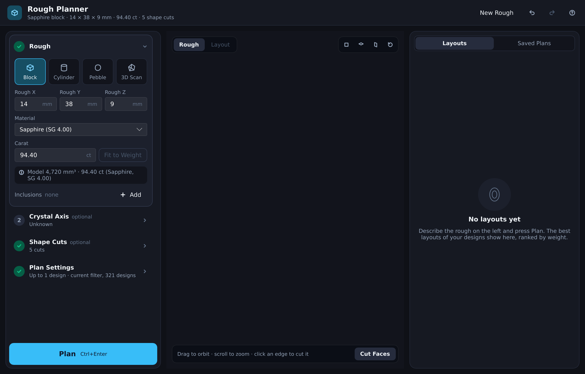
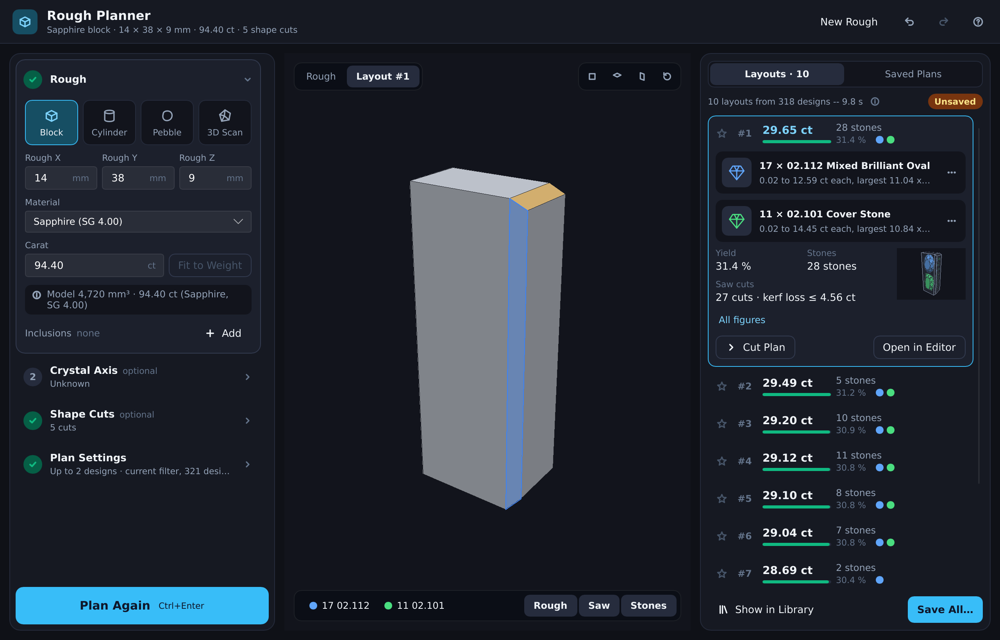

# 15. Planning a Rough

## What You Will Do

This chapter covers the **Rough Planner**: a separate window in which you
model a piece of rough (a block, a cylinder or a water-worn pebble, with flat
cuts taken off it, or a 3D scan), tell the planner how many stones you are willing
to cut and from which designs, and get the ten heaviest ways to cut it. You will
learn how to build the model in the four steps on the left, how the live weight
check works, what the planner does when you press **Plan**, how to read the 3D view,
the Layouts list and every metric in it, how to import a 3D scan and read its import
report, how to jump from a layout to the designs in your library and open one in the
editor with its piece of rough, how to save plans and share them as files, and what
the planner cannot do.

## Opening the Rough Planner

Choose **Library → Plan Rough...** from the menu bar. The planner opens in its
own window, not in a dialog on top of the main window, so you can keep working
in the library, click designs, and move the planner to a second screen.

- Closing the planner window only hides it. Your model, the results and the
  selection are kept until you quit the app; choosing **Plan Rough...** again
  brings the window back as you left it. A plan that is running keeps running
  while the window is hidden. Closing the main window closes the planner and
  cancels a running plan. Because that would lose work, closing the library
  window asks first when the planner holds results that were never saved or a
  plan is still running: the question names what is at risk ("The Rough Planner
  has 3 unsaved results." or "A rough plan is still running."), has no **Save**
  button unless the design in the editor also has unsaved changes, and **Discard**
  closes everything.
- Inputs are not remembered between launches: the planner starts empty every
  time you start the app. Anything you want to keep, you save (see "Saved
  Plans" below).
- The planner only works with your own local library. If a remote library is
  selected, the planner shows "Switch to the local library to plan a rough." in
  red, and **Plan** refuses with the same message (Chapter 1 covers switching
  libraries, Chapter 10 the remote ones).
- The help icon at the right of the planner's header opens this chapter.

## The Window at a Glance

The window has a header and three columns. It opens at 1280 x 820 (smaller on
a screen that cannot hold that) and cannot be made smaller than 1040 x 560.



- **Header** — the window's icon and "Rough Planner", with a subtitle that sums up
  the rough ("Tourmaline block · 30 × 60 × 20 mm · 94.40 ct · 4 shape cuts"). At
  the right are **New Rough**, the undo and redo icons and the help icon.
- **Left column** — the rough and the plan, as four steps (**Rough**, **Crystal
  Axis**, **Shape Cuts**, **Plan Settings**) with the **Plan** block pinned at
  the bottom. See "The Four Steps" and "The Plan Block" below.
- **Centre** — the 3D view, with a **Rough | Layout** switch at the top left, the
  view buttons at the top right and a bar along the bottom. See "The 3D View".
- **Right column** — two tabs, **Layouts** and **Saved Plans**. The Layouts tab holds
  the ranked list of results and the footer with **Show in Library** and the save
  button; the Saved Plans tab holds your saved plans. See "Reading the Results"
  and "Saved Plans". The two questions the planner can ask you (the name row when
  you save, and "Replace ... Unsaved Layouts?" when you plan again, see below) open
  inside the Layouts tab.

In a window narrower than 1180 pixels the left and right columns get narrower, the
design legend in the view's bottom bar is hidden (the selected layout's detail
already names its designs), and the layer toggles in that bar become icons. The
texts are shortened with an ellipsis rather than running out of a column.

Everything can be reached from the keyboard: Tab moves between the buttons, the
choices, the fields, the step headers, the layout rows and their stars, and Space
or Enter presses the one that has the focus (it gets a bright outline). Each control
has a name for screen readers. The shortcuts are listed at the end of the chapter.

## The Four Steps

The left column is a list of four steps, each a card with a header: a number
circle, the step's title (with "optional" for **Crystal Axis** and **Shape Cuts**), a
one-line summary while the step is closed, and a chevron. Only one step is open at a
time (an accordion): click a header to open that step, which folds the one that was
open; click the open step's header to fold it away. The column scrolls above the
**Plan** block, and the step you open scrolls into view.

- **The done check.** The number circle turns into a green check when the step is
  complete: **Rough** when the model is valid, **Crystal Axis** when the axis is
  **Known** or when the material has no axis to set, **Shape Cuts** when every cut
  row is valid. **Plan Settings** is always complete (every field has a default), so it
  always shows the check.
- **The summary.** A closed step says what it holds, for example "Block 30 × 60 × 20
  mm · Tourmaline · 94.40 ct" for **Rough**, "4 cuts" for **Shape
  Cuts** or "Up to 2 designs · current filter, 321 designs" for **Plan Settings**.
  On a 3D scan **Shape Cuts** reads "Face cuts only on a scan".
- **An error in a closed step.** A step whose model has an error shows a red dot
  and the error line as its summary, so a problem is never hidden behind a folded
  step. The error texts are the ones this chapter quotes (for example "Dimensions must
  not exceed 2000 mm.").

**Crystal Axis** is listed only for a material that has a crystal axis.

## The Plan Block

The block pinned at the bottom of the left column holds the **Plan** button and
shows the state of the plan:

- **Idle** — **Plan**, or **Plan Again** once there are layouts, with "Ctrl+Enter"
  beside it.
- **Running** — the block shows the stage line (see "The First Run: Measuring the
  Designs" for its texts), **Cancel**, and a progress bar. A line under the bar
  reads like "6 layouts so far · best 29.43 ct" once the cut orders have been
  tried; until then it stays empty. Layouts appear in the list when the plan has
  finished, not one by one. On a scan with a time limit the stage line also shows
  the time left.
- **Blocked** — the button is greyed out and the reason sits under it: a model
  with an error, no material with a specific gravity, a scan that is still being
  read ("waits for the scan"), a remote library ("Switch to the local library to
  plan a rough.").

## Modelling the Rough

### The Starting Shape

Step 1, **Rough**, starts with four icon tiles, **Block**, **Cylinder**, **Pebble**
and **3D Scan**; the first three are described here, the scan under "Non-Convex
Roughs". The step goes on with the size fields, **Material**, **Carat** with **Fit
to Weight**, the weight check chip and the **Inclusions** row.

- **Block** and **Pebble** take **Rough X**, **Rough Y** and **Rough Z** fields with the unit (mm)
  written inside them: the three sides of the box the rough fits in. A pebble is
  the ellipsoid inscribed in that box, so it is smaller than a block of the same
  size (an ellipsoid fills about half of its box).
- **Cylinder** takes **Diameter** and **Length** fields (mm), and an **Axis**
  choice, **X**, **Y** or **Z** (**Y** by default): the direction the cylinder
  runs along.
- **3D Scan** imports a Wavefront `.obj`, an `.stl` or a `.ply` file as the
  rough, a closed non-convex mesh included. Picking the tile opens the file picker;
  see "Non-Convex Roughs" below.

Type a number such as `12.0`; a decimal comma also works. Each size must be
greater than 0 and no more than 2000 mm ("Dimensions must not exceed 2000
mm."). A size field that is still empty is not an error: the planner simply
shows nothing until the rough has a size, and **Plan** answers "Enter the rough
size in mm." A field is applied when you press Enter or leave it.

The +Y axis points up in the view, and the three axes are the rough's own: the
cut plan and the stone sizes are reported in this X, Y and Z.

Switching between the shapes keeps the size as far as the shapes allow. Block
and Pebble share their box. A cylinder becomes the box that surrounds it. A box
becomes an upright cylinder whose diameter is the smaller of X and Z and whose
length is Y. Cuts are kept when you switch; see below for what happens to edge
and corner cuts on a round shape.

### Non-Convex Roughs

A scanned or modelled rough that has a notch, a hollow or a re-entrant side can be
imported with the **3D Scan** tile. Pick a Wavefront `.obj`, an `.stl` (ASCII or
binary) or a `.ply` (ASCII or binary) file. The numbers in the file are read in
the unit set in **File units** in the scan card (**mm** by default, or **cm**, **m**,
**inch** or **µm**) and scaled to millimetres, and **Fit to Weight** rescales the
whole mesh like any other rough. The unit can be changed after the import: the
planner then reads the same file again in the new unit (see "The Scan Card"). The
unit you chose is kept until you close the program. An STL file is a list of separate triangles, which the planner
joins into one surface; a PLY file's normals, colors and other data are ignored
(only the positions and the faces are used). Faces with more than three corners
are split into triangles as in an OBJ file. The format is taken from the file
itself where it can be (a PLY file starts with `ply`, a binary STL has the size
its triangle count gives) and otherwise from the extension.

The file is read in the background, so the window stays usable while a large scan
loads. The scan card shows "Reading the mesh file..." with a progress bar once the
triangles can be counted (or "Scaling the mesh..." for **Fit to Weight** on a mesh),
the view says "Reading the scan...", and until the file is done the shape tiles,
**Fit to Weight** and **Plan** wait ("waits for the scan"). **New Rough** or opening a saved plan
drops a mesh that is still loading. A file larger than 64 MB (64 × 1024 × 1024 bytes)
is refused before any of it is read: "the file is 120.5 MB, and the planner reads mesh files up to 64 MB".
A file that is cut short names what is missing (for example that it ends inside the
`face` element of a PLY file, or that a binary STL's header promises more triangles
than the file holds), and an ASCII STL facet that is not a triangle is refused.
A failed import shows its reason in the red error line (in the import report, with the
verdict "refused") and leaves your earlier rough as
it was. **Fit to Weight** does the same when it cannot scale the mesh ("Fit to
weight failed: ...", or "The model changed while it was being scaled" if you
edited the rough meanwhile): the model stays as it was and **Plan** stays
available. The red line clears when you next change the rough, its material or
the weighed carat, and when you press **Plan**. The other plan-form fields (the
kerf, the allowance, the skin, the minimum width, the design limit and the
stone limit) do not clear it.

A mesh whose size is not believable in the chosen unit is refused as well: more
than 2000 mm across, or less than 1 mm across. The message names the unit that
would bring the file into range and how large the rough would then be: "The file's
largest side is 0.034 units; read as metres that is 34 mm. Choose m in the unit box
next to the mesh choice and import it again." (The unit box is **File units**.) The
planner never applies the suggestion by itself: choose the unit and import the
file again. One mistake cannot be caught:
a file in centimetres whose rough still comes out between 1 mm and 2000 mm when read
as millimetres (a 5 cm stone read as 5 mm) is accepted, ten times too small. Check
the size shown in the scan card, and let the weight check (below) be the backstop.

If the file is a **closed mesh** (a solid surface with no holes), the planner uses
the mesh itself, not just its convex outline:

- **Notches and hollows are respected.** No planned stone extends into material that
  is not there. A stone must lie inside the mesh with the skin and allowance as
  clearance, and the sawn pieces of a several-stone layout are checked against the
  mesh as well. The planner works from the rough's convex outline and then rejects
  or shrinks whatever would reach into air, so near a notch it can be a little more
  cautious than the best possible layout.
- **The mesh volume is the rough's volume.** The model readout, the weight check,
  **Fit to Weight**, the yield and every fill percentage use the volume of the
  material, not of the convex outline around it. A face, edge or corner cut that
  you add takes the volume of the mesh inside it.
- **The 3D view draws the mesh**, with an edge line wherever the surface bends by
  more than 30 degrees and around each cut face. Cut faces can still be clicked.
- **Cuts and undo work as for any rough.** The cuts are flat planes over the
  mesh's bounding box, so a cut can run through a notch.
- **Saved plans keep the mesh** (plan file version 2). Plans of every other rough
  are saved exactly as before, and older plans still open. A rough with inclusions
  (see "Inclusions") is saved as version 3.

A face that names a vertex the file does not have fails the import with a message
naming the line.

A closed mesh needs every edge to be shared by exactly two triangles that run
along it in opposite directions, with its faces consistently wound. A **hollow
rough** is written as an outer surface plus one more closed surface for each
cavity; the planner works out which surface is which from how they nest (a surface
inside one other is a cavity), so a cavity can be wound either way round and its
volume is still taken out of the rough.

**Small defects are repaired.** A scan that is almost closed is not thrown away.
When the mesh is open or its faces are not consistently wound, the import tries
three repairs, the gentlest first, and says what it did in a **Repaired** finding of
the import report ("The mesh was repaired: ..."; see "The Import Report"):

- **Gaps a hair wide** are closed by joining vertices that are a little further apart
  than the usual join allows, up to 0.001 % of the rough's size; the note gives
  how many vertices were joined and the distance.
- **Faces that run the wrong way** round their neighbours are turned back; the note
  says how many. A surface that cannot be wound consistently at all (a
  twisted band) is left as it is.
- **Small holes** are filled: a hole whose rim is at most 5 % of the diagonal of
  the rough's bounding box and has at most 64 edges. A flat hole is filled with
  flat triangles, any other with a fan of triangles about the middle of the hole.
  The note says how many holes were filled and how wide the widest is. A fill
  invents a little material, which is why only small holes are filled; a bigger
  hole stays a hole, and so does a place where two holes meet at one vertex.

A mesh that is already closed and consistently wound is never touched, and a saved
plan stores the repaired mesh, so reopening it gives no note. A repair that does
not leave the mesh closed is dropped, and the mesh is then treated as unusable.

When the file cannot be used as a mesh, the import falls back to the **convex hull
of its vertices** and says why in the import report, where the **Planned on** verdict
reads "its convex outline":

- **No faces**: a file with only `v` lines is a point cloud; its convex hull is the
  rough.
- **Open mesh** (a hole too big to fill, or a gap wider than the repair joins), a
  **non-manifold** edge (more than two faces on one edge), or **inconsistent
  winding** that cannot be repaired: the hull is used.
- **A mesh that crosses itself**: the hull is used, and the note says where, for
  example "the mesh crosses itself in 4 places, the first near x 12.30, y 4.05, z
  7.80 mm" (the finding's **Show** turns the view to that place). The position is in the file's own coordinates, in millimetres after
  the unit you chose. A search stops after 16 places, so a heavily tangled scan is
  reported as "at least 16 places". Surfaces that only touch (two bodies corner to
  corner, a point resting on a face) are not crossing; surfaces that overlap in
  one plane are.
- **A mesh with no volume** (or whose faces have no area): the hull is used; if the
  vertices themselves lie in one plane, the import fails.
- **More than 200,000 triangles**: the mesh is too heavy for the planner and the hull
  is used; a smooth scan, whose outline is too fine to stand in for it, is refused
  instead. The limit counts triangles after polygon faces are split (a quad is
  two triangles); the faces are counted while the file is read, so a scan of
  millions of triangles gives up quickly, and a bad face number later in such a
  file is not checked. Decimate the scan in a mesh tool first.

A mesh that turns out to be convex (a cube, a faceted ball) is simply a convex
rough, with no finding, and plans exactly as the hull would.

Faces may be triangles or polygons (polygons are split into triangles; a polygon that is not convex is split inside its own plane, and if that fails the hull is used) and may
name their vertices as `v`, `v/vt`, `v//vn`, `v/vt/vn`, with positive or negative
indices. Texture coordinates and normals are ignored.

**A smooth scan** is one whose convex outline has more than 400 faces. The planner keeps the scan itself as the rough and uses a slightly
larger, simplified outline only to size its grid; every stone is checked against
the scan, so none leaves real material. After the import the report says how
many faces the outline had (its **Smooth scan** finding). If such a scan is open and cannot be repaired, or has
too many triangles, it is still refused, because nothing safe can stand in for it:
repair or reduce it in a mesh tool first. The weight and the yield use the scan's
own volume, not the outline's.

The grid outline of a smooth scan has at most 64 planes; a mesh whose exact outline
has 400 planes or fewer keeps it exactly. Every candidate stone is still checked
against the scan itself. A plan on a scan uses every core (one job per slab range of
the grid), so the time it takes falls with the number of cores.

A scan is planned on a coarser grid than a solid rough (about an eighth of the table
entries, 11 cells an axis for a cube at 10 stones instead of 16), because every entry
is checked against the scan. In step 4, **Plan Settings**, a rough with a scan shows
**Scan Plan Time Limit** (seconds) with the line "Scans plan on a coarser grid and use
every core.": 120 seconds by default, 0 for no limit, kept between sessions. When the
limit is reached the plan stops and shows the best layouts found so far, and the
Layouts tab shows an amber "Stopped at the time limit" badge beside **Plan Again with
More Time**, which doubles the limit and plans again. The search is partial, and
planning again may give different layouts. If it stopped before any layout existed, a
message says so; raise the limit and plan again. Solid and outline roughs ignore the limit. Without the limit
reached, a scan's plan is the same on any number of cores.

**Self-intersection is detected, not repaired.** Scans often have overlapping
shells or a surface that passes through itself, and such a file can satisfy the
closed-mesh checks yet leave the planner unsure which side of the surface is
material. The import therefore looks for triangles that cross one another (shells
that cross instead of nesting are the same defect) and, when it finds any, falls
back to the convex hull with the finding described above, so a stone is never planned
into a notch that does not exist. The check treats two surfaces closer than a
billionth of the rough's size as touching, and it does not compare triangles that
share a vertex, so a fold that only shares a corner can slip through. To use the
scan itself, repair it in a mesh tool (remove internal faces, merge shells) at the
place the finding names, and import it again.

### The Scan Card

Once a scan is imported, the **Rough** step shows a **scan card** under the shape
tiles:

- the file name, with the triangles and cavities it holds ("48,212 triangles · 1
  cavity");
- the scan's size, the bounding box in millimetres ("30.1 × 58.7 × 21.4 mm");
- **File units**, the unit the file is read in (**mm**, **cm**, **m**, **inch**
  or **µm**);
- a **⋯** menu with **Replace Scan...** and **Re-read**.

**File units** can be changed after the import. The planner remembers the path of
the file and reads it again in the new unit, so a scan imported in the wrong unit
is put right with one choice and no new file picker. **Replace Scan...** asks for
another file (it is the same as picking the **3D Scan** tile again), and **Re-read** reads
the same file again. While the file is
read the card shows the progress instead, as described above.

**Carat** and **Fit to Weight** work as for any rough: they scale the scan, and
the weight check chip compares the scan's own volume with the scale.

### The Import Report

Everything the import learns about the file is listed in the **import report**, a
card under the scan card.

**Planned on** is a badge that says what the planner works with:

- **the scan itself** (green): the closed mesh is used as it is, with repairs where
  they were needed;
- **its convex outline** (amber): the fallback, with the reason in a finding below.
  This is the case for a point cloud, an open or non-manifold mesh, a mesh that
  cannot be wound consistently, a mesh that crosses itself, a mesh with no volume
  and a mesh with too many triangles (see "Non-Convex Roughs");
- **refused** (red): the file cannot be used, with the reason and what to do in a
  mesh tool.

Under the badge there is one row for each **finding**, with an icon for its level
(fine, information, repaired or problem):

- **Repaired** — how many vertices were joined and over what distance, how many
  faces were turned, how many holes were filled and how wide the widest was. The
  rough shows in amber in the view.
- **Crosses itself** — in how many places ("at least 16" when the search stopped),
  with the first position in the file's coordinates. The rough shows in red in the
  view.
- **Smooth scan** — the scan itself is kept and every stone is checked against the
  scan; the grid outline has so many planes.
- **Weight** — the model's weight against the scale.
- **Saved with the plan, repaired on import** — shown when a saved plan with such
  a scan is reopened, since the plan stores the repaired mesh and nothing is repaired again.

A finding that has a place on the scan has a **Show** link: it turns the view to
that place and highlights it. The report is replaced by each new import.

### Scans in the View

The view draws the scan's own triangles, shaded. Two layers help to read the
import report; their toggles are in the view's bottom bar (see "The 3D View"):

- **Problems** — on by default when the report has any finding. It colors the
  repaired triangles amber and the places where the scan crosses itself red, and
  puts a marker at each place.
- **Outline** — draws the outline the planner uses, the convex outline or the
  grid outline of a smooth scan, as a cyan ghost around the scan, so a fallback is
  visible and not only mentioned.

The legend in the bar names the three colors ("Repaired", "Crossing", "Outline
used").

**Cuts on a scan.** Only **Face** cuts apply to a scan. The **+ Edge**
and **+ Corner** buttons are hidden, not greyed out, and the **Shape Cuts** summary reads "Face cuts only on a
scan". **Align to Face** and **Align to Edge** in the Crystal Axis step pick the
scan's own triangles.

### Inclusions

An inclusion is a flaw inside the rough that you know the place of: a crack, a
feather, a crystal of another mineral. No stone can be cut through it, but it is
still stone that you hold and paid for. The planner takes an inclusion as a **closed
mesh inside the rough**: stones keep clear of it, and the weight and the yield count
it as material. Every rough takes inclusions: a block, a cylinder, a pebble and a rough
imported with **3D Scan**, convex or not.

**Adding one.** The **Inclusions** row at the bottom of the **Rough** step shows how many
inclusions there are and an **Add** button, which opens the inclusion form. Its
**Margin** field sets the margin (below).

- **On a block, a cylinder or a pebble** the form has a **Kind**: **Mesh File**, your own
  closed 3D model of the inclusion, or a **Sphere**, an **Ellipsoid** or a **Box** that
  you describe by its size (a diameter, axis or edge lengths in mm). The **Position X**,
  **Y** and **Z** fields place the centre of the inclusion, in mm from the corner of the
  rough; an empty field is the middle of the rough on that axis, and a mesh file is placed
  by the centre of its bounding box. A shape is added with **Add Inclusion**; for a mesh
  file choose **Add Inclusion...** and pick the file (an `.obj`, `.stl` or `.ply`); the
  form's **File units** box sets the unit of its numbers, the same setting a 3D scan's card
  shows, kept for the session. The rough keeps its sizes and its cuts editable.
- **On a 3D scan** the inclusion is always a mesh file, so the form has no **Kind** and no
  position: choose **Add Inclusion...** and pick the inclusion's file (an `.obj`, `.stl`
  or `.ply`, the same formats as the rough). It is read in the unit set in **File units**
  and in the same coordinates as the rough's own file, so export both from the same scene.
  The planner moves the inclusion exactly as the import moved the rough (the import puts
  the rough's bounding box at the origin) and as **Fit to Weight** has scaled it since.

A mesh file is read in the background ("Reading the inclusion...", "Adding the inclusion..."), and each added
or removed inclusion is one undo step. The rows under the button show every inclusion
with its size and volume ("Inclusion 1: 4.6 x 4.6 x 4.6 mm, 97.3 mm³") and a
**×** to remove it. A file with several separate closed surfaces adds them as one
inclusion. An inclusion has to be a closed mesh of triangles, like a rough, and the
rough and its inclusions together must stay within 200,000 triangles; a mesh with small
defects is repaired as in the sections above.

**What is checked.** The planner refuses an inclusion, shows why in the red line and
changes nothing when:

- it **reaches the surface**: "an inclusion that reaches the surface must be cut away:
  model it as a notch in the rough's own mesh". An inclusion that breaks through the
  skin is not an inclusion any more but a notch; cut it out of the rough's own mesh.
  Merging it into the outer surface is not done for you.
- it **lies outside the rough's material**: outside the rough, in a hollow of it, or
  inside another inclusion. The message adds that the inclusion file must use the same
  coordinates and unit as the rough's file, which is the usual cause.
- it **crosses another inclusion**, or one lies inside another.
- it **cannot hold its margin** (below).

An inclusion that wraps a hollow or another inclusion is not detected.

**The margin.** The edge of a real inclusion is uncertain, so stones keep a margin
from it: **0.3 mm** by default (leave the field empty for the default; it takes 0 to
10 mm). The margin is applied when you add the inclusion, by moving every face of the
inclusion outward by that distance; for a convex inclusion with sharp corners this is
exact, and for a smooth or non-convex one it is approximate (a sharp spike is cut off
at four margins). The skin and the allowance of the plan form come on top, as for any
surface. An inclusion that fits as drawn but is closer to the surface than its margin
is refused ("closer to the surface ... than its margin allows"); lower the margin or
cut it away as a notch. To change the margin of an inclusion you have added, remove it
and add it again. A margin of 0 keeps stones off the inclusion exactly as drawn.

**Weight and yield count the inclusion.** The rough you weighed and paid for includes
the inclusion, so the model's volume is the **gross** volume: the stones' room plus the
inclusions. The readout says so ("Model 8,000 mm³ · 21.20 ct (Quartz, SG 2.65)
including 1 inclusion (98 mm³)", the inclusion's volume with its margin), the weight check and
**Fit to Weight** use it, the yield and every fill percentage take it as their
denominator, and a face, edge or corner cut takes the gross volume of the mesh inside
it. This is the difference from a **hollow** in the rough's own file, which is air: a
hollow is taken out of the weight, an inclusion is not.

**Saved plans.** A plan with inclusions is saved as plan file version 3, with the
rough's own mesh, each inclusion's mesh (the margin is already in it) and the move
from the rough file's coordinates, so you can still add inclusions from the same
scene after reopening it. A plan without inclusions is saved exactly as before, and
older plans still open; an older Pleochroma that meets a version 3 plan says that the
plan was made by a newer one. If you reopen a plan that has no inclusions, the planner
has forgotten the rough file's coordinates, and an inclusion file is then read as if
the rough's bounding box started at the origin.

### Locating Inclusions from Photos

When you can see an inclusion through the rough but have no 3D model of it, you can
photograph the rough on a fixed camera rig and let the planner work out where it is.
A straight line from the camera to the inclusion is wrong, because light from the
inclusion bends where it leaves the stone. The planner knows the rough's mesh and the
cameras, follows each of your clicks through the surface (the bending is Snell's law)
and into the stone, and finds the point all the clicks agree on. This works on a
**mesh rough** only, because the bending depends on the shape of the surface. In the
**Inclusions** row, **Locate from Photos...** is shown when the rough has a mesh.

**The rig.** The planner assumes cameras that do not move between photos. The default
layout has eight views: +X, -X, +Y and -Y, each seen from both ends, which the program
reads as an upper and a lower camera on each of the four sides ("+X upper", "+X
lower", and so on). The rig's frame has Z pointing up, and every camera looks at the
origin, where the stone stands. **Edit Rigs...** opens the camera rig window, where you
give a rig a name and set, for the whole rig:

- the **stone's refractive index**, which starts at the planner's material (for a
  birefringent stone use the ordinary index, and click the ordinary image in the
  photos), and
- the **surrounding index**: 1 for air, or the liquid's index when the stone is
  photographed in immersion. When it equals the stone's index, light does not bend at
  the surface at all.

and for each view its name, the camera position and look direction in millimetres, the
up direction, the **scale** (the focal length in pixels, or for an orthographic
(telecentric or macro) lens its scale in pixels per millimetre), the principal point
in pixels (the image centre unless you know better) and the image size in pixels.
**Fill the 8 Views** writes the default layout from the camera distance, the
elevation, the focal length and the image size; every pose stays editable afterwards,
so a rig that is not symmetric is entered by hand. Rigs are kept in the program's
settings file, so they are there next time. A photo must have the size its view says,
because the focal length and the principal point are in pixels of that size.

**Calibrating the rig with a beam-splitter cube.** Hand-entered values work without
any calibration. To measure the rig, photograph a beam-splitter cube of known size
instead of the stone, in every view, and use the **Calibrate** tab:

1. Put the cube where the stone will stand, centred on the rig's origin with its faces
   along the rig's axes. Use a backlight or a dark field so that its outer edges show
   as sharp lines (a clear cube against a plain background gives weak outlines). A
   cube looks the same from 24 orientations, so stick a small opaque dot (paint or
   tape) on the corner at +X +Y +Z, and keep it visible.
2. Enter the cube's **datasheet edge length and tolerance** and its glass (N-BK7,
   1.5168, unless the datasheet says otherwise), and how well you know the focal
   lengths (in percent).
3. Load the cube photo of each view. With the **Edge** tool click the two ends of every
   visible outer edge (any two points along the edge will do), and with the **Dot**
   tool click the orientation dot once. The dot is a check: if the corner it names
   lands far from your click, the cube was turned, and the result says so.
4. **Pass 1** fits the camera poses, the focal lengths and the cube's size to the edge
   lines. **Pass 2** is optional and measures how good the whole rig is: the coated
   diagonal of the cube is a known plane inside the glass, and its four edges, seen
   through the faces, are clicked with the **Diag 1** to **Diag 4** tools (several
   clicks along each edge, in at least two views that see it through the glass). The
   program triangulates them through the glass, with the same refraction as for an
   inclusion, and compares them with the true plane. The remaining distance is the
   rig's **measured accuracy**.

The result lists the edge misfit per view in pixels, the **fitted edge against the
datasheet** (so a cube that is outside its tolerance shows: 0.1 mm on a 25.4 mm cube is
0.4 % in scale) and the diagonal check, and **Save Calibrated Rig** stores the refined
poses and focal lengths with the measured accuracy. One caveat belongs next to the
scale line: the image scale is the focal length times the cube's edge divided by the
distance, so **the scale check only means something when the camera distances and the
focal lengths are entered precisely**. With loose values the fit can hide a wrong cube
size in them. Measure the distances, take the focal lengths from a calibration you
trust, set "how well you know the focal lengths" small, and then read the ratio.
Changing a pose later clears the stored calibration, because it described the old
poses.

**How to photograph the rough.** The inside of the stone has to be visible. Frosted,
water-worn or sawn surfaces scatter the light and hide it, so polish a small flat
**window** on each face a camera looks through, or put the stone in a clear cell of
**liquid** (immersion) and set the surrounding index to the liquid's. Keep the stone
and the cameras still between the photos, make the photos sharp and the same size as
the rig says (PNG or JPEG), and save them upright: the orientation tag some cameras
write is not applied. Photos are read from where they are when you load them; they are
never copied into the program's files.

**Aligning the mesh to the rig.** The scan's frame is not the rig's, so the planner
fits one rigid move of the mesh for all the views together:

1. Load a photo into each view slot of the locate window (click a row to show its
   photo) and pick the rig.
2. Say which mesh axis points up and which points to the right, and nudge the start
   with turns and shifts if it is off.
3. Choose **Outline** above the photo and click around the stone in each photo, in at
   least two views, and press **Align Mesh to Rig**.

The alignment uses the outlines only, which do not depend on refraction. It reports the
remaining misfit per view in pixels and **refuses to go on above 4 pixels**, with a note.
The outline of the mesh in each photo is its convex outline, so the bays of a non-convex
rough show up as misfit. If the rough changes afterwards (a new mesh, or **Fit to
weight**), align again.

**Marking.** Choose **Point** and click the inclusion in every photo where it is
visible: at least two views, and all eight are better. For a feather or a bundle of silk
choose **Line** (or **Polygon** for a flat inclusion) and click along it, with the same
vertices in the same order in every view. **Undo Click** takes back the last click, and
**Clear** removes what the chosen tool marked in the view; the zoom buttons (1x to 8x)
help with accuracy.

**Reading the result.** **Solve** traces every mark through the surface and gives the
inclusion's position in the rough's own coordinates, the **uncertainty** (the RMS
distance of the rays from the point) and a suggested margin, the larger of 0.3 mm and
twice the uncertainty. Each view has a line with the distance of its ray from the point.
A mark can be unusable, and the line says why: the ray misses the stone, or it hits the
surface beyond the critical angle, so no direct image comes out that way.

Inside a stone you also see **reflected copies** of an inclusion, from light that bounced
off the back faces. With four or more views the planner checks each view against the
others, and a view that disagrees with them by far more than they disagree among
themselves is flagged: "this view's mark may be a reflected copy". On the photo, a
**hollow green marker** shows where the solved point appears in that view, with its
distance in pixels from your mark; **hollow amber markers** show where its reflected
copies, after one or two bounces, would appear. If your mark is nearer an amber marker
than the green one, you most likely clicked a copy.

**Adding it.** The photos give a position, so you set the **radius** of the shell that
stands for the inclusion, in millimetres, to the size of the blob you saw, and the
**margin**, which starts at the suggested one. **Accept** adds the point as a small
closed shell through the same route as **+ Mesh File**, so the same checks apply
(an inclusion that reaches the surface is refused) and the addition is one undo step.
A line or polygon can be located but is not yet added as an inclusion: Accept is
disabled with the note that feathers and silk can be located but not yet added. The
marks and the rig of each added inclusion are kept for this session, listed under
"LOCATED THIS SESSION" with **Re-Open**, so you can solve them again after
recalibrating the rig; they are not part of a saved plan (a plan keeps the inclusion's
mesh) and are forgotten when the program closes.

**What this is not.** The photos are used for the inclusion's position and size, not
for rendering: the planner does not draw the stone with the inclusion in it. The accuracy
is bounded by the scan's accuracy where the rays enter the stone and by the rig's
calibration, so read the measured accuracy of the rig next to the uncertainty of the
solution. For a birefringent stone only the ordinary ray is traced.

### Material and Carat: The Weight Check and Fit to Weight

- **Material** — the material the stones will be cut from, listed as its name
  and "(SG x.xx)". Only materials with a known specific gravity are listed: the
  built-in ones that have one, plus any custom material from your catalogue that
  records one (marked "(catalogue)" if it shares a name with a built-in). The
  default is Quartz. The specific gravity turns volume into carats (Chapter 6
  covers materials). If no material has a specific gravity, the planner says so
  and **Plan** is disabled.
- **Carat** (ct) — the model's own weight: the volume of the modelled rough times
  the material's specific gravity, rewritten whenever the size, the cuts or the
  material change. Type the weight from your scale over it to compare the two.

Below these fields the planner shows the **weight check** as a chip, and, once you
have typed a weighed carat over the model's own, in a color. Hold the pointer over
the chip to see the live readout of the model, for example "Model 257 mm³ · 3.40 ct
(Quartz, SG 2.65)":

| Difference between model and weighed carat | Chip |
| --- | --- |
| within 5 % (inclusive) | green: "matches weighed 3.31 ct (+2.7 %)" |
| more than 5 % and up to 15 % | amber: "close to weighed (+9.8 %)" |
| more than 15 % | red: "check the model: 31 % heavier than weighed" (or "lighter") |

The check never stops you from planning: a red chip means "look at your size and
cuts again", not "wrong". Since the scale is the more reliable of the two
measurements, the **Fit to Weight** button next to the field scales the whole
model to the typed weight: every size, every edge and corner setback and every
face depth is multiplied by the cube root of the carat ratio (a 10 % heavier
weight makes the rough 3.2 % larger in each direction), as one undo step.
Afterwards the field shows the model's carat again and the chip disappears. The
button is available while the chip shows; a typed weight within a hundredth of
a percent of the model's only hands the field back to the model. If the scaled
rough would be more than 2000 mm across, the red line says "Fit to weight failed:
Dimensions must not exceed 2000 mm." and the model stays as it was.
A typed value that is not a positive number switches the check off: the model,
the view and the volume keep updating regardless. **Plan**, **Fit to Weight**
and saving, however, stop and the red chip shows "Weighed carat must be a number
in ct." (or "Weighed carat must be greater than 0 ct.") until you correct or
clear the field.

### The Crystal Axis of the Rough

For a material that has a crystal axis, step 2, **Crystal Axis** (listed between
**Rough** and **Shape Cuts**, optional), tells the planner how the crystal runs in the
rough. Its switch starts as **Unknown**, and the planner then plans exactly as it always
did. **Known** gives a tilt and a turn (the azimuth) in the rough's own frame. A state
card shows the axis gizmo and says in a sentence how the axis runs, with a note under it
that is colored by its level. You can type **Tilt** and **Turn** (and a **Second Axis**
for a two-axis material), or take the axis from the **Find the Axis** menu: **Align to
Face**, **Align to Edge**, **Fit to Crystal Length** or **From Color Zones**. While one of
these waits for your clicks, the state card says "Click a face in the view" with a
**Cancel**, and the view shows a cyan "Click a face — Esc cancels" chip at the top. You can
also turn the axis by dragging the axis line in the 3D view. With the axis known, the
material's usual orientation rule is switched on and the **rule card** says so, for example "Stones are oriented to the crystal axis: Table
Across (Sapphire default)"; **Change** opens the rule editor in the card. An amber line
says when the axis has changed since the layouts on screen were planned. The planner
then orients the stones to the rule, and the stone rows in a layout say how far each
stone is from it. The rule can be changed for the whole
plan, for one design or for one stone, each with a Reason, and a stone can be locked so
that the next plan cuts the rest of the rough around it. Chapter 25 describes all of it.

### Cutting the Rough

Real rough is rarely a perfect box. Step 3, **Shape Cuts** (optional), lets you take flat
cuts off the starting shape. Every cut removes material with one flat plane, so
a cut never makes a rough less convex than its starting shape (to model a notch
or a hollow, import a mesh; see "Non-Convex Roughs"). Each cut is measured against
the starting shape, not against the cuts before it, so you can edit or delete
any cut without disturbing the meaning of the others.

There are three kinds of cut, added with **+ Edge**, **+ Corner** and **+ Face**.
Each appears as a compact row in the list above the buttons: the kind's icon, the
cut's name, a line saying how much it removes, its setback fields in the row (a
face's three fields go on a second line), and a **×**. Below the buttons the step
says "Or click an edge or a corner in the view".

- **Edge** — takes a wedge off one of the twelve edges of the box. The name of the
  row ("Edge Top-Front") is a menu: click it to choose the edge by the two faces
  that meet there (Top-Front, Top-Back,
  Top-Left, Top-Right, Bottom-Front, ... Back-Right). The two setback fields,
  **Setback A (mm)** and **Setback B (mm)**, say how far the cut reaches from the edge across the two
  faces: A along the first-named face, B along the second. Neither may be longer
  than the face it is measured along. New edge cuts start on Top-Front.
- **Corner** — takes a corner off the box. The row's name menu chooses one of the eight
  corners by its three faces (Top-Front-Left ... Bottom-Back-Right).
  The setback fields **Setback A (mm)**, **Setback B (mm)** and **Setback C (mm)** say how far
  the cut reaches along the three box edges that meet at the corner, in the order of the three
  faces named: A is measured along the axis that the first-named face is
  perpendicular to. For Top-Front-Right, A is down the vertical edge. New corner
  cuts start on Top-Front-Right.
- **Face** — a flat face in any direction, for a sawn or broken surface. It has
  **Azimuth (°)**, **Elevation (°)** and **Depth (mm)**. Elevation 90° is
  straight up (+Y) and -90° straight down; at elevation 0°, azimuth 0° faces +X
  and azimuth 90° faces +Z. The depth is measured from the rough's outermost
  point in that direction, and it must be less than the rough's thickness in that
  direction. New face cuts start facing straight up. Face cuts work on every
  shape.

Edge and corner cuts need a block: **+ Edge** and **+ Corner** are greyed out for
a cylinder or a pebble, which show "Edge and corner cuts need a block", and on a 3D
scan they are hidden (only face cuts apply there). If you
switch a shape that already has edge or corner cuts to a cylinder or a pebble,
the rows stay, and the model reports "Cut 2: edge and corner cuts are only
supported on block rough." until you delete them or switch back.

New cuts get default sizes so that they are visible at once: setbacks of 15 % of
the shortest side involved (the shorter of the two sides an edge cut runs across,
the shortest side of the box for a corner cut), and a face depth of 10 % of the
rough's extent in the cut's direction. Both are rounded to 0.1 mm and are at least
0.1 mm.

Click a cut's row to select it (the selected row is outlined in cyan). Its face is outlined in the 3D view, and the row
shows how much it removes, for example "removes 84 mm³ (1.11 ct)" (84 mm³ of Quartz, SG 2.65, is
1.11 ct). Clicking into any field of a row selects the row too, and a row you
have just added scrolls into view with its first field ready to type over. The **×** at
the right of the row deletes the cut. While you type in a cut field, the
picture and the readout follow the number at once. If a value is not allowed, for
example a setback longer than its face, the row shows the reason in red under
the fields and the model shows the same message; **Plan** is greyed out until the
model is valid. Text that is not a number gets a message that names the unit the
field is measured in: "Azimuth must be a number in degrees." for the two angles,
"Depth must be a number in mm." for the lengths.

### Clicking in the 3D View

You can also make cuts in the view itself, without touching the buttons.

- **Edge or corner.** With a block in the view, move the pointer over an edge or a
  corner of the block. When it is within 10 pixels of one, a tooltip in the view
  reads "Click to cut the edge Top-Right" or "Click to cut the corner
  Top-Front-Right", and the edge or corner is marked. A corner wins over an edge
  next to it. Click, and the planner adds that cut with the default setbacks and
  selects its row.
- **Face from View.** Press **Face from View**. The button lights up and a cyan chip
  at the top of the view reads "Click a face — Esc cancels". Move the
  pointer over any face of the rough: the face is highlighted and the hint reads
  "Click to cut this face flat". Click, and the planner adds a **Face** cut whose
  direction is that face's, with the default depth. The mode switches itself off
  after one cut; press the button again or press Esc to leave it early.
- **Selecting a cut.** Pointing at the face of an existing cut shows "Click to
  select cut 2"; click to select its row.

A single click adds its cut after a moment (the time a double-click takes); a
double-click on an edge, corner or face adds the cut at once and leaves the camera
where it is, while a double-click on empty space resets the view (see below). Cuts
can only be made while the view shows the rough (the **Rough** side of the
**Rough | Layout** switch, see "The 3D View") and no plan is running. The view
shows the rough before the first plan and after you change the model. While a plan
runs it still shows the rough, but the model is locked, so a click in it adds no
cut. **Face from View** is greyed out while the view shows a result (an armed pick
can still be switched off with Esc).

### Undo, Redo and New

**Undo** and **Redo** step through your model edits, up to 100 steps each way.
One step is: adding or deleting a cut, changing which edge or corner a cut is on,
finishing an edit in a field (Enter, or leaving the field), switching the shape,
opening a saved plan, or **New Rough**. Typing itself is not a step until you finish
the edit. **Ctrl+Z** undoes and **Ctrl+Y** (or **Ctrl+Shift+Z**) redoes; while a
text field has the keyboard focus it keeps these keys for its own typing.

**Undo** and **Redo** are the icons in the header. **New Rough**, also in the header,
replaces the model by an empty block and clears the
weighed carat and the selected cut. It is itself one undo step. It does not touch
the plan settings or the results on screen.

The buttons that change the model (Undo, Redo, + Edge, + Corner, + Face, Face from
View, the × of a cut row) and every field of the rough, the cuts and the plan are
disabled while a plan is running, so that the model on screen stays the one being
planned.

## Planning

Step 4, **Plan Settings**, sets up what the planner may use and how much it must
leave; the **Plan** block below the steps starts the plan.

- **Designs, up to** — a stepper from 1 to 99, 1 by default: the most *different* designs
  one layout may mix. Set it to 1 and every layout uses a single design (as many stones of it as
  fit best, up to the stone limit below); raise it to let the planner combine a
  large stone of one design with smaller stones of others in the space that is
  left.
- **Stones, up to** — a stepper from 0 to 99: the most stones one layout may hold in all,
  whatever their designs. **0**, the default, means no limit (the stepper shows ∞ and
  "no limit" beside it): the planner fits as many stones as yield the most weight, one
  stone or dozens, within the losses and the minimum width below. With a limit,
  the planner looks for the heaviest layouts of at most that many stones. It does
  not simply drop stones from a bigger layout, so with fewer stones the pieces,
  and often the stones, are larger. The two limits apply together:
  **Designs, up to** 2 and **Stones, up to** 5 give layouts of at most five
  stones of at most two designs. A plan saved before this setting existed opens
  with no stone limit.
- **Candidate designs** — a segmented switch, with the counts in its segments, that
  says which designs the planner may use:
  - **Filter · N** (Current Filter for screen readers) — only the designs the library's search and
    filters currently show (Chapter 2). This is the default, and the way to say
    "only round brilliants" or "only designs I can cut on my machine". While a
    "Show in library" filter from the planner is active (see "Library Links"),
    this means exactly those designs.
  - **Library · N** (Whole Library for screen readers) — every design in the library, except
    entries
    you have flagged as ignored.
  - **N designs excluded**, with a **Show** link — not a third choice, but a line under the
    switch that appears as soon as one design is excluded. **Show** opens the
    list of excluded designs inline. An excluded design
    is left out of **Current filter** and of **Whole library** alike, before
    anything is measured, and neither count includes it. Use it for a design that
    keeps winning but that you do not want to cut, such as a plain cube. The
    design stays in the library, in every search and in the preview and tilt
    batches; only the planner leaves it out, and a small "not planned" note marks
    its card in the library list.

    To exclude a design, choose **Exclude from Planner** in the **⋯** menu of its
    design card in the expanded layout (the card then carries a **Left out of future
    plans** note), or in the
    right-click menu of its card in the library (Chapter 2). To bring it back,
    press **Show** on the excluded line to unfold the list and press **Restore** next
    to the design, or **Restore All** for every one; **Include in Planner** in
    the library menu restores one design too. The menu entries in the planner are greyed
    out while a plan runs. The mark is stored in your library, so, unlike the
    planner's inputs, it survives a restart. Excluding or restoring a design
    never changes the results on screen: a note tells you to plan again. The mark
    is written in the background, so the window never waits for the library, even
    while an import or a search is using it; a second click that comes before the
    first is saved gets "The last change to the excluded designs is still being
    saved. Try again in a moment." Like the rest of the planner, it works on the
    local library only.

  The counts follow the library while the planner is open, so you do not need to
  reopen it. They are worked out when you choose **Library → Plan Rough...**,
  about a second after you change the library's search or filters, each time you
  press **Plan**, after a "Show in library" button, when you switch libraries and
  after a change to the exclusions. **Plan** itself reads the library filter and
  the exclusions afresh when you press it, so a count that is out of date never
  changes what is planned. Counts of a thousand or more are written with
  separators ("Current filter · 1,234"), and a count of one reads "1
  design". While the counts are being worked out they read "(counting...)".
- **Losses** — a one-line summary of the four loss settings ("kerf 0.30,
  allowance 0.20, min 1.00 mm") with an **Edit** link. **Edit** unfolds
  the fields inline (kerf, allowance, skin, minimum width) and folds them away again:
  - **Saw Kerf (mm)** — the material lost to the saw blade at every cut.
    Default 0.30 mm. It applies to the sawn layouts; an exact single stone (see
    below) involves no saw cut.
  - **Allowance / Side (mm)** — extra material kept on every side of each stone
    for preforming and polishing, so the finished stone is smaller than the piece
    it comes from by twice this amount along each axis. Default 0.20 mm.
  - **Rough Skin (mm)** — the outer crust trimmed off every face of the rough
    before any cutting. Default 0.00 mm. A skin that leaves nothing of the rough
    gives "The skin allowance leaves nothing of the rough."
  - **Min Stone Width (mm)** — the narrowest finished stone the planner will
    accept, measured across the stone's smaller horizontal width. Default
    1.00 mm. A rough smaller than this plus the allowances gives no layouts at
    all.

Kerf, allowance and skin cannot be negative and the minimum width must be greater
than 0. Kerf, allowance and skin may not exceed 50 mm and the minimum width may not
exceed 1000 mm; a larger value is refused with a message such as "Kerf must be at
most 50 mm.". Skin plus allowance must leave something of the rough, and a minimum
width larger than the rough gives no layouts.

**Plan** also refuses to start when one saw kerf plus the allowance on both sides of
a stone is more than the rough's smallest side, because no piece could be sawn from
it. The message names the three figures, for example: "The kerf (0.30 mm) and the
allowance on both sides of a stone (0.40 mm) need 0.70 mm, more than the rough's
smallest side (0.50 mm)." Lower the kerf or the allowance, or use a bigger rough.

Press **Plan** (or Ctrl+Enter). **Plan** is greyed out while the model is invalid,
and the reason sits under it (see "The Plan Block"); the error that explains it shows
in the summary of the step it belongs to, marked with a red dot.

If the results on screen are a plan you have not saved, the planner asks before it
throws them away. A question opens at the top of the Layouts tab, "Replace 4
Unsaved Layouts?", with **Replace** and **Keep**. **Replace** starts the plan;
**Keep** (or Esc) leaves the results as they are and starts nothing. Results you
have saved do not trigger the question, and the amber **Unsaved** badge in the
Layouts header tells you when they are the kind that would.

While the plan runs the Plan block shows **Cancel**, the stage line and a
progress bar, and the layouts found so far appear in the Layouts tab as they come in,
with placeholder rows for the rest. **Cancel** is
available at every stage and returns the planner to idle with "Planning
cancelled."; the stage line reads "Cancelling..." until the plan has stopped. Esc
also cancels a running plan.

### The First Run: Measuring the Designs

To fit a design into a rough the planner needs to know how big the finished stone
is: its footprint, its height, its volume and its convex outline. It gets these by
solving each design's facets into a solid and measuring it, which takes a moment
per design.

The first time a design is used in a plan, that measuring happens and the result
is stored in your library database. The progress line reads "Measuring designs
120 / 3,299" while it works. Every later plan reads the stored figures instead,
so it starts straight on the planning stage. If only the outlines are missing from a
design's stored measurement, the line reads
"Measuring design outlines 120 / 3,299 (one-time)". On a
large library the first run over **Whole library** can take a while; a run over a
small filter measures only those designs.

A few things to know about the stored measurements:

- They are per design, not per plan: they do not depend on the rough, the
  material or any loss setting, so changing those never triggers a re-measure.
- If you cancel while measuring, the designs already measured stay stored, and
  the next run continues from there.
- A design is measured again automatically when its geometry changes: when you
  re-import a design over an existing one, save a design over its catalogue
  entry, or when a mirrored library updates it. If the app itself later changes
  how designs are measured, every stored measurement is treated as missing and
  re-measured once.

After measuring, the stage line steps through the planning stages: "Planning:
pruning designs", "Planning: sizing the pieces", "Planning: cut orders (k of 6
finished)", "Planning: alternatives", "Planning: single-design layouts",
"Fitting single stones: screening / exact search / polishing", "Refining", and
finally "Preparing the results...".

### What "Fits" Means

The planner builds its ten results from two kinds of layout, ranked together.

**Sawn layouts, one stone per piece.** The rough is sawn the way rough is
actually sawn: cuts always run edge to edge across the whole part, in three
stages. The first cut direction divides the rough into **slabs**, the second
divides each slab into **bars**, and the third divides each bar into **pieces**.
The planner tries all six orders of the three axes. Every saw cut costs one
kerf, and every piece holds at most one stone.

The stone is the design scaled evenly to the largest size that fits inside its
piece less the allowance, with its table facing any of the six rough faces. For
this the planner treats a stone as the smallest box around it: the footprint of
the finished stone (its length and width, measured on the stone's outline
however it is turned about the table) times its height. Stones of different
designs can be mixed in one layout.

- On a **block without cuts** the pieces are boxes inside the block.
- On a **cut block, a cylinder or a pebble** the saw still runs across the
  rough's bounding box, so a piece can be partly air. The stone box must fit in
  the part of the piece that is really rough, less the allowance. A piece that
  sticks out of the rough holds a smaller stone, placed off-centre where the
  rough is; a piece entirely outside the rough holds none.

**Exact single stones.** For one stone the planner does better than a box: it
uses each design's real convex outline, turns it freely in every direction,
scales and slides it, and looks for a very good fit: a large copy that lies
entirely inside the rough with the skin and the allowance taken off all round
(the search is a search, not a proof of the best possible fit; see "Limitations"). A single stone in a
round or cut rough can therefore sit tilted, with its table not facing any rough
face. To keep this affordable across thousands of designs, the planner first
scores every design coarsely, then searches orientations in detail for a
shortlist of at least 48 of the best-scoring ones and polishes the best of those.

The two kinds of layout are merged and ranked together, so a tilted single stone
can be number 1, with a sawn layout of several stones right behind it. When the
same single design is found both ways, only the heavier of the two is listed.

### Why One Big Stone Often Wins, and Why Several Sometimes Do

A finished stone's weight grows with the *cube* of its size. Cutting a rough in
half along one axis does not give two half-weight stones; it gives two stones
that are each only a fraction of the size, plus you lose a kerf and two more
allowances. On a rough with a roughly even shape, one large stone that fills it
therefore usually weighs more than two or three smaller ones. That is why the top
layout on an evenly shaped rough is often one or two big stones: the planner
places as many stones as weigh the most, and here that is few.

A long, thin rough is the opposite. A single stone must fit inside the
cross-section, so it can only grow as big as the thin sides allow, and the extra
length goes unused. Cutting the rough into several pieces along its length gives
each piece the full cross-section to work with, and several stones of that size
weigh far more than one stone of the same size that leaves most of the rough
behind. On such a rough the top layouts become a row of stones, and the planner
fills what is left at the ends and sides with smaller stones where they add
weight.

A mix of different designs can beat any single design when the rough has an
awkward shape: a broad, shallow stone from one design in one part of the rough
and a slimmer one in another. **Designs, up to** sets how many designs may be
mixed; when the best layout would need more, the planner drops the design that
adds the least weight and plans again until the layout is within the limit.
**Stones, up to** is part of the search itself: every cut order is planned for
its heaviest layout of at most that many stones, rather than a larger layout
being cut down. A small limit on a large rough can leave a piece much bigger
than its stone; the rest is shaped away when you preform the stone.

## The 3D View

The centre column shows the rough being modelled, or, once you select a layout, that
layout: the stones inside the rough. Controls float over the picture as glass
overlays:

- **Top left** — the **Rough | Layout** switch (the second segment reads "Layout #n"
  with the number of the selected layout). **Layout** is greyed out until a layout is
  selected.
- **Top right** — icon buttons **Front**, **Top**, **Side** and **Reset** (the camera
  presets). While the view is being drawn a small "Drawing the view..." chip also shows here.
- **Top center** — a cyan banner chip, "Click a face — Esc cancels", while
  **Face from View** or an axis pick (**Align to Face**, **Align to Edge**) waits for your click.
- **Bottom bar** — in Rough mode, the hint text and **Cut Faces**; in Layout mode, the
  design legend and the layer toggles (see below); on a 3D scan, the **Problems**
  and **Outline** toggles with their legend (see "Scans in the View").

**Rough being modelled.** The rough is drawn as a solid. Its own faces are pale
grey and the faces of your cuts are tinted amber while **Cut Faces** is on. The
selected cut is outlined.

**A selected layout.** The stones are drawn as their real designs, each design in
its own color (eight soft colors that repeat), the same color as the dot on
its design card and in the legend. The rough is drawn around them as a faint glass volume with its
edges. The saw pieces are drawn as amber outlines. The bottom bar holds:

- the **design legend**: one entry for each design, with its color dot, the stone
  count and its short name ("17 Oval"). Click an entry to select that design's card in
  the layout's detail and highlight its stones in the view. In a window narrower than 1180 pixels the legend is hidden;
- the layer toggles **Rough**, **Saw** and **Stones**, drawn as toggle segments (icons
  in a narrow window).

The view's controls:

| Control | What it does |
| --- | --- |
| Drag with the left mouse button | Orbit around the rough |
| Mouse wheel | Zoom |
| Double-click on empty space | Reset the view |
| Double-click an edge, corner or face (rough view only) | Add its cut at once |
| **Rough \| Layout** | Show the rough you are modelling, or the selected layout |
| **Front**, **Top**, **Side** | Snap the camera to that view (**Side** looks at the right side) |
| **Reset** | The starting view, from the front-top-right |
| **Cut Faces** (rough view only) | Tint the faces of your cuts |
| **Rough**, **Saw**, **Stones** (layout view only) | Show or hide that layer |
| **Problems**, **Outline** (3D scan only) | Show or hide the problem highlights and the outline ghost |

**While you drag the picture, or while the wheel is turning, the view is drawn at
half resolution, and at full resolution again as soon as you let go** (after the
wheel has been still for about a tenth of a second). That keeps orbiting smooth
with a lot of stones on screen. A drag that moves less than three pixels before
you release still counts as a click.

Hovering shows what is under the pointer in a glass tooltip card next to it. In the
rough view, that is the edge, corner or face you could cut ("Click to cut the edge
Top-Right"; see above). In the
layout view, hovering a stone shows its design, its weight and size, its axis line
when the rough has a crystal axis, and its place in the
saw plan as the slab, bar and piece number that the cut plan uses (see "The Cut
Plan"; an exact single stone is not sawn and has no such place). Clicking a stone
selects its design card in the expanded layout and outlines all stones of that design;
clicking empty space clears the outline.

When a plan finishes, layout #1 is selected and shown. Click a layout row to
show another one. If you then change the model on the left, the view goes back
to the rough you are editing; the layout rows stay where they are, still
belonging to the model they were planned for, and clicking a row shows its
stones again. The **Rough | Layout** switch takes you between the two at any time.

## Reading the Results

The right column's **Layouts** tab is headed by the summary line, which reads like "10
layouts from 2,431 designs -- 3.2 s", with the number of layouts in the tab's own
label ("Layouts · 10"). Next to the summary is an **(i)** icon whose tooltip carries
the note that the weights and yields are estimates for a rough that is clean except
for the inclusions you added, after your kerf and allowance, and the line that counts the designs
that were skipped (see "Which Designs Are Skipped"); an amber **Unsaved** badge shows while the
results are the kind that the replace question guards. Up to ten layout rows
appear below, ranked by weight. All ten fit in the column at 1280 x 820, so you can compare them at a glance. There are fewer than ten when fewer distinct
layouts are possible, and also when the ranking rule that lets at most three
layouts share one set of designs (see "How the List Is Ranked") leaves fewer. If nothing fits, the column shows "No layout fits: the
rough is too small for the minimum stone width, or no measured design is small
enough." With no plan yet, the tab shows "No layouts yet" and a sentence that says to describe the rough and press **Plan**.



When a scan's plan stopped at the time limit, the header also shows the amber
"Stopped at the time limit" badge and **Plan Again with More Time** (see
"Non-Convex Roughs").

When you opened a saved plan, a slim card above the list says `Saved plan "..." ·
2026-09-30` and offers **Re-Plan** (see "Opening a Saved Plan").

### The Layout Row

Each row is one layout. It shows:

- a **star**, for saving (see "Saved Plans"); it has a name for screen readers. Click
  it to star the layout; an amber star means the layout is kept for saving;
- the **rank**, "#1" being the heaviest;
- the **total weight** in carats in bold, for all the stones in the layout together
  (volume × specific gravity ÷ 200, the same figure the yield tools use), with a
  **yield bar** under it that is as long as the layout's weight relative to the
  best layout;
- the **stone count** ("1 stone", "6 stones") and the **yield**: the finished
  stones' volume as a percentage of the modelled
  rough's volume, so a cylinder or a cut block is measured against what is really
  there, not against its box;
- one **dot** for each design used, in the design's color;
- a purple **badge** with the layout's short label where it has one ("Best
  orientation", "Balanced"). The full label, including "(Unrefined)", is in the
  badge's tooltip.

Click a row to select it: the view shows that layout, and the row expands in place.

### The Expanded Layout

The selected row opens into a detail card, outlined in cyan, with:

- one **design card** for each design used, most stones first (see "The Design Card");
- a status line, when the layout has a note (for example about designs that have
  changed, see "When the Library Has Changed");
- four **figures** as a two-column grid: the yield, the number of stones, the saw
  cuts with the kerf loss ("27 cuts · kerf loss ≤ *x.xx* ct": the kerf loss is an upper estimate of the weight
  the saw turns to dust), and the share of the weighed rough ("31.4 % of 94.40 ct weighed", shown when you
  entered a weighed carat). **All figures** opens the full table of metrics (see "The Design
  Card" for the table);
- **Cut Plan**, which folds the sawing instructions in and out (see "The Cut Plan");
- **Open in Editor**, for the layout's first design (see "Library Links");
- with a crystal axis, **Stones**, a fold-open list of the stones inside the card (see
  Chapter 25), which keeps pose, **Re-Fit**, lock, free orientation and reason;
- when the plan has a rough color (Chapter 24), **Stone Orientation** as a two-way switch,
  **Planner Pose** or **Best Color**.

The kerf figure costs each cut with the
cross-section of the part it saws, taken from the rough's bounding box, so it is
overstated for a cut or round rough (hence the "≤"). An exact single stone (see
"What "Fits" Means") is not sawn, so it has no saw-cuts figure.

### The Design Card

Each design card shows:

- the design's **thumbnail** when it has one, otherwise a shape icon in the
  design's color (the same color as the stones in the 3D view);
- "*count* × *design name*" — for example "17 × Oval Brilliant 02.1", with the
  detail line under it: the weight of each stone and, when the stones of one design
  differ, their weight range and the largest stone's size instead. The size is the box around the stone in the
  rough's own X x Y x Z. The name is a link that selects the design in the
  library, exactly as if you had clicked its card, while the planner stays open;
- a short status chip, only on saved plans (see "Saved Plans"), with the full
  wording on the line under the name;
- a **⋯** menu with **Open in Editor** (the design opens in the editor with the piece of
  rough its stone comes from, see "Library Links"; next to **Use Color**, Chapter 24),
  **Show in Library**, **Exclude from Planner** and the design's own **Orientation Rule...** entry
  (Chapter 25). **Exclude from Planner** keeps
  the design out of every later plan (see "Candidate designs" in "Planning"); the card
  then carries an **Excluded** mark, and choosing the entry again brings the design
  back. The results on
  screen stay as they are and a note tells you to plan again. The entry is greyed
  out while a plan runs, for a design that has been deleted from the library, and
  while a remote library is selected, and **Open in Editor** is greyed out while a
  plan runs and while a remote library is selected;
- the metrics. Clicking anywhere else on the card selects it, which outlines
  the design's stones in the view.

The metrics shown by **All figures**, where a group of stones of unlike size shows each figure as a range:

| Metric | What it says |
| --- | --- |
| **Weight** | "0.62 ct · 29 % of the total", "0.62 ct each ...", or a range "0.48-0.62 ct ...". The percentage is this design's share of the layout's weight |
| **Size** | "L x W x D = 7.10 x 5.10 x 3.40 mm" — in the stone's own terms, not the rough's: length along the stone's long side, width across its short side, depth from table to culet |
| **Ratios** | "L/W 1.39 · D/W 67 %" — the design's proportions: length to width, and depth as a percentage of width |
| **Volume** | The finished stone's volume in mm³ |
| **Orientation** | "table faces Top (+Y)" when the table faces a rough face (Top +Y, Bottom -Y, Right +X, Left -X, Front +Z, Back -Z), or "table tilted 23° from Top" against the nearest face. Different orientations in one group are listed with their counts |
| **Fill** | "stone uses 58 % of its piece": the stone's volume over the volume of its piece where the rough is really there. For an exact single stone, which has no piece of its own, "stone uses 41 % of the model" |
| **Optics** | The design's brilliance, extinction and windowing at zero tilt (table up), from its stored tilt curves, for example "brilliance 71 % · extinction 12 % · windowing 4 % (preview material: Quartz)"; "not generated yet" if the design has no stored curves (Chapter 14 covers generating them) |

### The Cut Plan

Click **Cut Plan** in the expanded layout to fold out the instructions for sawing that
layout; click it again to fold them away. The plan is text, for example:

```
Cut order: slabs across X, bars across Y, pieces across Z (each cut loses 0.30 mm)
Stone sizes are X x Y x Z, in the rough's own axes.
Cut X into 3 slabs: 8.10 / 8.10 / 7.80 mm
Slab 1 (8.10 mm): cut Y into 2 bars: 6.00 / 5.70 mm
  Bar 1 (6.00 mm): no cut along Z (one piece, 9.00 mm)
    Piece 1: Design name, table faces Z, 5.10 x 5.10 x 3.40 mm, 0.62 ct
```

Read it from the top. The first line gives the order of the saw cuts and what each
cut costs. The next lines split the rough into **slabs** with the first cut, each
slab into **bars** with the second, and each bar into **pieces** with the third.
The numbers restart at every level: "Piece 1" is the first piece of its bar, "Bar
1" the first bar of its slab. A stone's place in the plan is its slab, bar and
piece number, and the hover text in the 3D view uses the same three numbers.
"No cut along Y" means that stage leaves the part whole. Every piece then names
the design cut from it, which rough face its table faces, the finished stone's
size along the rough's X, Y and Z, and its weight. The sizes listed for the cuts
are the lengths of the pieces *after* the kerf has been taken out; the layout is
built so that they, the kerfs between them, and the skin add up to the rough's
box exactly. On a cut or round rough the pieces may hold air, and the stone is
smaller than its piece. An exact single stone is not sawn: there are no saw stages to follow, so its
card has no saw cuts line, and its plan does not describe slabs, bars and
pieces. It gives the design and the box around the stone, and the **Orientation**
metric says how the stone sits.

### How the List Is Ranked

The list is ranked by weight only. Equal weights are broken in favour of fewer
stones (fewer cuts, fewer stones to polish). Two layouts with the same designs in
the same numbers are listed once, and at most three layouts may use the same set
of designs, so the list stays varied rather than showing "1 x A", "2 x A" and
"3 x A" one after another. Alongside the best mix of designs, the planner also
looks for the next-best mixes that avoid the design the best one uses most, so
more than one mixed layout can appear. Only layouts within both limits
(**Designs, up to** and **Stones, up to**) are listed.

## Library Links

The planner talks to the library in four ways:

- **Click a design name** in a layout. The design is selected in the main window,
  as if you had clicked its card. The planner stays open.
- **Show in Library** in the **⋯** menu of a design card narrows the library to *all the designs of that
  layout*, and **Show in Library** in the footer of the Layouts tab narrows it to the designs of
  *all* the layouts. The library list then shows only those designs under a
  labelled banner, for example "Rough plan · result #3 (4 designs)" or "Rough plan
  · all 10 results (17 designs)"; a plan opened from the Saved Plans tab says `Saved
  plan "Aqua pebble" · result #2 (3 designs)`. The banner has a **Clear** link that
  restores the full list, and any change to the search box or the filters clears
  it too. Designs that have been deleted from the library are left out, and if
  none is left the planner tells you so.
- While such a banner is active, **Current filter** in the planner means exactly
  those designs, and the count next to it says how many.
- **Open in Editor**, in the **⋯** menu of every design card (and as a button in the expanded
  layout, for its first design), opens that design in the editor and hands it the
  piece of rough its stone comes from. The design opens exactly as it does with
  **Load Selected** (Chapter 3): if the open design has unsaved changes, you are
  asked to save, discard or cancel first, and Cancel opens nothing. The main window
  comes to the front at once, on the page it was on, so you can answer that
  question. It shows the Edit view when the design has landed; a Cancel leaves
  its page as it was. Once the design
  is on the bench, one undo step makes the piece of rough that the first stone of
  that design comes from the design's preform and sets the design's **Girdle
  Diameter** to the stone's real width. When (Chapter 24) the plan
  has a stored rough color, the same step sets the adopted color material too. A
  message names what was applied. The next section describes the piece.

With a remote library selected, all of these, **Open in Editor** included, are
disabled, and the Layouts tab shows "Switch to the local library to open designs from
these results." They work again as soon as you switch back to the local library.
**Open in Editor** is also greyed out while a plan runs.

## From a Result to the Bench

The piece that **Open in Editor** hands over is the *planned piece*: the sawn piece
of rough the stone comes from, which is the stone's bounding box plus the kerf and
the allowances, clipped by the rough's own outline wherever that outline reaches
into the box. An exact single stone is not sawn, so its piece is the stone's
bounding box in the rough's axes, clipped the same way. The piece is turned and
moved into the design's own frame and scaled to the design's model units, and it may
have any number of flat sides, while the editor's preform shapes are a Block or a
Cylinder. The **Preform** tab (Chapter 4) shows it as its bounding box in the
number fields, with a note under the shape box, for example: "Planned piece from the
Rough Planner: Saved plan "Aqua pebble", result 3, stone 1 (14 planes). The fields
show its bounding box; Apply Preform replaces it with the shape above." The stone
number in the note is that of the first stone of that design in the result, and
**Apply Preform** replaces the piece with a Block or a Cylinder (**Undo** brings the
piece back). The piece is saved in the design file, so the design reopens with it,
but an older build cannot open such a file. Two things do not
reach the editor: inclusions, which the planner plans around but the editor neither
draws nor checks; and the rough's true scanned surface, because a mesh rough enters
as its convex outline. The stone orientation you chose and the plan's color do reach
it: the planned piece follows the chosen orientation, and
the adopted color material is set as well (Chapter 24). Both stay in the library
database with the plan, and an exported plan file carries them (see "Export and
Import"). When the rough's Crystal Axis is set (Chapter 25), the design also gets the
stone's true crystal orientation as its own Crystal Axis, together with the orientation
rule the stone was planned under and its Reason.

## Saved Plans

Plans are saved in your library database, so they survive restarts, and they can
be exported as files and imported again. Saving is always your explicit choice;
the planner does not save anything by itself.

### Saving

Click the **star** on the layouts you want to keep. The primary button in the footer
of the Layouts tab then reads **Save 2 Starred...** (with the number of stars); with
nothing starred it reads **Save All...** and saves every layout. Ctrl+S does the same
as that button. A name row opens inline above the footer. Its title says what is about
to be saved, "Save 3 starred layouts" for the starred ones or "Save all 10 layouts". It
suggests a name built from the shape, size and material and the date (UTC), such
as "Pebble 18x11x10 mm Aquamarine 2026-09-30" or "Cylinder Ø12x30 mm Quartz
2026-09-30". Edit the name, then press Enter or **Save** (Esc or **Cancel**
discards). A confirmation reads "Saved 3 results as "..."." It shows in the Layouts tab and at the top of the Saved
Plans tab.

The questions the planner can ask you (whether to overwrite a saved plan, and
"Replace ... Unsaved Layouts?" when you plan again) show as amber
cards in the Layouts tab.

A saved plan contains the model and the settings *the results were planned for*
(not whatever is in the left column now), the material and weighed carat, whether
the plan used the current filter or the whole library, and every starred layout
with its cut plan and the exact place of every stone. It also records each used
design's title and a fingerprint of its shape. It does not record which designs
were excluded from planning: that belongs to the library, not to a plan. You
cannot save while a plan is running: the save button is greyed out and
Ctrl+S does nothing until it finishes or you cancel it.

### The Saved Plans Tab

The **Saved Plans · n** tab (or Ctrl+O) opens the list in place of the layouts;
the **Layouts** tab returns. Switching between the two keeps the scroll position of
each. Each plan is a card with its name, a summary such as "3 layouts · best 29.65 ct ·
31.4 %", its date and a **⋯** menu. A double-click on a card opens the plan. The menu
has:

- **Open** — loads the plan (see below).
- **Rename** — edit the name in place (the field starts with the current name
  selected); **Save** or Enter applies it. The field closes when the list has
  refreshed with the new name, so a name the planner refuses stays open beside its
  message.
- **Export** — write the plan to a file (see below).
- **Delete** — asks `Delete "<name>"? This cannot be undone.` first; **Yes, Delete** confirms.

**Import...** at the bottom of the list loads a file. Notes and errors from the
saved-plan actions (a plan opened or exported, a file refused) appear directly
under the list's heading; a note about designs that have changed is shown in amber.

### Opening a Saved Plan

**Open** puts the plan's model, settings (both limits and the losses), weighed
carat, material and choice of candidate designs (**Current filter** or **Whole
library**; a file without that choice reads as **Current filter**) back into the
left column (the model as one undo step, so you can undo your way back), and
shows the saved
layouts in the Layouts tab exactly as they were saved, with a slim card above them: `Saved
plan "..." · 2026-09-30 · Re-Plan uses the current model and settings`, with a **Re-Plan** button. The layouts are shown
from the file; nothing is recomputed. Select any layout and the 3D view shows its
stones just as they were saved. A design that is excluded from planning today is
shown like any other, with all its stones; only its **Excluded** mark tells you.
A plan whose scan was
repaired on import shows a **Saved with the plan, repaired on import** finding in the
import report.

**Re-Plan** in the card re-plans with the current model and settings, the ones
in the left column now (the loaded ones unless you have changed them since), using
today's library and today's exclusions: a design you excluded after saving is left
out of the new plan, and one you restored is back in. If the results on screen
are not saved, the planner asks before replacing them (see "Planning"). If the
plan's material is no longer in your material list, the planner says so and keeps
the material that is selected now.

You cannot open or import a plan while a plan is running: the **Open** and
**Import...** buttons are greyed out until it finishes or you cancel it, and a
request that still gets through is refused with "Wait for the running plan to
finish, or cancel it, first."

### When the Library Has Changed: The Status Chips

A saved plan stores each design's entry number and a fingerprint (its length to
width, height to width, and volume to width cubed). On opening, every design is
checked against the library, and a chip on its design card says what was found; the
chip is short and the full wording is on the line under the design's name:

- **deleted** ("design deleted", red) — the design is no longer in the library. Its name is
  no longer a link, and in the 3D view its stones are drawn as plain grey boxes.
- **changed** ("design changed since saved", amber) — the design is still there but its shape
  no longer matches the fingerprint (to within a millionth). It is drawn with its
  current shape, which may no longer match the sawn box the plan was made for.
  A design that has never been measured cannot be compared and counts as unchanged.
- **by title** ("matched by title", cyan) — the entry number is gone, but exactly one design in
  the library has the same title (capital letters ignored) and the same
  fingerprint, so the planner uses that one. This is how a file exported from
  another library finds its designs.

### Export and Import

**Export** on a saved plan asks where to write it. The suggested file name is the
plan's name with `.psrd` after it (Pleochroma Suite Rough Document), with characters
that file names cannot hold replaced by underscores; a name you type that does not
already end in `.psrd` gets `.psrd` added. The dialog's file filter reads "Pleochroma rough
plan (*.psrd)".
The file is plain text (TOML inside), named after the plan as it is called now, so a
rename is exported.

**Import...** reads such a file (up to 16 MB). Its dialog lists `*.psrd` first and
`*.toml` second ("Rough plan (*.toml)"), so a plain `.toml` file that holds a rough plan
still imports; new exports are always `.psrd`. It stores the file as a new saved plan under
the name in the file, and opens it, with the status check above. A file that is
not a rough plan, or that a newer version of the app wrote, is refused with a
message ("This plan was made by a newer Pleochroma ... Update Pleochroma to open
it."), and a file with an invalid value names the field that is wrong. Keys the app
does not know are ignored, so an older build opens a plan
that has a stone limit as one without it.

An exported plan carries the plan's color and the stone orientations when it has them
(plan file version 4), and an import stores them with the new plan, so
the planner shows the stones in their color and orientations again. An older build
refuses such a file with the "newer Pleochroma" message; a plan without a color and
without orientations is exported exactly as before, and every older file still imports.
The rig photos are not in the file: they are only a cache, so fit again if you need
them. A file whose color cannot be used, or whose orientation names a stone the plan does
not have, is refused with the file named, and nothing is stored.

## Keyboard Shortcuts

These work anywhere in the planner window. Ctrl is Cmd on macOS. They are the
planner's own; they are not part of the main window's list in Appendix B.

| Shortcut | Action |
| --- | --- |
| Ctrl+Enter | Plan (the same as **Plan**, and only when it is available) |
| Ctrl+S | Save the starred layouts (all layouts when none is starred); opens the name row. Not while a plan runs |
| Ctrl+O | Open the Saved Plans tab |
| Ctrl+Z | Undo the last model edit (a focused text field keeps it for its own typing) |
| Ctrl+Y, Ctrl+Shift+Z | Redo |
| Tab, Shift+Tab | Move the focus between buttons, choices, fields, step headers and layout rows |
| Space, Enter | Press the button, choice, star, step header or layout row that has the focus. In a size, weight or cut field: apply it. In the name row: save |
| Space, Enter on a view toggle | Switch the toggle that has the focus (**Cut Faces**, or **Rough**, **Saw**, **Stones** in the layout view, **Problems**, **Outline** on a scan) on or off; the focused toggle gets a bright outline, like every other control |
| Esc | Answer "Keep" to the replace question; otherwise close the name row; otherwise leave **Face from View**; otherwise cancel a running plan |

## Limitations, and How to Read the Numbers

- **A design's concave tiers are honoured, and the fit uses its carved outline.** The
  concave (tool-cut) tiers of [Chapter 16](16-concave-tiers.md) only ever remove
  material from the flat stone. The planner measures a design that has them from the
  carved stone: its volume, carat weight and yield, its width, length and height, and
  the outline it places in the rough all come from the convex hull of the stone after
  the tools have cut it, and the 3D view draws the tool cuts. Because a tool only
  removes material, this outline is never larger than the flat stone's, so a planned
  stone always fits. It is smaller only where a tool removes a vertex that sets the
  outline (the manufacturability check warns about exactly that case); a groove or
  dimple inside the outline changes nothing. A design without concave tiers is
  measured from its flat stone. A design whose concave tiers cannot be resolved (an invalid
  tier, too many placements) is skipped and counted in the result's note; it is never
  planned as a flat stone. A design whose tools remove the whole stone cannot be
  measured and is left out like one that does not close. When the measuring rule differs
  from the one a stored measurement was made under, the library is measured again on the
  next plan. A plan whose designs were measured under the other rule shows a note saying
  so; it is not reported as changed for that reason alone, and its placements stay valid.
  The shape of the rough itself is covered in the section on non-convex roughs.
  An inclusion or crack can be modelled as a closed mesh inside any rough (see
  "Inclusions"), and stones then keep clear of it. A compact inclusion that you can see through the rough
  can be located from photos taken on a camera rig (see "Locating Inclusions from
  Photos").
- **A non-convex rough is checked, not optimised, around its notches.** The planner
  verifies every stone against the mesh and drops or shrinks what reaches into air,
  so near a notch a layout can be a little worse than the best possible one. A
  mesh with more than 200,000 triangles (counted after polygon faces are split) falls back to its convex hull (a smooth scan is refused), as does a
  mesh that crosses itself (it is detected and the note names the place) or one
  whose holes are too big to repair (see "Non-Convex Roughs").
- **A cylinder and a pebble are approximations, always slightly on the small side.**
  The cylinder is a prism with 64 sides inscribed in the circle, whose volume is
  99.84 % of the true cylinder's (0.16 % less). The pebble is a polyhedron with
  162 faces inside the ellipsoid, whose volume is at least 97 % and less than
  100 % of the ellipsoid's. The planner therefore never plans a stone into material
  that is not there. The first, coarse screening pass of the single stones uses a
  coarser 16-sided cylinder and a 42-face pebble.
- **Several stones use the box model.** In a cut, round or pebble rough, and in a
  plain block too, a layout of several stones treats each stone as the smallest box
  around it, so a round stone is treated as needing a square footprint. Only a
  single stone is fitted with its real outline and free rotation.
- **The saw grid has a limited resolution.** The planner looks for saw positions
  on a grid, and then refines the best layouts by moving their cuts
  continuously. To keep the plan quick and its memory use bounded, the grid has at
  most 48 steps per axis for a plain block and at most 20 per axis for a cut,
  cylindrical or pebble rough, and fewer where the table of pieces would otherwise
  grow too large: a 20 mm cube uses 16 steps per axis. With many small stones the
  pieces are only a few grid steps across, so the layouts found with many stones in
  a shaped rough can be a little worse than the best possible one; the continuous
  refinement of the best layouts recovers part of the difference.
- **The single-stone search is a search.** It screens every design coarsely and
  searches orientations in detail for a shortlist of at least 48, so a design that
  only fits well in an unusual orientation can be missed.
- **The model is only as good as your measurements.** The planner assumes a
  rough that is flawless apart from the inclusions you added, stones that come out
  exactly to their design's proportions,
  and allowances and kerf exactly as you typed them. Real rough has inclusions,
  cracks and color zoning that decide where you actually cut, and each stone
  starts as a preform that you shape before faceting (**Open in Editor** gives the
  editor that piece, see "From a Result to the Bench"). Only the inclusions you add
  are known to the planner (see "Inclusions"); color zoning is
  known only when a rough color has been fitted (Chapter 24), and
  any flaw you did not model never is. Calipers and a scale give
  you a few percent of error each. Use the weight check to catch a model that is
  clearly off, treat the weights and yields as an estimate for a rough that is
  clean except for the inclusions you added, after your kerf and allowance (real
  yield also depends on the flaws you did not model and on how closely you follow
  the plan; the (i) note in the Layouts header says the same), use the ranking to
  compare options and choose where to look first,
  and do the final marking-up on the rough itself.

## Which Designs Are Skipped

The planner can only use designs it can measure as a closed solid.

- **Designs known only by their angle table.** Some catalogue entries carry a
  table of angles but no design file to build a solid from. The app can draw an
  approximate stone for them, but its size and volume are not real, so the
  planner does not use them.
- **Designs whose facets do not close on their own.** A schedule that relies on
  its preform to close the stone would measure as the preform's blank instead of
  the stone, so it is left out. A design that deliberately uses its preform
  as part of the stone is skipped for the same reason.

The planner does not name the skipped designs; the (i) tooltip in the Layouts header
counts them ("12 designs skipped: no usable design file"). If every chosen design is skipped,
the summary reads "None of the N selected designs has a usable design file."
Designs that could not be loaded or measured at all are named in the summary line
("; 3 designs could not be measured"), and they are retried on every run, since
nothing is stored for them. A skipped design is not an error, and it never blocks
the plan.

A design you have excluded from planning (see "Candidate Designs") is a different
case. It is left out before anything is measured, so it is not counted as skipped,
costs no measuring time, and is not part of the N in "None of the N selected
designs". Instead the summary line carries the clause "; 2 designs excluded from
planning" ("; 1 design excluded from planning" for one), on every outcome,
including "No layout fits". If every candidate is excluded, **Plan** stops before
it starts and says "Every candidate design is excluded from planning. Restore one
under Candidate Designs, or widen the filter."

## Next Steps

Chapter 2 covers the library filter that decides which designs the planner may
use, Chapter 6 the materials and their specific gravities, and Chapter 14 the tilt
curves behind the **Optics** line. To cut one of the designs the planner suggests,
click **Open in Editor** on its row (see Library Links), or load it as in Chapter 3.
