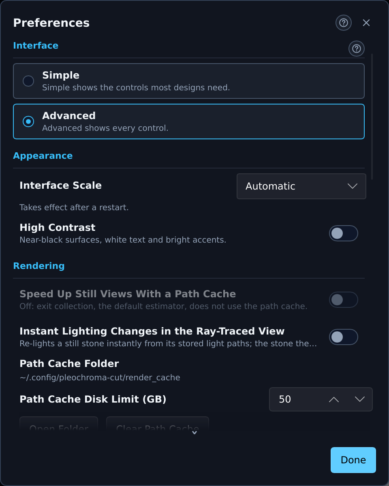

# 17. Preferences and Accessibility

## What You Will Do

Some choices are about you and your screen, not about one design: how many controls
you want to see, how big everything is, whether the colors are easy to read, and
whether the drag handles are easy to grab with a finger or a pen. They all live in
one place, the **Preferences** dialog. This chapter covers each one, and the two
viewport buttons the app now remembers between sessions. Every choice is saved
automatically and comes back the next time you start the app.

## Opening Preferences

Choose **Edit → Preferences...**, or press **Ctrl+,** (Ctrl and the comma key). The
dialog has these sections: Interface, Appearance, Rendering, Direct Manipulation, Faceting
Machine, Updates, Graphics Driver (Linux only) and Tutorials.
Press **Escape**, click **Done**, click the × in the corner, or click outside the
dialog to close it. The shortcut does nothing while you are typing in a text field,
so a comma in a name stays a comma.

While a guide or tutorial step has locked them (the worked example in Chapter 7, the
tutorials in Chapter 22), the menu item, the shortcut and the Simple | Advanced pill
are locked, because a step locks the controls it does not need. A step about the
Simple | Advanced switch or about Preferences unlocks its own control; otherwise close
the guide first.

## Simple and Advanced

The app can show every control, or only the ones most designs need.

- **Simple** shows the controls most designs need.
- **Advanced** shows every control.

There are two ways to switch, and they are the same switch: the small
**Simple | Advanced** pill at the top left of the window, next to the library
badge, and the two choices at the top of the Preferences dialog. Hover the pill to
see a reminder. You can change it at any time; switching hides or shows controls and
nothing else, so your designs, your settings and your files are never affected.

A brand-new installation starts in **Simple**. An installation that already has saved
settings starts in **Advanced**, with every control shown.

In the two viewports and their dialogs, Simple mode hides the **Tilt Curve** button;
in the Parameters dock's Render tab, the Library Thumbnails card (Preview Image Size and
Preview Samples), Motion Preview Resolution, the Compute card (Live Compute with its live
transfer, Local Compute), the Ray-Traced View card and Max Ray Bounces (Chapter 2); the two Library Thumbnails sliders
also appear as Picture Quality in the preview question, in both modes (Chapter 2); in
the Stone tab, the RI Override;
and in the tilt video export, Max Ray Bounces, Color Space, Transfer and the
folder-name template (Chapter 14). A hidden setting keeps its value and still
applies. When one of the hidden render settings is not at its default, the tab says
"Some advanced settings are in use. Switch to Advanced to see them." The Reset This
Tab button restores a tab's defaults in both modes, hidden settings included.

In the editor, Simple mode hides these (each one is listed again in the chapter
where it is described):

- **Tier table and Tier tab** (Chapters 3 and 4): the MAST, SOLVE,
  and ORBIT columns; the Adopt, Pin and Detach buttons; Adopt All; Steps and Mirror; the
  table filter; the imported-meet line; and "Exact Scale Value" in the Meets list
  (it is shown when the tier already uses it). The Optimize tab's advanced controls
  are hidden too. In History and Variants, the per-row save-as-variant icon and
  "Compare Text" are hidden. The VS BASELINE figures card of the Edit viewport (Chapter 5) shows the figures
  alone in Simple and adds the changes and Keep as Trial in Advanced. The Optimize
  tab hides its Tune view, Run settings, Trials and Variants (Chapter 8). The Angle Sweep's Two Tiers mode is in the Angle Sweep dialog, which
  is itself Advanced (Edit > Angle Sweep). The Tier tab's "+ Add Concave Tier" and Offset stay
  visible.
- **Command bar** (Chapter 3): Deep Solve, the Baseline menu, Tilt Batch... and Tilt Chart.
  The File menu drops its Gem Cut Studio (.gcs) entry.
- **Design settings panel** (Chapter 6): Symmetry Order, Mirror and
  Apply Symmetry, Extra Header Lines, Footnotes, Gear Ref. Angle and the
  printed-proportions row; in the gear remap dialog, Rounding. When a hidden control
  holds a value, the panel says "Some advanced settings are in use. Switch to
  Advanced to see them."
- **Status strip** (Chapter 5): the solve-duration figure, and the Pin column of
  Deep Solve's results.
- **Menus**: File > Export Gem Cut Studio (.gcs); Edit > Edit as Text and Angle
  Sweep; and the three Regenerate entries of the Library menu.
- **Top toolbar** (Chapter 1): the Remote button, until a remote worker is set up
  or a remote library is showing.
- **Library** (Chapter 2): the Advanced Filters panel's "Compute Missing Tilt
  Curves" button and its "Regenerate for Filtered Set" section, and the detail
  header's Export .gcs button.

- **Dialogs**: the Export Render Image dialog (Chapter 9) leaves out Compute, Max Ray
  Bounces, Color Space, Transfer and the saved-lighting fan-out. The remote worker
  dialog (Chapter 10) leaves out the live transfer, the update interval, the
  preview scale, the default export transfer and the number of lanes a batch keeps
  busy. Retarget (Chapter 14) leaves out Crown Handling and the Optimize objective,
  range and effort. The material editor (Chapter 29) leaves out the birefringence
  slider, the crystal system and optical character lists, and the coefficients
  switch (it stays when the material already uses coefficients). When a hidden
  setting is not at its default, the dialog says "Some advanced settings are in use.
  Switch to Advanced to see them." New Design, the Compare window, Edit as Text, Angle
  Sweep, Cutting Mode and the Rough Planner show everything in both modes; the Edit as
  Text and Angle Sweep commands themselves are hidden from the menus and the command
  bar in Simple mode.

All of these only hide the control. A tier, setting or file that already uses one
keeps working exactly as before.

## Denoise Live View

The Advanced **Render & Output** tab also has **Ray-Traced View** settings:
Anti-Aliasing (Off, 4×, 8×, 16×) and Fire. They are saved independently from the
Path-Traced target samples. Ray-Traced finishes after its fixed taps and bypasses
the live denoiser. Its approximation note lists the omitted optical effects.
The selected viewport mode is saved but startup still opens Solid in both viewports.

The **Denoise Live View** switch (on by default) is not in the Preferences dialog: it
sits in the Parameters dock's Render & Output tab. It smooths the grain out of the
live picture while it builds up, and it is the same switch as **Denoise Merged Image**
in the remote worker dialog (Chapter 10), so changing one changes the other. It is
saved with your settings like the choices above (`denoise_enabled` in
[settings.md](../settings.md)).

## Interface Scale

**Interface Scale** makes everything in the windows larger or smaller. The choices
are **Automatic** (follow your operating system's display scaling), 75 %, 90 %, 100 %, 110 %, 125 %, 150 %, 175 % and 200 %.

The scale is applied when the app starts, so a change **takes effect after a
restart**. Close and reopen the app to see it. Picking and dragging in the viewport
uses the same scale, so a scaled window still hits what it shows.

If you have set the `SLINT_SCALE_FACTOR` environment variable yourself, your value is
used and this choice is ignored.

## High Contrast

The **High Contrast** switch changes the colors to near-black backgrounds, white text,
clearly visible borders and bright accent colors, for easier reading in bright rooms
or with low vision. It takes effect **immediately**, in the main window and in the
Compare and Rough Planner windows, including ones you open later.

Everything the app draws itself follows the switch: panels, dialogs, chips, toggles,
the tilt graph with its grid and hover card, the hint badges over the Live Render
picture and the warning banners. The standard buttons, text boxes, drop-down lists,
sliders, number boxes and scroll bars are always drawn in the dark look with white
text, in normal mode and in high contrast, whatever your system theme is (the app
has no light theme, so a light system theme does not turn them light). In high
contrast their borders stay thin and subtle, because the app cannot change how those
controls draw them; the controls the app draws itself get strong borders and a clear
focus ring.

A few colors keep their own value on purpose, because they stand for something:

- the curve colors of the tilt graph (cyan for brilliance, amber for windowing, red for
  extinction) and the red and green of the Compare overlay legend;
- color swatches that show a real color, such as the material colors and the gem
  colors in the material editor;
- the rendered pictures themselves. The picture in the Compare window and the Rough
  Planner keeps its own dark background and edge colors; the frame around it follows
  the switch.

The backgrounds and labels around these colors do follow the switch.

## Adaptive Sampling in the Viewport

**Adaptive Sampling in the Viewport** (Rendering, off by default; shown only in a build with
the optional `adaptive-sampling` feature, Chapter 9) stops refining the
parts of the live picture that are already clean. While the stone stands still, the
picture normally gives every pixel the same number of samples until it reaches the
sample count of the Render & Output tab. With the switch on, the viewport checks the
picture in small tiles from 32 samples on, stops the tiles whose noise is below the
Standard target (the same one the export dialog's Target Noise offers), and spends the
samples on the noisy tiles instead, so the picture cleans up sooner. The progress bar
shows the samples the still-active tiles have, and reads Complete when every tile has
stopped. It applies to the Path-Traced renderer on this computer, with a sample count
of 64 or more; a remote worker, the Ray-Traced renderer and the reduced-resolution
picture while you move the stone are not affected. Any change of the stone, the
lighting or the size starts the picture over, as it always did, and switching the
setting off gives back the usual picture exactly. The standard build does not show the
switch and does not use it; it keeps the saved choice unchanged.

## The Path Cache

The Rendering section also holds the path cache's settings (Chapter 9 explains the cache
itself).

**Speed Up Still Views With a Path Cache** (off by default) lets the live viewport reuse
the stone's light paths. Once the stone has stood still for a while, the viewport works
out the paths of the current view, keeps them in memory only, and shades the stone from
them for the rest of the refinement, so the picture cleans up sooner. Moving the stone, or
changing the design, the material or the size, drops the cache at once. It is never written
to disk, and it applies to the Path-Traced renderer. It combines with Adaptive Sampling in
the Viewport. While the app renders with exit collection (Chapter 9) the box is greyed out
and a note says that exit collection does not use the path cache; the saved choice stays as it
is.

**Instant Lighting Changes in the Ray-Traced View** (off by default) re-lights a still
stone instantly from its stored light paths. Once a Ray-Traced view has stood still and
finished, the viewport keeps the stone's light paths in memory only (never on disk, and
within the same 4 GB limit as the cache above). Changing the lighting preset, the light
direction, the exposure, the backdrop or the HDR map then shows the re-lit stone at once,
without the small preview picture and without tracing again. Moving the stone, or changing
the design, the material or the size, drops the paths and the view is drawn as usual. The
re-lit stone follows the path tracer's physics, so it can differ slightly from the
Ray-Traced look; the background and a stone that cannot use the paths (see Chapter 9) are
still drawn by the Ray-Traced renderer. Switching the setting off gives back the usual
Ray-Traced view exactly.

**Beam Tracing in Still Views** (off by default; shown only in a build with the `beam` feature) lets the live viewport use beams (Chapter 9)
for a faceted stone. While the app renders with exit collection the Path-Traced view does not
beam trace, and the switch's line says so; it still feeds Instant Lighting Changes With Beams
in the Ray-Traced view. Once the Path-Traced view has stood still for a while, the viewport
follows the light through the stone as beams in the background, tile by tile. The finished
tiles show the beam picture, finished with a small share of ordinary samples, and the rest of
the view keeps refining as usual, so a faceted stone settles much sooner. Moving the stone,
or changing the design, the material, the size or the renderer, stops the work at once and
the view goes back to the ordinary refinement. A stone that cannot use beams (rounded edges,
tools, frosted facets, a hazy body; Chapter 9 lists them) stays with the ordinary picture.
The beams are kept in memory only, never on disk, within the same 4 GB limit as the
caches above, and the work shares the processor with the live view, so the view stays
responsive. It applies to the Path-Traced renderer, on this computer. It combines with
Adaptive Sampling in the Viewport, and where beams apply they win over the path cache.
Switching the setting off gives back the usual picture exactly.

**Instant Lighting Changes With Beams** (off by default) works only while Beam Tracing in
Still Views is on; until then the switch is greyed out and its hint says so. The still view
then keeps the stone's beams in memory, and changing the lighting preset, the light
direction, the exposure or the head shadow re-lights the stone at once, without tracing the
beams again. The re-lit stone equals a fresh beam picture under the new lighting. Moving
the stone, or changing the design, the material or the size, drops the beams. The name
differs from the Ray-Traced switch above on purpose: that one is for the Ray-Traced view and
its stored light paths, this one is for the beams. In the Ray-Traced view the same switch makes
a still stone come from beams as well (Chapter 9): the stone is drawn from the beams without
noise, and the background and outline stay with the Ray-Traced renderer. Your choice is
kept when you turn Beam Tracing in Still Views off, and takes effect again when you turn it
back on.

Beam tracing is retired, and the two beam switches above are shown only in a build with the
`beam` feature (`cargo build -p pleochroma-cut --features beam`). The standard build does not
show them. It still keeps your saved beam choices: it reads them and writes them back
unchanged, but never uses them.

**Path Cache Folder** shows where kept caches live (in a build with the `beam` feature, kept
beams too), and **Open Folder** shows it in your file manager. The standard build never reads
kept beams. They share this folder and its disk limit, so the standard build's limit and
**Clear Path Cache** can delete them. **Path Cache Disk Limit (GB)** is the most space kept
caches may use; it starts at 50. When the folder grows past it, the caches used longest ago
are deleted first. Lowering the limit deletes the extra caches right away.

**Clear Path Cache** deletes every kept cache. It asks first, and a line under the buttons
tells how many it cleared. Nothing is lost but the time they took to build: the next render
that needs a cache builds it again. Your designs, pictures and settings are not touched.

## Direct Manipulation

**Larger Handles** makes the angle, depth and index handles on the Solid viewport
(Chapter 13) about 60 % bigger, and makes the area you can grab around each one just
as much bigger. It is meant for touch screens and pens, where a fingertip is far
less precise than a mouse. A touch screen also has no "hover", so with larger
handles on, the line under the toolbar tells you what the three handles do as soon
as you select a facet, instead of waiting for you to point at one.

**Snap to Gear Steps When Dragging** is the same setting as the **Snap** button in the
Solid view's toolbar: when it is on, dragging the angle and depth handles snaps to
round steps, and when it is off the handles move freely. Change it in either place
and the other follows.

### What the App Remembers

- **Snap** (above) is remembered, so a session starts the way you left it.
- The Slice tool's **Symmetric** button is remembered: whether a new facet is
  repeated around the whole symmetric set or is a single index.
- The Slice tool itself is **not** remembered. While it is on, a left drag draws a
  line instead of turning the stone, so every session starts with it off.
- The Solid viewport's **Crystal Axis** pill, which draws the stone's crystal axis over it
  (Chapter 25), is remembered too. It also switches itself on for the rest of a session
  the first time you set an axis.

## Faceting Machine

The **Faceting Machine** section describes how your machine moves the stone over the lap, which decides which way the polishing scratches of a Surface Finish point (Chapter 26). It holds the choice between **Arm Points at the Lap Centre** and **Mast to the Side**, the **Arm Offset**, the **Lap Radius**, the **Mast Position**, the **Sweep Range** (**Narrow**, **Typical**, **Wide** or **Custom** with an **Inner Radius** and an **Outer Radius**) and a **Reset to the Plain Machine** button. A small figure shows the lap from above with the swept band, the dop arm and the scratches, and a sentence states the range of scratch angles. The setting is yours: it is kept in the settings file and never saved in a design, so the same design shows each cutter's own scratches. A change redraws the render only when a tier has a surface finish.

## Updates

The first time the app is idle, it asks once whether it may
check for new versions. If you choose **Check Daily**, the app asks GitHub's public release
list at most once a day, when it starts, whether a newer release than yours exists. The
only thing sent is the request itself (it names the app and its version, as every web
request names its program); no design, setting or personal data is sent. Nothing is
downloaded or installed: a newer release shows a slim notice under the header with **View
Release** (opens the release page in your browser), **Skip This Version** and **Later**. If
GitHub cannot be reached, the daily check says nothing. **Don't Check** never contacts
GitHub. Preferences has a **Check for New Versions** switch to change your mind and a
**Check Now** button that checks at once and tells you the result, including "up to date" or
why it failed.

## Graphics Driver

On Linux, where Mesa's AMD driver (RADV) can be used, the **Graphics Driver** section holds
the **RADV Shader Workaround** switch. It turns off one optimization of the AMD shader
compiler, which renders some stones with color zones, play-of-color structure or oriented
inclusions correctly, at about 10 % less GPU speed. Other graphics drivers are not
affected. The choice takes effect after a restart; **Restart Now** restarts the program,
asking first about unsaved changes. The section is hidden where the driver cannot be used.

## Tutorials

- **Reset Tutorial Progress** forgets which tutorials you have already finished, so
  they offer themselves again.
- **Show the Welcome Tour Again** brings back the first-run tour that new
  installations get once.

Each button confirms what it did with a short line under it.

## Keyboard and Screen Readers

Every button, switch, list and field of the dialogs and windows can be reached with
**Tab** and **Shift+Tab**, and pressed with **Space** or **Enter**; the control that has
the keyboard shows a bright ring. **Esc** closes the dialog (or backs out of its
comparison or confirmation first). Hover any control for a one-sentence tooltip that
says what it does, and the reason when it is greyed out. A round **?** button in the
header of a dialog opens the manual page for it.

- **Lists** (the tutorial browser, Retarget's options, the angle table, the manual's
  contents) are one Tab stop; **Up** and **Down** move through them. The command palette
  keeps the keyboard in its search box, and Up and Down choose a row.
- **Pictures you can turn.** In the Compare window and in the Rough Planner's 3D view,
  Tab to the picture, then the **arrow keys** turn it, **+** and **-** zoom and **Home**
  goes back to the starting view. The Compare window's split divider moves with
  **Left** and **Right**. In Angle Sweep, Tab to the chart and use **Left** and
  **Right** to choose an angle; the table follows.
- **Cutting mode** is driven by its own keys (Left and Right, Space or D, Esc) and keeps
  Tab out on purpose, so that nothing under the screen can be touched by mistake. Its
  buttons and index tick boxes are reachable by a screen reader's own actions.
- Icon buttons are at least 20 pixels square, and a screen reader hears every button's
  name, whether a switch is on, and which list row is selected.

## Where Your Choices Are Stored

All of these go into the same settings file as your render and remote settings
(Chapter 1 shows where it lives). The keys are listed in
[settings.md](../settings.md). Deleting the file puts every preference back to its
default, and the app then treats the next start as a brand-new installation.

## Limitations

- The interface scale needs a restart.
- High contrast leaves the colors that carry meaning and the rendered pictures as they
  are (listed above), and the standard controls keep their own thin borders.
- Simple mode only hides controls; it does not change what a design contains or how
  it is solved, rendered or saved.
