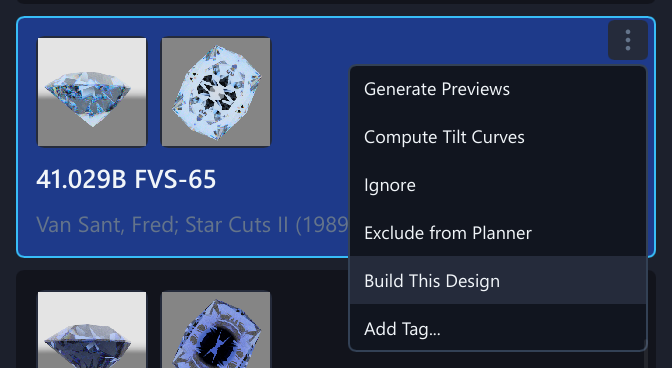
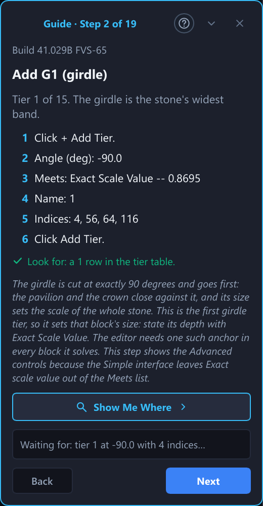

# 22. Tutorials and the Welcome Tour

## What You Will Do

A **tutorial** is a short guided lesson inside the program. A small panel walks you
through one tool step by step, outlines the control each step is about, and moves on
by itself when you have done what the step asks. This chapter covers where the
tutorials are, how to start one, what the panel does, the welcome tour a new user sees
first, and where progress is kept.

Chapter 7 is the long-form version of one tutorial, the New Design Walkthrough. Every
other tutorial works the same way.

## Finding the Tutorials

There are four ways to open the **tutorial browser**, and they all show the same list:

- Choose **Help → Tutorials...** in the menu bar.
- Press **Ctrl+K** and type `tutorials` (Chapter 19).
- Click **Browse All Tutorials...** at the bottom of the empty state, the screen shown
  until a design is created, loaded or opened.
- Click **Start from a Library Design** in the same empty state if you would rather
  begin from a design that already exists. It shows the library and puts the cursor in
  its search box. Pick a design there and use **Load Selected** (Chapter 3).

The browser is a small window over the main window. It shows:

- **Sections.** Tutorials are grouped under headings that follow a learning path, such
  as Getting Started, Adding and Editing Tiers, Solving and Checking, Improving a
  Design, Materials and Color, Rendering and Lighting, Saving, Cutting and Exporting
  and The App and Preferences, and, once you have made one, Built from the Library (see
  "Building a Tutorial from a Library Design" below). A section with no tutorial left after a search is not shown.
- **A row for each tutorial:** its name, how many steps it has, a one-line summary of
  what it teaches, and a **Start** button.
- **A Done mark** on every tutorial you have finished. Its button then reads
  **Restart**, so you can run it again.
- **A search box** that already has the cursor. Type a few words; a tutorial stays in
  the list when every word appears in its name, its summary or its section name.
  Capitals do not matter. Press **Enter** to start the first tutorial in the list.
- **A line under the list** saying how many tutorials you have finished.
- **Reset Progress**, which removes every Done mark. It does not touch your designs,
  and the welcome dialog does not come back. The same action is in
  **Edit → Preferences...** (Chapter 17).

Close the browser with **Close**, the cross at its top right, **Esc**, or a click
outside it. The list grows as the program does, so this chapter does not name every
tutorial.

## Starting a Tutorial

Click **Start** (or **Restart**). The browser closes and the guide panel opens at the
first step. What happens before that depends on what the tutorial needs:

- **It works on whatever is open, even nothing.** The panel opens at once. The welcome
  tour and the New Design Walkthrough are like this.
- **It needs a design to be open.** If none is, its **Start** button is dim and the row
  says "Open or create a design first." Open or create one, then start it again.
- **It starts from a new design.** The program makes the new design for you, with 96
  teeth, 8-fold symmetry and mirror on. If the design you have open has unsaved
  changes, the usual question appears first: save, discard or cancel. **Cancel** stops
  the tutorial from starting and leaves your design as it was.
- **It starts from a library design.** The program opens that library design into the
  editor, with the same unsaved-changes question first. A design that has to be
  downloaded from a remote library can take a few seconds. The panel opens once the
  design is there, and gives up quietly if it never arrives.

Only one tutorial runs at a time. Starting another one replaces the one on screen.

## Building a Tutorial from a Library Design

Any design in the library can become a tutorial that shows how to cut it from
scratch. The program reads the design, writes a lesson for it and starts the lesson.
The library design itself is not opened and is never changed: you build in a new design.

**Starting it.** Select a design in the library, then do one of these:

- Click the **steps button** (a small staircase) in the design header, next to the
  export buttons.
- Right-click the design's card, or click the three dots on it, and choose
  **Build This Design**.
- Press **Ctrl+K** and choose **Build the Selected Library Design**.

It works for the local library and for a remote one. A toast says the lesson is being
prepared; a large design can take a few seconds, because the program has to solve it to
know every depth. The buttons are dim meanwhile, so a second click does nothing. When the
lesson is ready the guide panel opens at its first step.

A lesson cannot be made for every design. The toast says why when the design has no tiers,
when the library entry only has an angle table and no cutting file (every depth would be
zero), or when the design does not solve.

### The Steps of a Lesson

1. **Start a new design.** The step gives the New Design dialog values: the gear, the
   symmetry order and the mirror setting of the original, and a preform shaped like its
   rough. Create the design yourself; the usual question about unsaved changes comes
   first, so your own work is safe. The step finishes when the new design has the
   original's gear, symmetry order and mirror setting. The preform only has to be bigger
   than the finished stone.
2. **One step for each tier, in cutting order**, which is the order of the cutting sheet:
   the girdle and pavilion tiers first, then the crown, the table last. A step is titled
   with the tier's code on the sheet, followed by the tier's own name when it has one
   (for example "Add P1 Pavilion Main"). Each step lists
   what to type into the tier form, in the order of the form: **Angle**, **Meets**,
   **Name**, **Indices**. Index lists use the shorthand the Indices field accepts when it
   is shorter, with the plain positions beside it. A short note says what the tier is
   for. The step finishes when a tier with that name, an angle within 0.02 degrees, the
   same index positions and the same kind of Meets is in the design.
3. **Concave tiers** get a step of their own, placed where the cutting sheet puts them. It
   lists the tier's fields and the tool, and finishes when the design has that many concave
   tiers.
4. **Solve and check.** Solve the design. The step finishes by itself when the result is a
   closed solid.
5. **Compare with the original.** Click **Compare** on the command bar to list every
   tier as Same or Changed, and **Compare Visually...** to see the original and your stone
   side by side (Chapter 14). Entering this step holds the original as the Baseline, which
   replaces the Baseline the design had, so Compare is ready at once. The step finishes by itself when every tier is cut as in the original and
   every solved depth is within one percent of the original's. **Next** opens the
   comparison for you; if the stone will not match, **Skip Step** then finishes it anyway.
6. **You rebuilt the design.** A closing step that unlocks everything.

### What Meets Says

The first tier of each block (girdle, pavilion, crown) states its depth with **Exact Scale
Value**, because the solver needs one such tier in every block. For the other tiers, a
library design imported from a `.asc` file keeps only a rough note of what each tier meets.
The program therefore tries the lesson before it shows it: it types every tier through the
tier form, solves the result, and uses **Named Facet(s)** or **Unspecified Vertex** only for
a tier that lands within 0.4 percent of its original depth. Any other tier states its depth
with Exact Scale Value, and the step says so. You never have to guess a depth.

The Simple interface leaves **Exact Scale Value** out of the Meets list for a new tier. A
step that asks for it therefore shows the Advanced controls while it is current, the same
way the other tutorials do, and says so in its explanation. The girdle step also names the
**Girdle Facet Preset**, which fills in the angle 90 and an exact scale value of 1 in one
click.

Tier names that the form would refuse (blank, repeated, or containing a comma or a slash)
are replaced in the lesson by short names such as P1 and C2.

### Large Designs

A design of more than 40 flat tiers would be a very long lesson. Consecutive tiers of the
same kind are then grouped into one step with a checklist of up to six tiers, and the first
step says how many steps the lesson has. The step finishes when all of its tiers are in.

### Finished Lessons

A finished lesson shows its Done mark under **Built from the Library**. The mark is saved
under the library design's own id, so building the same design's lesson again later shows
it as done. The lesson itself is listed only while the program runs; build it again to run
it again.

## The Tutorials, Area by Area

The viewing lessons recognize all six Edit modes: Solid, Path-Traced, Solid + Path-Traced,
Diagram, Ray-Traced and Solid + Ray-Traced. Keys 1–4 keep their earlier meanings; 5 selects
Ray-Traced, and Solid + Ray-Traced has no key (keep Solid selected and click Ray-Traced).
Ray-Traced is an image approximation with fixed AA taps; switching to it changes
neither the solved geometry nor the metrics model. The lesson's highlighted view
controls remain the way to follow a step that names a particular mode.

Besides the long lessons above, the browser has a short tutorial for each tool. They are
grouped as a learning path: the sections run from the first steps, through building,
solving and improving a design, to materials, rendering, output, the library, the rough
planner and the program's own settings, and inside a section the lessons run from basic to
advanced. Each one
starts from a design that suits it (an empty design, one of the two teaching
templates, or the Standard Round Brilliant), locks everything the current step does not need except Undo, and finishes a
step when the design shows the result. A lesson that starts from a template is cut from
that template's own rough, the same one the New Design dialog gives it, so the stone in the
first step is the stone the template makes, with nothing clipped at the bottom. The first
and last steps of many of them only ask you to read.

The tutorials that look at a design, get it out of the program, find one in the library or
set the program up start from the Rich Teaching Design (card 5 of the New Design dialog) or
from whatever is open, and lock everything except Undo and the controls of the step. Many of
their steps wait for an action that leaves no trace in the design, such as a facet picked, a
file written or the glossary opened; the program notices those itself. The solving,
checking, optimizing and comparing tutorials start from the Standard Round Brilliant or the
Rich Teaching Design (cards 1 and 5). Several of them use controls that belong to the
Advanced interface; a step about one of those shows it even while the program is in Simple
mode.

### Getting Started

Section **Getting Started** in the browser:

- **Welcome Tour** is the two-minute reading tour of the window (see "The Welcome Tour"
  below).
- **New Design Walkthrough** builds an 8-fold round brilliant from an empty design
  (Chapter 7).
- **The Manual and Context Help** opens the manual and the page for the screen with F1.
- **The Glossary** opens the glossary and searches it.

### Building a Design

Section **Adding and Editing Tiers**:

- **Add a Tier** teaches the Tier form: Angle, Meets, Name and Indices, by adding a
  girdle, a pavilion and a crown tier.
- **Edit a Tier** changes the angle, the name and the Meets of a picked row, then undoes
  the last change. The Meets step leaves the pavilion without an exact scale value, so
  the status strip says the pavilion has no anchor until the Undo step; the lesson says
  so beforehand.
- **Quick Add** adds a girdle, a table and a culet with one click each.
- **Inline Angle and Nudging** edits an angle in the table cell and nudges it with the
  arrow keys and Ctrl plus the mouse wheel.
- **Index Shorthands** writes a ring with `0:12:96`, `12 x8` and `6 x8` instead of
  listing every position.
- **Facet Chips** adds, removes, detaches, rotates and mirrors single facets of a tier.
- **Tier Notes** attaches a short note to a tier and clears it.

Section **Arranging and Repeating Tiers**:

- **Duplicate a Tier** copies a tier right below itself and changes the copy.
- **Move a Tier** changes the cutting order by moving a row up the table (the pavilion and
  girdle rows are cut first, then the crown rows, the table last).
- **Delete a Tier** removes a tier and brings it back with Undo.
- **Multi-Select** ticks several tiers, offsets their angles together and deletes them
  together.
- **Generate Steps** writes a ladder of tiers with a fixed angle step.
- **Keep Linked** writes a ladder whose rungs follow the first one, then frees a rung.
- **Mirror to Other Block** copies a tier to the opposite side of the girdle.

Section **Meets, Relations and Concave Tiers**:

- **Meets: Named Facets** sets a tier to meet named facets or an unspecified vertex, and
  shows a rename following the tiers that meet the renamed one. It starts from the
  Standard Round Brilliant, whose crown and pavilion each keep other tiers with an exact
  scale value, so the stone still solves when one tier leaves its depth to the solver.
- **Meets in Millimetres** states a depth, a table width and a girdle thickness in
  millimetres, after giving the stone a girdle diameter.
- **Pin to Mast** freezes the depth the solver found as an exact scale value. It also
  starts from the Standard Round Brilliant.
- **Adopt Imported Meets** switches the tiers of an imported design from pinned depths to
  the meets their file stated, one at a time and all at once. It needs an open design.
- **Tier Relations** makes one tier's angle follow another's, and stops it again.
- **Arithmetic in Fields** types sums such as `34.5+0.3` into the number fields.
- **Cheater Offset** records a small azimuth correction on a tier (Advanced).
- **Concave Tiers: Cylinder and Cone** cuts a groove and a bevel with the concave form
  (Chapter 16).
- **Concave Tiers: Sphere, Disc and Plunge** cuts a dimple and a wheel groove, and switches
  a tool from stroked to plunged.

### Solving, Checking and Improving

Section **Solving and Checking**:

- **Solve** edits a design, sees it marked not solved, presses Solve or F5 and reads the
  result.
- **Auto-Solve** turns the Auto-solve list off and on and says what the times mean.
- **Reading the Solver Status** reads the status strip after a good solve and a failed
  one, fixes a missing anchor and explains Abandon Solve.
- **The Overall Verdict** reads the Good, Check or Problem badge, opens its reasons and
  shows how a lower-index material changes it (Chapter 5).
- **The verdict's Fix buttons** adds a missing table and snaps an index to the gear, each
  as one undo step.
- **The Preform Tab** reads the stone's proportions, changes the rough's size and solves
  again.
- **Yield and Carat Weight** sets the material and the girdle diameter and reads the yield
  and the carat weight.

Section **Improving a Design**:

- **Deep Solve** checks a catalogue design's solved stone against the proportions printed
  for it. It needs a design from the library, so its steps mostly read.
- **Optimize** chooses an objective, opens the angle ranges, runs a short search, picks a
  candidate and applies it.
- **Retarget for a New Material (Shift)** moves a design from quartz to topaz in Shift
  mode and undoes it.
- **Retarget: Optimize Mode** lets Retarget search for the best crown and pavilion angles
  in a new material, picks an option and applies it.
- **Angle Sweep** tries one tier's angle over a range, reads the table and uses one of the
  angles.
- **Sweep Two Tiers** sweeps a crown tier against a pavilion tier, reads the heat map and
  its plateau outline, and uses one pair of angles (Chapter 21).
- **Keep Trials** keeps the design as a trial after two changes, reads the Trials table
  against the Baseline and restores a trial (Chapter 18).
- **Tune by Hand** works through the Tune view of the Optimize tab: picks a tier, nudges
  its angle, reads the strip, accepts the tier and moves on (Chapter 8).

Section **History, Variants and Comparing**:

- **History Panel and Jumping** reads the list of changes, goes back to a step and comes
  forward again.
- **Variants** saves two named copies of the design in your library, opens one, undoes the
  open and compares two designs. The variants it saves stay in your library until you
  delete them; the last step says how.
- **Baseline and Compare** sets the Baseline, changes the design, and reads the comparison
  table and the compare window.
- **Edit as Text** changes one angle in the cutting instructions as text, compares the text
  with the Baseline and applies it.

### Materials, the Viewport and Rendering

Section **Materials and Color**:

- **Custom Materials** defines a material with the Material Editor's two sliders.
- **Materials from Coefficients** types a Sellmeier or Cauchy curve and reads its
  readout and warnings.
- **Stone Effects** adds haze, a frosted girdle, rounded edges and a stone width to the
  picture, and shows each one in the Path-Traced view.
- **Make a Watermelon Tourmaline** gives a custom material a Watermelon Color Pattern in
  the Color Pattern Editor, picks its colors and saves it (Chapter 29).
- **Look at Ametrine** picks the built-in Ametrine and shows its amethyst and citrine
  halves in the Path-Traced view.
- **Orient a Sapphire** sets a sapphire's Crystal Axis in the Stone tab with **Set for This
  Stone** and **Through the Table**, shows it with the **Crystal Axis** pill and reads the
  Doubling figure (Chapter 25).
- **Tourmaline With the Axis in the Table** tries **In the Table Plane** and **Along the
  Width** on a tourmaline and looks at the color change in the Path-Traced view.
- **Best Blue Tanzanite** sets the Second Axis of a tanzanite and chooses **Best Blue
  Face-Up** and **Violet Face-Up**.
- **Set a Stone's Crystal Axis** drags the axis handle on the stone, cancels a drag with
  Escape, undoes it and goes back to **As Material**.
- **Polish Quality and Haze** sets a tier's surface grade, looks at the haze it gives and
  reads the Show Surface Finish pill (Chapter 26).
- **Scratch Direction** chooses the faceting machine in Preferences, sets the direction of
  the polishing scratches and sees them follow the machine (Chapter 26).
- **Silk in a Sapphire** gives a sapphire its silk, changes its Density and Silk Turn and
  reads the silk direction on the stone (Chapter 27).
- **Opal Play-of-Color** chooses a Pattern for an opal, changes its Color Range and
  Coverage and reseeds the flashes (Chapter 28).
- **Labradorite Flash** turns on a labradorite's schiller, turns it with the stone and
  reads the flash (Chapter 28).
- **Ordinary and Extraordinary Curves** gives a custom material its own curves for the
  two rays and saves it (Chapter 29).

Section **Working in the Viewport**:

- **Picking Facets in the Solid View** reads a facet's tier, angle and index under the
  pointer and selects its tier by clicking, in the Solid, Path-Traced and Diagram views.
- **The Diagram View** reads the crown, pavilion and profile panels, picks a facet, drags a
  handle on the flat diagram and enlarges one panel.
- **The Cut slider** shows the stone as the rough, after a step, and finished.
- **Drag Handles** changes a tier by dragging the angle, depth and index handles on the
  stone, undoes one drag in one step, and turns the Snap pill off and on.
- **Slice: Cut a Facet with the Mouse** draws a line across the stone, flips it, cuts it in
  with the depth handle, keeps it as a new tier and undoes it.

Section **Rendering and Lighting**:

- **Live Render and Lighting** opens the traced picture, turns the stone, and chooses a
  lighting rig.
- **Lighting for This Design** saves the lighting a design should open with, and forgets it.
- **Optical Diagnostics at a Viewing Angle** inspects leakage, extinction, light return and
  dispersion potential without changing the picture.
- **Render Jobs** saves a picture as a render job from the export dialog and finds it in the
  Render Jobs window.
- **Start, Pause and Resume the Queue** starts the queue, pauses it early, puts the job back
  in line and exports the jobs as a script.

### Output, the Library and the Rough Planner

Section **Saving, Cutting and Exporting**:

- **Save a Design** changes a tier, saves the whole design, and explains Save As, the
  backup and the autosave.
- **Open a Design** saves, opens the file again, and lists what else Open accepts.
- **Cutting Mode** walks the cutting steps one page at a time and marks one done.
- **Export the Cutting Instructions (.asc)**, **Export for Gem Cut Studio (.gcs)**,
  **The Cutting Sheet** and **Export the Diagram (PNG)** each write one file and say what
  is, and is not, in it.

Section **The Library**:

- **Import Designs into the Library** writes an `.asc` file and imports it.
- **Search the Library** types in the search box, clears it and selects a design.
- **Filter and Sort the Library** changes the Shape drop-down, a range filter and the sort
  order, then puts everything back.
- **Load a Design into the Editor** selects a design and loads it with Load Selected.

Section **Planning from the Rough**:

- **The Rough Planner** opens the planner, models a rough and runs a plan.
- **Model the Rough Shape** chooses a rough shape, looks at it from every side, cuts it in
  the 3D view and takes a cut back.
- **Read the Planner Results** picks a layout, a design and a Cut Plan, reads the numbers on
  a card and finds its designs in the library.
- **Save and Share Plans** saves results as a plan, opens the plan again and exports it as
  a file.
- **From Plan to Editor** opens a planned stone in the editor with the piece of rough it
  comes from.
- **The Rough Color Wizard** works out the color of a piece of rough from photos on a
  backlit rig and reads how sure the result is.
- **Use the Rough Color in the Planner** shows stones in the color of the rough, chooses the
  pose that shows the most of the inner zone and takes the color to the editor.
- **Override a Stone's Orientation** sets the rough's Crystal Axis in the planner, reads the
  rule line, overrides one stone with a Reason, locks it, plans again and opens a stone in
  the editor with its axis (Chapter 25).

### The App and Preferences

Section **The App and Preferences**:

- **Simple or Advanced** switches the interface and back (Chapter 17).
- **Interface Scale**, **High Contrast** and **Larger Handles** each change one setting in
  the Preferences dialog.
- **The Command Palette** runs Diagram View from Ctrl+K and shows how a dim row explains
  itself.
- **Keyboard Shortcuts** switches the view with the number keys, Live Render and Edit with
  Ctrl+E, and opens the list of every key.

Tutorials about a dialog (Preferences, the Material Editor, the Rough Planner, the
glossary, cutting mode) cannot show their panel while the dialog is open, because the
dialog covers the window. The step that sends you there lists everything you need to do in
it; the panel comes back when you close the dialog, and the next step is read then.

A step about an advanced control (cutting mode, the Gem Cut Studio export, Preferences, the
Simple | Advanced switch) shows it even while the program is in Simple mode, so the step
can point at it. The Simple layout is back as soon as the step is over or the tutorial is
closed.

Dialogs open beside the guide panel rather than over it, so the step text stays in view
while you work in them; the New Design dialog can also be dragged by its title. If the
window is too narrow to leave room (under about 420 pixels beside the panel), the dialog
covers the panel and the step that opens it lists everything you need to do in it. A step that waits for something the design does not show, such as
a search finishing or a compare window opening, finishes when the program notices it.

## The Guide Panel

The panel is the same for every tutorial and works as Chapter 7 describes: it sits in
its own column beside the tier table on a wide Edit tab and floats near the
bottom-right corner everywhere else. Each step shows:

- a **title** and one sentence of context;
- **numbered actions**, one short line each, with the exact values to type;
- a **Look for** line saying what you should see once the step is done;
- sometimes a small italic note explaining why;
- a status chip: **Waiting for:** and the thing it needs, then **Done** for a moment
  before the next step opens.

**Next** on a step you have not done yet does the step for you. The program makes the
same entries you would (it types the values the step lists into the Tier form and
presses Add Tier, picks the material and applies it, presses Solve, opens the tab or the
view the step names) and then judges the step the usual way: **Done**, then the next
step. The edit is one Undo step like your own, so **Ctrl+Z** takes it back, and a value
the form refuses is refused with the same message under its field. If the step is still
not done after that, the button changes to **Skip Step**. Steps the program cannot do
for you, such as ticking rows, a drag in the viewport, or choosing a file, show
**Skip Step** from the start. A step you have already done shows **Done** and moves
on by itself, and a reading step always waits for **Next**.

**Back** returns to the previous step and checks it again: if you still have what it
asked for, it shows **Done** and waits for you to click **Next**, so you can read it
again without it moving on by itself. Back does not undo anything. **Skip Step** moves on
without doing the current one, and the cross in the corner closes the tutorial and
unlocks everything. The small arrow button in the panel's header collapses it to a pill;
the tutorial keeps running.

A step is judged from the design, not from the buttons you pressed. Whichever way you
reach the goal counts: the tier form, an inline edit in the table, Undo and Redo, or
auto-solve finishing first. A step whose result leaves no trace in the design, such as a
file exported, the glossary opened or the Cut slider moved, is judged from the action
itself: the program notes it once it has happened. A step that only asks you to read, or
to look at something, waits for **Next** instead.

While a step is open, the controls it does not need are dimmed and their keyboard
shortcuts do nothing, with a tooltip saying why. That leaves the step's own action as
the only thing to click. Selecting rows and looking around stay possible, and so does
the command palette, though a command whose controls are locked says so in its row.

### What Counts as Finished

Reaching the last step and clicking **Finish** counts. Closing the panel part-way does
not. A finished tutorial is saved with your other settings and shows its Done mark in
the browser from then on. Starting it again, to the end, changes nothing further.

## The Welcome Tour

The first time you start the program, a **Welcome to Pleochroma Cut** dialog asks how
you would like to begin. It waits until the program has finished starting and any
restore question has been answered. It has three buttons:

- **Take the 2-Minute Tour** starts the welcome tour.
- **Start with a Template** opens the New Design dialog, where the template cards are.
- **Not Now** closes the dialog and does nothing else.

Esc means **Not Now** and Enter means **Take the 2-Minute Tour**. Any of the three
answers counts as having seen the welcome, so the dialog does not return by itself.

The welcome tour is a tutorial of eight reading steps. It locks nothing and needs no
design. Each step has a few lines and **Next**; some outline the part of the window
they are about.

1. **Welcome to Pleochroma Cut.** What the program is for.
2. **The library.** The list on the left, its search box and Load Selected.
3. **The command bar.** Undo and Redo, Solve, and the File menu with New Design...,
   Open, Load Selected, Save and the exports. The Solve button is outlined.
4. **The tier table.** A design is a list of tiers; each row is one. The table is
   outlined.
5. **The inspector.** The panel that edits the selected tier. Its Tier tab is outlined.
6. **The viewport.** Turning the stone, the Solid, Path-Traced, Solid + Path-Traced and Diagram
   buttons, and the 1, 2, 3 and 4 keys.
7. **Simple and Advanced.** The one switch in the top bar that sets how many controls
   the whole program shows (Chapter 17).
8. **Help and the command palette.** Help → Tutorials..., Help → User Manual and
   Ctrl+K.

The library, the viewport and the Simple/Advanced switch are described in words, not
outlined. Finishing the tour marks it Done in the browser.

### Showing the Welcome Again

Use either of these:

- **Edit → Preferences...**, under Tutorials, **Show the Welcome Tour Again**. The
  dialog opens as soon as you close Preferences. If you quit before answering it, it
  opens again the next time the program starts.
- **Ctrl+K**, then **Welcome Tour**. The dialog opens at once.

The welcome tour is also in the browser, under Getting Started, so you can start it
without the dialog.

## Where Progress Is Kept

Which tutorials you have finished, and whether the welcome has been seen, live in the
program's settings file, the same file as the UI scale and the Simple/Advanced choice
(Chapter 1 says where your settings live). They belong to you, not to a design: opening
another design or starting a new one does not change them. **Reset Progress** (in the
browser) and **Reset Tutorial Progress** (in Preferences) clear the Done marks.

## Limitations

- **Outlines.** A step can outline the New Design dialog, the inspector's Tier and
  Preform tabs, the Design Settings panel, the Solve button, the tier table, the Solid
  viewport and its view-mode, Snap, Slice and Cut controls, the Live Render tab and
  Lighting drop-down, the Cut Mode button, the File menu (Export .asc, the other exports, Save, Open and
  Load Selected), the library's search box, filters and Import button, and the Simple | Advanced
  switch. The solving lessons also outline the Auto-solve list, the verdict badge, the
  Deep Solve, Retarget, Set Baseline and Compare buttons, and the Optimize and History tabs.
  A step about anything else, such as a menu or a dialog, names the control in its text
  instead.
- **One tutorial at a time.** There is no queue and no way to pause one and come back
  to the same step later. Closing the panel forgets where you were.
- **Locks follow the step.** A tutorial that locks controls does so only while its
  panel is open. If you need a locked control, close the tutorial.
- **A step that never finishes.** If a step cannot be done in your situation, for
  example because the design you opened already has the tier it asks you to add, use
  **Skip Step**. It appears in place of **Next** on a step the program cannot do for you,
  and after **Next** has tried and the step is still open.
- **Next does not guess.** It types only the values the step lists. A step that leaves a
  value to you (the girdle diameter of your own stone, a file to open, a facet to drag)
  shows **Skip Step** instead.
