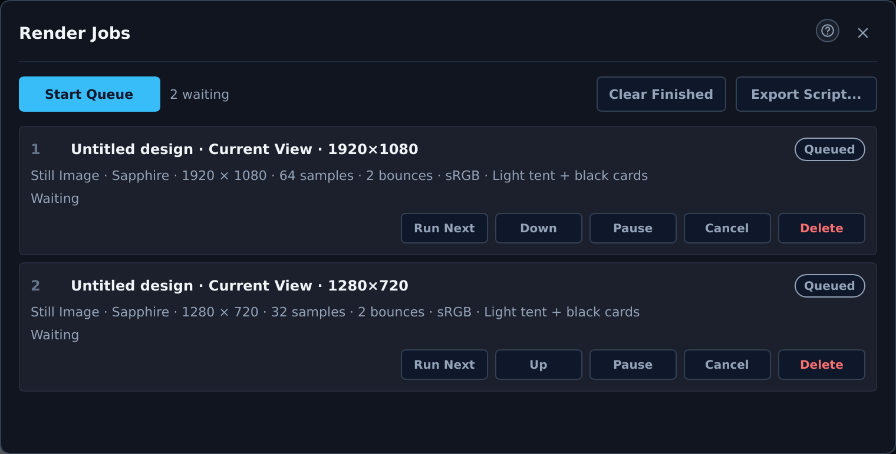

# 23. Render Jobs

## What You Will Do

Collect still pictures and tilt videos as render jobs, then let the program render them one after another while you keep working, or overnight. You can pause, resume, restart, reorder and cancel jobs at any time. You can also export the jobs as a script and render them on another computer with the command-line tool.

## Adding a Job

You can add a job from two places:

- the export dialog (Chapter 9): set everything as you would for an export, then press **Add to Queue** instead of **Start Export**;
- the **Export Tilt Video** section of the Tilt Performance dialog (Chapter 14): press **Add to Queue** instead of **Start Video Export**.

**Add to Queue** sits next to the button that renders at once. The two do not replace each other. **Start Export** and **Start Video Export** still render immediately. **Add to Queue** saves a render job and renders nothing yet. A message tells you how many jobs were added and where to start them.

### What a Job Keeps

A job also freezes **Renderer**, and either the Path-Traced sample count or the
Ray-Traced AA tap count and Fire option. Ray-Traced stills and tilt-video frames
finish after their fixed taps and use no denoiser. Local, GPU and protocol-44
remote routes honor the frozen engine. Later viewport or output-setting changes
do not replace it.

With "Stone Shadow" off and "Tray Reflection" at 0, Path-Traced files use `format: 1` and
Ray-Traced files use `format: 2` with an explicit `engine` object. Legacy files without an
engine load as Path-Traced. The shadow alone makes a still use `format: 3`, so an older
reader refuses the job. Any still with "Tray Reflection" above 0 uses `format: 4`, with or
without the shadow (the job keeps the reflection as `tray_reflection`, from 0 to 1), which
an older reader also refuses.
A Path-Traced job of a stone with color zones (Chapter 24) uses `format: 5` whatever else it holds
(a turned HDR map still makes it `format: 6`): the zones are
saved in the job file as `zoning`, so a script made with **Export Script...** and the command line
render them, and an older reader refuses the job instead of rendering the base color alone. A
Ray-Traced job never carries zones, because that engine renders the base color. A job queued by an
older version keeps its zones in the app; **Export Script...** adds them to the job file.
The job supplies the same engine, shadow and reflection settings to a remote worker.
A job of a stone moved within the picture (Chapter 2) uses `format: 7` whatever else it holds:
it keeps the move as `camera_pan`, and an older reader refuses the job instead of drawing the
stone in the middle. A job of a centred stone keeps its format.
A job of a stone in a Stone Pose (Chapter 2) uses `format: 8`, which wins over `format: 7` and
every other format: it keeps the pose as `stone_pose`, `[tilt, turn, spin]` in degrees, and an
older reader refuses the job instead of drawing the stone as designed. A job of an unposed
stone leaves the key out and keeps its format. A tilt-video job never carries a pose.

The shadow requires a studio light and a backdrop. HDR maps, As Lit,
"Contrast view (ASET-style)" and tilt videos cannot use it. The renderer builds a Final
quality map before the first sample. The Tray Reflection has the same scope and
works together with the shadow. In the app its row dims with the Stone Shadow row's notes
("(not used with an HDR map)", "(needs a backdrop)", "(not used with this light)"); a job
or worker that cannot serve it says "Tray reflection needs a studio light with a
backdrop." Tilt videos do not show it.

A job keeps a frozen copy of everything it needs: the finished stone, its width and material effects, the material and its color (the preview material, if you were previewing one), the lighting, the camera, the size, the samples and the other export settings. If you change the design afterwards, the job still renders what you saw when you added it.

The job does not freeze the remote worker. Its address and certificates are read from Settings when the job runs (see Limitations). The job does remember your choices about where to render: local only, local and remote, or remote only, and the transfer.

A tilt video has the same **Compute** pills as a still picture. **Remote Only** keeps this computer free: the video's frames are drawn entirely by the remote worker, and this computer only receives and saves them and encodes the video, using almost no CPU or GPU. If the remote is missing or stops answering, the job fails with a message instead of drawing the frames here; resume it once the remote is back and it continues with its first missing frame. On the command line, `pleochroma-cli tilt-video` takes the same choice from the job file, or from `--compute local`, `remote` or `both`.

A job also keeps the **Adaptive Sampling** choice and its **Target Noise** (Chapter 9). Adaptive sampling stops each part of the picture once it is clean enough; the samples setting is the most any part gets. A job that uses it says so in its detail line, for example `· adaptive (Standard)`, and a job without it reads as before. Jobs saved by an older version have no such choice and render every pixel to the full sample count. Adaptive sampling renders on this computer only for now, so a job that uses it needs **Local Only** under Compute. Adaptive sampling is an optional build feature (`adaptive-sampling`). The job file keeps its `accel.adaptive` choice and loads and validates in every build. A standard build renders such a job at the job's own samples per pixel, without adaptive sampling, and its progress note says "Adaptive sampling off: this build has no adaptive sampling."

A job also keeps the **Path Cache** choice (Chapter 9). The path cache is a preview that reuses the stone's light paths when a kept view is drawn again; a job that asks for it says so in its detail line with `· path cache`. For a still picture, **Keep for Re-Renders** is saved in the job: the cache is written to disk and a later render of the same view starts from it. A tilt video writes its frames' caches to disk only when **Keep Path Cache for This Video** was ticked when it was added. A job that asks for the cache without keeping it is drawn as without it, and a note says so. Kept caches live in the cache folder that Preferences shows (Chapter 17). Jobs saved by an older version have no such choice and render without the cache.

A job also records its **estimator**, the way a stone sample is drawn (Chapter 9, "Exit Collection"). The app renders with exit collection. A job recorded with the branching estimator, such as one from an older version, is re-rendered with exit collection under a new token, so its pictures and frames are never mixed with the old ones. Under exit collection the path cache is off, and a job that asks for it says "Path cache off: exit collection, the default estimator, does not use it." A tilt video started with the branching estimator is not resumed: its folder is refused with a message that names the change, and you use **Restart** in the Render Jobs window to render it again.

A job also keeps the **Beam Tracing (Faceted Stones)** choice (Chapter 9). Beam tracing follows the light through a faceted stone as beams, so the stone settles much faster, and the result equals the path-traced picture within noise. It applies to a convex stone with flat, polished facets and sharp edges; for any other stone the job draws as without it and says why in a note. A job that uses it says so in its detail line with `· beams`, and while it runs the progress line names the phase, `tracing beams` and then `finishing`. For a still picture, **Keep Beams for Re-Renders** is saved in the job too: the beams are written to the cache folder when the picture is done, and a later render of the same view, even with other lighting, starts from them. For a tilt video every frame builds its own beams, and they are written to disk only when **Keep Path Cache for This Video** was ticked when the job was added. A job with beam tracing uses the compute choice it was added with: a remote worker draws its share of the beam tiles (Chapter 9), and when no worker is set up the job renders on this computer and says so in a note ("Beam tracing renders on this computer"). The Ray-Traced renderer cannot use beams, so a job added with Ray-Traced selected carries no beam choice. Jobs saved by an older version have no such choice and render without beams.

Beam tracing is retired and is an optional build feature (`beam`). The standard build never adds a job with beams, but a job file that asks for beams still loads and renders there, without them. Its progress note says "Beam tracing off: this build has no beam tracer." A job that also asks for the path cache and keeps it uses the cache. The paragraph above describes a build with the `beam` feature.

### One Job per Picture

With saved lighting ticked under **Also Render With Saved Lighting**, each picture becomes its own job: one for the current view and one for every ticked lighting.

### File Names

The file name is worked out when you add the job, from the folder and the name template of the export dialog. If a file with that name exists by the time the job runs, or another job already uses the name, " (2)" is added to the name. A date or time in the template is the date and time of **Add to Queue**, not of the render.

## The Render Jobs window



Open it in one of two ways:

- **File → Render Jobs...**;
- the **Jobs** button at the top of the main window. It appears while a job is waiting or running, or while a started queue is running. It reads, for example, `Jobs: 3 waiting`, or `Rendering 2 of 5 · 42%` with a thin progress bar while a job renders. Click it to open the window.

Each row shows the job's number, its name, its state and what it renders, then its progress. The states are **Queued**, **Running**, **Paused**, **Done**, **Failed** and **Cancelled**. The list is kept in your library, so the jobs are still there the next time you start the program. The window has a round **?** button that opens this chapter, and **Close**. Closing the window does not stop a job that is rendering.


## Starting and Pausing the Queue

**Start Queue** renders the waiting jobs from the top of the list down, one job at a time. While the queue runs, the button reads **Pause Queue**. It stops the job that is rendering and keeps the rest waiting.

**Stop After This Job**, next to it while a job renders, lets the running job finish and then stops the queue; the rest keep waiting. Click it again (it then reads **Keep Queue Going**) to let the queue go on after all.

The queue never starts by itself, not even when the program starts. When the last waiting job is done, the queue stops and the program says so.

Only one export runs at a time, whether it is a queue job or a still picture or a tilt video started from its own dialog. While a still picture or video from a dialog is rendering, **Start Queue** is greyed out; while a queue job renders, the Export button and **Start Video Export** are greyed out. Each says why in its hover note. A dialog export can be sent to the background (**Run in Background**) and shows as a chip in the header; click the chip to open its dialog again (Chapter 14). **Add to Queue** is always available.

Only the buttons that make sense for a job's state are shown on its row.

| Button | What it does |
|---|---|
| Run Next | Moves the job to the top, so it is the next one to render. It does not interrupt the job that is rendering. |
| Up / Down | Moves the job one place. |
| Pause | Stops this job. The queue goes on with the next one. |
| Resume | Puts a paused or failed job back in line. A tilt video goes on with its first missing frame. |
| Restart | Renders the job again from the beginning. |
| Cancel | Stops the job for good. Restart can still bring it back. |
| Show | Opens the folder with the finished file. |
| Delete | Removes the job from the list. Files it already wrote stay on disk. |

Two more buttons sit at the top of the window.

| Button | What it does |
|---|---|
| Clear Finished | Removes every Done and Cancelled job from the list. Files stay on disk. |
| Export Script... | Opens the script section at the foot of the window (see below). |

**Delete** and **Clear Finished** never delete pictures, videos or frames. Only the list entry goes.

## What Pausing Keeps

Pausing works frame by frame.

- A **still picture** starts again from the beginning when you resume it. The picture is rendered as a whole, so nothing is kept.
- A **tilt video** keeps every frame it finished. When you resume it, it continues with the first missing frame, in the same folder. The video file is made once all frames are there.

A paused video keeps its frames on disk until it is finished or you delete the folder. At large sizes this can be many gigabytes.

**Restart** throws the finished frames of a video away and starts at frame one.

### Closing the Program While a Job Renders

If you close the program while a job renders, the program asks first, in the same dialog it uses for unsaved work. If you go on, the job stops and waits as **Paused**. A tilt video keeps its finished frames. The queue is stopped, so nothing starts by itself when you open the program again.

If the program stops without asking (a crash or a power cut), the job is found as **Paused** the next time the program starts, with a note on its row that the program closed while it was rendering. At most one frame is rendered twice.

## Exporting a Script

**Export Script...** writes the jobs that are not finished, in queue order, to a new folder. The section at the foot of the window has these choices:

| Choice | Meaning |
|---|---|
| Script Type: **Both**, **PowerShell (.ps1)**, **Shell (.sh)** | Which script files are written. |
| Render On: **This Computer**, **This Computer and the Remote Worker** (with its address), or **Only the Remote Worker** | The script passes `--compute both` or `--compute remote` for the last two, whatever each job chose. Both are dimmed with "No remote worker is set up in Settings." when there is none. |
| **Put the Finished Pictures and Videos in the Script Folder** | Without it, each picture or video goes to the folder its job was added with. |

Press **Choose Folder and Export** and pick a folder. The program makes a new folder in it, named `render-jobs-` with the date and time, so nothing is ever overwritten. It holds:

```
render-jobs-2026-10-06-1403/
  run-render-jobs.ps1     the PowerShell script
  run-render-jobs.sh      the shell script
  jobs/                   one job file per job, and assets/ with any HDR maps
  renders/                the finished files, if you chose to put them there
```

The button is dimmed when no job is unfinished. Copy the whole folder to the computer that should render, then run:

- Windows: `powershell -ExecutionPolicy Bypass -File run-render-jobs.ps1`
- macOS and Linux: `sh run-render-jobs.sh`

The script runs `pleochroma-cli` once per job. If the tool is not on the PATH, set the environment variable `PLEOCHROMA_CLI` to its full path first. At the top of the script you can change the engines, the remote address and the certificate folder. A tilt video that stopped part way continues where it stopped when you run the script again.

## Running a Job File by Hand

The jobs of a script are job files (`*.job.json`). You can run one yourself:

```
pleochroma-cli render FILE.job.json
pleochroma-cli tilt-video FILE.job.json
```

`render` renders a still picture and `tilt-video` renders a tilt video. A job file of the other kind is refused. Both use the program's own render engine, so the picture is the one the program would have made.

| Option | Meaning |
|---|---|
| `--engine path` or `ray` | Override the frozen image renderer. Ray-Traced uses the job's sanitized AA options and the required format rule. |
| `--local cpu`, `gpu` or `cpu+gpu` | Which engines of this computer render. The default is `cpu+gpu`. Without GPU support in the build, everything renders on the processor and a note says so. |
| `--remote HOST:PORT` with `--cert-dir FOLDER` | Also use a remote worker. The two go together. |
| `--compute local`, `remote` or `both` | Replace the job's own choice. `remote` and `both` need `--remote`. |
| `--transfer full` or `final` | Replace the job's own transfer choice. |
| `--contribute-local` | With `--transfer final`: this computer renders a share too. |
| `--out FILE.png` | `render` only: write the picture somewhere else than the job says. |
| `--out-dir FOLDER` | `tilt-video` only: use another frame folder. |
| `--restart` | `tilt-video` only: start again from the first frame. Without it a video resumes. A video made with another estimator than the one this run uses is refused: run the way the video was made to resume it (the message says how), or use `--restart` to start again. |
| `--quiet` | No progress lines. Notes and errors are still printed. |
| `--material NAME` | Render the stone in another built-in material (any letter case), at the job's stone size. An unknown name is refused with the list of materials. |
| `--color-pattern NAME` | Render the stone in one of its material's typical color patterns (Chapter 29), built on the material's own color as the Color Pattern window builds it: `hexagonal-banding`, `watermelon`, `"Parti Color"` and so on. A Watermelon or Reverse Watermelon also turns the Crystal Axis through the table, as the app does. Not together with `--color-variant`. |
| `--color-variant KEY` | Render the job's material in one of its built-in color variants, at the job's stone size: the full key (`ruby.thai`) or the part after the dot (`thai`). An unknown key is refused, and the message lists the material's keys. |
| `--adaptive` | Use adaptive sampling with the standard Target Noise: each part of the picture stops once it is clean enough, and the job's samples are the most any part gets. A job that was saved with Adaptive Sampling ticked uses it without this option. Only in a build with the `adaptive-sampling` feature; otherwise an unknown flag. |
| `--target-noise X` | Stop at a cleaner or rougher picture than the standard one. `X` is a fraction of the brightness: `0.005` is Fine, `0.01` is Standard and `0.02` is Draft. It turns adaptive sampling on. Only in a build with the `adaptive-sampling` feature; otherwise an unknown flag. |
| `--min-spp N` | The fewest samples any part gets before it may stop. It must be a multiple of 16 and not above the job's samples. It turns adaptive sampling on. Only in a build with the `adaptive-sampling` feature; otherwise an unknown flag. |
| `--noise-metric relative` or `absolute` | Measure `--target-noise` as a fraction of the brightness (`relative`, the default) or as a color difference (`absolute`, where `1` is a difference that is just visible). It turns adaptive sampling on. Only in a build with the `adaptive-sampling` feature; otherwise an unknown flag. |
| `--path-cache` | Ask for the path cache: the stone is shaded from its stored light paths, a preview with approximate facet edges. It is used only together with `--persist-cache`; alone, the picture is drawn as without it and a note says so. A job that was saved with Path Cache ticked asks for it without this option. This run renders with the branching estimator, which the path cache needs, and says so. |
| `--persist-cache` | Also keep the cache on disk for later renders of the same view. It turns the path cache on. For a tilt video it keeps the cache of every frame. |
| `--cache-dir FOLDER` | Keep the caches in another folder than the one Preferences shows. |
| `--stone-pose TILT,TURN[,SPIN]` | `render` only: stand the stone on the tray in this pose, in degrees: TILT 0 to 180 (90 stands the table upright), TURN and SPIN 0 to 360 (a value outside the range is clamped or wrapped). The job is saved as format 8. `tilt-video` refuses it. A value that is not two or three numbers is refused with "--stone-pose takes TILT,TURN or TILT,TURN,SPIN in degrees". |
| `--highlights whiten` or `keep-color` | How colors too bright for the screen are shown. `keep-color` (the default) keeps their hue and saturation and dims them; only light brighter than white turns white. `whiten` keeps their brightness and makes them paler, so a bright ruby can look pink. With a remote worker, `whiten` needs `--transfer full`. |

Adaptive sampling does not combine with `--engine ray`, or with a remote worker for now (`--compute local`). The path cache does not combine with `--engine ray` either. The options above win over what the job file says. A job saved with adaptive sampling or the path cache, and a run without these options, uses the job's own choice. A standard build, without the `adaptive-sampling` feature, renders a job saved with adaptive sampling at the job's own samples per pixel, with the note "Adaptive sampling off: this build has no adaptive sampling."

`--material`, `--color-pattern`, `--color-variant`, `--stone-pose`, `--highlights whiten` and the adaptive sampling options (only in a build with the `adaptive-sampling` feature) make a different picture than the job describes. The first three, and `--engine ray`, also drop the color zones of the job file (the Ray-Traced engine renders the base color), and the job's format follows. A tilt video run with any of them needs its own `--out-dir`: the folder of the plain run belongs to another job.

The tool prints one line on standard output: the path of the finished file (for a video, the MP4 or GIF, or the frame folder when no video could be made). Progress, notes and the line `wrote PATH` go to standard error.

| Exit code | Meaning |
|---|---|
| 0 | Done. |
| 1 | The command line is wrong, or the job file holds the other kind of job. |
| 2 | The job file cannot be used: it is not a job file, it comes from a newer version, a value is invalid, an HDR map is missing or changed, or the frame folder belongs to another job. |
| 3 | A file could not be read or written. |
| 5 | The render failed or was stopped. |

## Same Picture, or Nearly the Same

Ray-Traced uses fixed AA taps, not a new random sample stream on each run. CPU
execution is deterministic on one target, and GPU/remote output is checked against
the CPU tolerance. It can still differ slightly across devices or numerical targets;
the Monte Carlo noise discussion below applies to Path-Traced.

A render done only on the CPU, or only on the GPU of one computer, gives the same picture every time. A render that splits its work between the CPU and the GPU, or that uses a remote worker, is only the same statistically. Each run shares the samples out by measured speed, so a few samples land on a different engine, and the noise differs a little from run to run. Both pictures are equally correct.

## Limitations

- One job renders at a time. A picture you export directly from the export dialog can render at the same time as a queued job; both are then slower.
- The queue never starts by itself. After you open the program, press **Start Queue**.
- Jobs use the remote worker set up in Settings when they run, not the one set up when they were added. If it is gone, the job renders on this computer with a note.
- An HDR map must stay where it was and stay unchanged until the job has rendered, or the job fails with a message saying so. Script export copies the maps for you.
- A paused still starts again from the beginning. A paused video keeps its frames and uses disk space until it is done.
- A date or time in a file name template is the time of **Add to Queue**.
- Deleting a job never deletes files.
- The command-line tool needs the same kind of computer as the program. Without a GPU build it renders on the processor.

## Next Steps

Chapter 9 explains every export setting, Chapter 10 sets up a remote worker, and Chapter 14 covers the tilt video. Chapter 12 lists what to do when a job fails.
