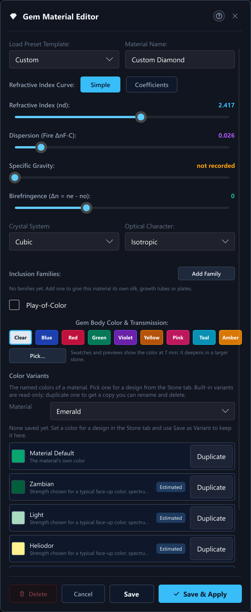

# 29. Custom Materials and Color Patterns

## What You Will Do

This chapter continues Chapter 6. Chapter 6 covers the built-in material list and the Stone tab's Material and RI Override controls; this chapter is about building a material of your own in the Material Editor: its fields, the refractive-index curves of the ordinary and the extraordinary ray, the color of the material, and Color Patterns, the zones of different colors that a custom material can carry.

## Custom materials

Press **New/Edit Material...** in the Stone tab (Chapter 2) to open the **Material
Editor**. The pencil buttons in the material lists open it too, so you do not have to
switch tabs. Its fields are:

| Field | Control | Notes |
|---|---|---|
| Load Preset Template | combo | Starts you from Custom, or from one of eleven built-ins (Diamond, Sapphire, Ruby, Emerald, Tanzanite, Synthetic Moissanite, Zircon, Topaz, Spinel, Quartz, Cubic Zirconia) as a base to tweak. |
| Material Name | text field | Rejected with a warning if it matches a built-in material's own name. |
| Refractive Index Curve | switch: **Simple** / **Coefficients** | **Simple** uses the two sliders below. **Coefficients** types the curve as a Sellmeier or Cauchy fit and hides those two sliders -- see "Dispersion coefficients" below. |
| Refractive Index (nd) | slider, 1.30–3.20 | Simple mode. |
| Dispersion (Fire ΔnF-C) | slider, 0.000–0.210 | Simple mode. |
| Specific Gravity | slider, 0.0–7.0 | Shows "not recorded" at 0 -- leave it there if you don't know the figure. |
| Birefringence (Δn = ne − no) | slider, −0.050 to +0.100 | Zero means isotropic. |
| Crystal System | combo | Cubic, Tetragonal, Hexagonal, Trigonal, Orthorhombic, Monoclinic, Triclinic. |
| Optical Character | combo | Isotropic, Uniaxial (+), Uniaxial (−), Biaxial (+), Biaxial (−). |
| Biaxial nβ − nα | slider | Only shown when Optical Character is one of the two Biaxial choices. |
| Crystal Axis | **Not Set** / **Set**, then **Tilt** and **Azimuth**; for a biaxial material a **Second Axis** with a **Turn** | Shown for every material that is not isotropic. The default direction of the material's crystal axis (for a biaxial material, the axis of the largest index). A design takes it unless it sets its own (Chapter 25). |
| Per-Axis Curves | **Simple** / **Curves**, then **Curve For** | Shown for every material that is not isotropic. **Curves** types a Sellmeier or Cauchy fit for the extraordinary ray of a uniaxial material, or for the alpha and gamma rays of a biaxial one (see "Curves for the Extraordinary Ray" below). |
| Inclusion Families | **Add Family**, up to four | Needles, plates or random needles that give the material its own silk (Chapter 27). |
| Play-of-Color | enable, then **Imitates**, **Pattern**, colors, **Purity**, **Coverage**, **Reseed** | Lets the material show the flashes of an opal or a labradorite (Chapter 28). |
| Color Mode | radio toggle | **Fantasy** (unconstrained colors) or **Physics** (mineralogical host crystal + real chromophores). Only in builds with the `physical-color` feature -- see "Physics Color Mode" below. |
| Gem Body Color (Fantasy) | swatches + Pick... | Clear, Blue, Red, Green, Violet, Yellow, Pink, Teal, Amber, a custom kept color, or a free choice: **Pick...** opens the Tone / Saturation / Hue color editor (see "Body Color" below) and the material keeps the full color. For a birefringent material (one-axis or two-axis) **Pick...** shows one color for each direction (Along and Across, or Alpha, Beta and Gamma), and the material keeps all of them. |
| Chromophore Recipe (Physics) | controls & swatches | Only in builds with the `physical-color` feature. Host crystal, element rows with log sliders, locks, sources, strength + fractions or absolute view, treatments, equivalent path, D65 / 3200 K swatches, color picker with the inverse solver, and Undo. |

Buttons: **Delete**, **Cancel**, **Save**, and **Save & Apply** (saves, then
makes it the design's material as one undo step; it ends a running preview, and for a
library row it becomes the material that row is shown as).

### Dispersion Coefficients (Sellmeier and Cauchy)

The two sliders describe a material's refractive-index curve with just two
numbers: the index at the yellow sodium line (nd) and the spread between the
blue and red lines (ΔnF−C). The program builds a smooth Cauchy curve through
them. That is enough for most gems. When you have a published fit instead --
a glass data sheet, or a paper on a synthetic crystal -- switch **Refractive
Index Curve** to **Coefficients** and type the fit itself. The stone is then
traced with exactly that curve, on the graphics card and on the processor
alike.

**Model.** Pick the equation your source uses. The wavelength λ is always in
micrometres (µm), so 589 nm is 0.589.

- **Sellmeier, 3 Terms:** n² = 1 + B1·λ²/(λ² − C1) + B2·λ²/(λ² − C2) +
  B3·λ²/(λ² − C3). Fields B1, B2, B3, C1, C2, C3. This is the form glass
  catalogues print, and what the built-in Diamond, Sapphire and glass entries
  use.
- **Sellmeier, 1 Term:** n² = 1 + B1·λ²/(λ² − C1). Fields B1 and C1. If your
  source gives two terms, use the 3-term model and enter 0 for the unused B
  and C.
- **Cauchy:** n = A + B/λ² + C/λ^4 (λ to the fourth power). Fields A, B (µm²)
  and C (µm^4); C is often 0.

Each B is a strength with no unit; each Sellmeier C is a resonance wavelength
squared, in µm². So C = 0.01 means a resonance at 0.1 µm = 100 nm, deep in
the ultraviolet. A typical glass has C values like 0.006 and 0.02 (resonances
at 77 nm and 141 nm) and one large C (about 103, an infrared resonance).

**Copy From.** For the Sellmeier 3-term and Cauchy models, the **Copy From**
combo fills the fields with the coefficients of a built-in material of that
model (Glass (N-BK7), Diamond, Sapphire, ...). It is the quickest way to a
sensible starting point: copy, then change one number and watch the readout.
Choosing a different model starts its fields empty, because the same number
means something else in each equation. Switching from **Simple** to
**Coefficients** the first time starts from the Cauchy fit of the two sliders'
values, so the curve you had is the curve you start editing.

**Examples.** N-BK7 glass as a 3-term Sellmeier:

| B1 | B2 | B3 | C1 | C2 | C3 |
|---|---|---|---|---|---|
| 1.03961212 | 0.231792344 | 1.01046945 | 0.00600069867 | 0.0200179144 | 103.560653 |

reads back nd 1.5168 and an Abbe number of about 64.2. A Cauchy fit of a
similar crown glass: A = 1.5046, B = 0.0042, C = 0 gives nd 1.5167,
ΔnF−C 0.0080 and an Abbe number of about 64.4. Use a decimal point (a decimal
comma works too when there is no point) and plain digits; 1e-3 is accepted.

**The live readout.** Under the fields you see nd (the sodium D line, 589.3
nm), nF (blue, 486.1 nm), nC (red, 656.3 nm), ΔnF−C and the **Abbe number**,
(nd − 1) divided by (nF − nC). A low Abbe number means strong dispersion and
lots of fire (diamond is 55, a crown glass about 64). Below that is a small
plot of n against wavelength from 380 to 780 nm. The vertical scale fits the
curve itself, so a nearly flat curve still looks like a curve; read the two
numbers at the left edge of the plot for the range.

**Errors (Save is disabled).** Each field that is not a number is outlined in
red with a plain message such as "'abc' is not a number". Beyond that, the
curve as a whole must be usable, and the red line under the fields says what is
wrong:

- *A C value puts a resonance at ... nm, inside the 300-800 nm range.* A
  resonance in the range the stone is rendered in makes the index jump to
  infinity there. This is nearly always a unit slip: C is the resonance
  wavelength squared, in µm², so a resonance at 600 nm is C = 0.36 and one in
  the ultraviolet at 100 nm is C = 0.01.
- *The refractive index comes out as ... at ... nm. It must stay above 1.* The
  signs or sizes of the coefficients do not describe a real material.
- *The refractive index cannot be calculated.* A division by zero or a negative
  square somewhere in the range.

The program never saves a curve it cannot render; the check runs again when
you press Save.

**Warnings (amber, Save still works).** These mark curves that are possible but
usually a typing slip:

- the index rises with wavelength somewhere between 380 and 780 nm (real gems
  fall from violet to red; check the signs);
- the Abbe number is outside 5 to 120;
- the index is the same at the blue and red lines, so the stone shows no fire.

**What is stored, and what else uses it.** The coefficients are stored with the
material in your catalogue and, when a design uses that material, in the
design's `.psdd` file next to the plain nd and ΔnF−C numbers. Those two
numbers are always the curve's own, so the Effective RI chip and the
cutting-sheet export agree with the readout on nd. Live Render traces with the
full curve, on the graphics card and on the processor alike. So does a remote
worker: every render request carries the whole material, including its Sellmeier
or Cauchy coefficients, so a high-resolution export, the share of a live picture
and the frames of a tilt video that a remote traces show the same color play as
your own computer. Nothing has to be installed on the worker for that. Three
things to know:

- An **RI Override** on a design replaces the whole curve with a single-index
  Cauchy curve at the typed number, for that design only. This is how an RI
  override has always worked for any material, built-in or custom.
- Switching an existing material back to **Simple** and saving replaces the
  curve with the Cauchy fit of nd and ΔnF−C (the sliders start from the
  curve's own values). The coefficients are not kept. Picking a template, or a
  host in Physics color mode, proposes an nd and a ΔnF−C and so switches the
  section back to **Simple**.
- An older version of Pleochroma Cut, and the browser viewer, do not know the
  coefficients. They show the material with a Cauchy curve built from nd and
  ΔnF−C instead (close, but not the identical curve).

### Curves for the Extraordinary Ray

A birefringent crystal has more than one refractive index, and each of them changes with wavelength in its own way. Most built-in materials give the main curve (the ordinary ray, or the middle ray of a two-axis crystal) its own dispersion and add the birefringence as one constant. A few have a published curve for the other ray or rays too, and for those the program uses the curve, not the constant, on the processor and on the graphics card alike.

| Ray | Materials |
|---|---|
| Extraordinary ray of a one-axis crystal | Quartz, Amethyst, Citrine, Ametrine and Rutile (as before), and now **Sapphire** and **Ruby** (Malitson and Dodge, 1972), **Synthetic Moissanite** (Wang, 2013) and **Benitoite** (a separate Cauchy curve for each ray, with the ordinary ray's dispersion corrected to the published 0.039) |
| Alpha and gamma rays of a two-axis crystal | **Alexandrite** and **Chrysoberyl (Yellow)** (Walling, 1980) |
| One constant offset, as before | Zircon, Tourmaline, Emerald, Aquamarine, Morganite, Topaz, Tanzanite, Peridot, Andalusite, Labradorite and Moonstone, because no per-ray dispersion was found for them |

What changes for the stones with a curve:

- The birefringence is no longer one number. Sapphire's extraordinary index lies 0.0085 below the ordinary one at 400 nm and 0.0080 below at 700 nm (0.0081 at the sodium line, the figure the table above shows). Alexandrite's spread is 0.0085 at 380 nm and 0.0074 at 780 nm.
- Chrysoberyl (Yellow) takes Alexandrite's published curves, which makes its total birefringence 0.0076 (it was 0.0090 before). The published figure wins over the older value.
- The doubled images of a birefringent stone separate a little by color, and the direction in which the extraordinary ray is displaced follows the index at each wavelength. This also applies to Quartz, Amethyst, Citrine, Ametrine and Rutile, which had a curve for the index but not yet for the displacement.
- Their renders and their Doubling figure therefore changed once, on purpose, when this version arrived. A material without a curve renders exactly as before.

**In the Material Editor.** A material that is not isotropic has a **Per-Axis Curves** row with **Simple** and **Curves**. **Simple** keeps the one main curve plus the constant birefringence. **Curves** shows a **Curve For** choice: **Extraordinary Ray** for a one-axis material, or the alpha and the gamma ray for a two-axis one (the main curve is the beta ray). Each curve has the same fields as the main curve (Sellmeier or Cauchy, with **Copy From**, a live readout and the same checks). Switching to **Curves** the first time starts from a Cauchy fit of the main curve and the birefringence, so you edit from the stone you had. A two-axis material needs both curves, and **Save** stays disabled while a needed curve is unusable. A two-axis pair is used only if the alpha curve stays below the beta (main) curve and the gamma curve above it at every wavelength from 380 to 780 nm; otherwise the pair is ignored and the fixed spreads apply. The curves are stored with the material in your catalogue and as `dispersion_model_e`, `dispersion_model_alpha` and `dispersion_model_gamma` tables of `[material.custom]` in a design; they are written only when used.

### Physics Color Mode

Available in builds with the `physical-color` feature. Other builds keep and
render physics colors but do not show the editor.

**In a build without the feature** (the normal build), the Material Editor
has no **Color Mode** toggle and no Physics section: it always shows the
Fantasy swatches and **Pick...**. A material whose color comes from a physics
recipe still renders exactly as before. Open it and the editor shows a note:
"This material's color comes from a physics recipe made in another build.
Picking a color here replaces it with a fixed color; the recipe stays saved
with the material." No swatch is marked until you pick one, and the crystal
system and optical character stay locked (the recipe's host fixes them) until
you do. Open it and Save without touching the color, and nothing changes: the
stored mode and recipe are written back as they were. Pick a swatch (or load a
preset template, which brings its own color) and the material becomes a
fixed-color material; the recipe is still saved inside it, so a build with the
feature can switch back to it. Such a build also never asks the "Color Changed
by an Older Version" question when you open a file (it keeps the saved recipe
and says so in the open message) and does not show the "Color Data Updated"
badge.

The rest of this section describes the editor in a build with the feature.

The **Color Mode** toggle switches between **Fantasy** and **Physics**. Both
colors are kept: switching never discards the other one. Going to Physics for
the first time solves your *current fantasy color* into the chosen host
(closest reachable); going back to Fantasy keeps the recipe, and saving while
Fantasy is active still stores the recipe, so physics -> fantasy -> save does
not delete it. A fantasy color that was still "Clear" is seeded from the
physics color on the first switch back.

In **Fantasy** mode the nine swatches are joined by **Pick...**, which opens
the same Tone / Saturation / Hue color editor as the design settings' Body
Color (see "Body Color" in Chapter 6): sliders, the optional
hue/saturation/brightness picker (**Use Picker...**), the four size swatches
and the reachability badge. **Apply Color** makes the color the material's
color (the swatch row then shows the nearest swatch, or "Custom (keep)") and
**Save** writes it to the library: a custom material keeps its seven-band
color, so the same material looks deeper in a larger stone. Picking one of the
nine swatches afterwards replaces it. The material also stores the closest
three-band color next to it, which is what an older version of the program
shows. A material that uses the Physics color keeps its recipe's color; the
editor is for Fantasy colors. A library database from an older version opens
unchanged: its materials simply have no seven-band color.

In **Physics** mode the body color comes from absorption spectroscopy:

- **Host Crystal.** The list is the color data's own host list (corundum,
  beryl, chrysoberyl, spinel, quartz, topaz, tourmaline, zircon, garnets,
  peridot, diamond, and so on). Choosing a host fixes the crystal system and
  optical character (those combos are greyed out) and prefills refractive
  index, dispersion, birefringence and specific gravity from the host's
  built-in material. For a garnet the RI and SG are interpolated over the
  end-member mix and re-prefilled as you change it. Picking a built-in
  template in "Load Preset Template" preselects its host.
- **Data-confidence banner.** One banner per host, shown only when some of its
  coefficients are not verified measurements ("Strengths uncalibrated --
  approximate").
- **Elements.** Each recipe row has a log-scale amount slider bounded by the
  host's maximum for that item, the amount with its unit (ppm, wt% oxide,
  mole fraction), a **Lock** toggle (the solver keeps locked amounts), a
  remove button, an "estimated data" note when the data behind the item are an
  estimate, and a **Sources** popover (confidence, source citations, skipped
  bands). **+ Add** lists only the items the data offer for the host; ones
  that cannot be added right now (no room in a garnet's end-member budget, a
  required or excluding chromophore, a centre that only a treatment creates)
  are greyed with the reason. Garnet and olivine items are mole fractions that
  add up to at most 100 % with a colorless remainder.
- **Two views.** *Strength + Fractions* shows each item's share and one
  **Strength** slider (a multiplier on every item's absorption, so the hue
  does not change); *Absolute Amounts* shows the amounts themselves.
- **Treatments.** Only the treatments the data define for the host, and only
  when their required elements are present.
- **Equivalent path.** The reference light path in millimetres. It defaults to
  1.5 x the open design's girdle diameter (a rough proxy for the table-to-culet
  path plus return) and to 5 mm when no design with a size is open.
- **Swatches.** The computed body color under D65 daylight and under 3200 K
  incandescent light, each unpolarised plus the ordinary, extraordinary and
  (biaxial hosts) beta ray, the color-change dE between the two, and, when it
  differs from the reference path, the color at this stone's size.
- **Pick color...** opens the color picker; the picked color becomes the
  solver's target. The solver runs on a background thread (the dialog shows
  "Solving..." and never freezes); if you pick again the latest request wins and
  the older result is dropped. The readout shows "dE x from your pick (D65)",
  with "closest reachable shown" when the pick cannot be matched within
  dE 1, in the warning color above dE 2.
- **Undo.** The dialog keeps its own recipe undo stack (50 entries): every
  slider release, add/remove, treatment, host change and solver result is
  undoable with **Undo**/**Redo** or Ctrl-Z / Ctrl-Y.

Edits to a recipe count as unsaved changes: closing the dialog asks before
discarding them, and every time the dialog opens its physics state is rebuilt
from the selected material (nothing carries over from a previous open).

**What is saved, and older versions.** The material stores both colors and the
recipe together with its *resolved bands* and the color-data version. Rendering
always uses the stored resolved bands: if a later release recalibrates the
color data, the material keeps its color, the Live Render toolbar shows a
"Color Data Updated" badge for it, and the editor offers **Update to Current Data**
(undoable, never automatic). The top-level color written next to a recipe is the
nearest legacy color, so an older version of Pleochroma Cut that does not know
physics color still shows an approximate color (within dE 15 for the reference
recipes). If such an older version edited that color and saved the file, this
version notices on opening it and asks whether to keep the physics recipe or use
the edited color. A physics material also takes a 7 mm default stone width when
the design has no size, so its color depth is not rendered at model scale.

**Per-design body color.** The design settings' *color* override replaces the
whole absorption, i.e. the physical color, so it is greyed out for a physics
material ("replaces the physical color"); if an override was already set when
the material was selected, a warning says it still wins until set back to
"Material Default". In a build without the `physical-color` feature the same
notes avoid the word "physical": the combo is greyed out with "This material
defines its own color.", and an already-set override is reported as replacing
"this material's own color".

**How colors relate to the stone width.** The built-in colors, the color presets and
the nine Fantasy swatches are shown as they look face-up in a stone of 7 mm: the
swatch, the color control's dot and the render agree, and with no stone width set
the stone is rendered as a 7 mm one. Setting the **Stone Width (mm)** in the Stone tab
(the design's girdle diameter, the same value as the Preform tab's Girdle Diameter)
scales the color physically from there: a bigger stone is darker and
more saturated (a 10.87 mm green cubic zirconia stays green, only deeper), a
smaller one paler. Colors made with the L*C*h editor, the library band rows
and Physics recipes are per millimetre and follow the stone width the same way,
with 7 mm assumed when none is set. There is only this one width: it is saved in the
design, it is undoable, and the old per-app "Stone Size" setting no longer exists.

**Where a custom material lives.** Saving writes it to your catalogue's own
database -- this is the copy every material picker across the app actually
reads from, and it is what makes the material available the next time you
open the app or select a different design. Separately, if a design's own
Material is set to a custom material, saving that design with **Save**
also writes a small snapshot of that material's numbers
(`CustomMaterialSnapshot`: RI, dispersion, birefringence, specific gravity
if set, crystal system, optical character, and the Sellmeier or Cauchy
coefficients if you typed them) into the design's own `.psdd` file. This snapshot exists purely so the design
still opens with its real optics if it is ever loaded on a machine whose
catalogue database has no row for that material name -- without it, a design
would silently reload as plain Diamond. You never edit this snapshot directly;
it is written and read automatically alongside Save and Open
(Chapter 11).

### Color Variants in the Material Editor

The Material Editor has a **Color Variants** section that shows and manages the
named colors of a material (Chapter 6, "Color Variants and Pleochroism"). Its
**Material** box lists your custom materials, then the built-in materials, and
starts on the material of the open Live Render. Below it each variant is a row
with a swatch, its name and a detail line: the first source line for a built-in
variant, "The material's own color" for the first row, or "Saved by you". An
**Estimated** tag marks a built-in variant whose spectrum is not a measured one of
that variety or whose strength was chosen for a typical face-up color, which is
true of almost all of them; its hover note says which part is estimated. The hover
note of every row also names the color of each direction for a pleochroic material.
Many built-in variants are fitted to measured spectra, mostly polarized (the
research, the sources and the fit records are in `docs/color_variants/` of the
source tree).

The buttons of a row:

- **Rename** (your saved variants only) renames it in place.
- **Duplicate** copies any row into a saved variant of your own, named "<name>
  Copy" (made unique if needed), which you can then rename and use. This is how
  you start from a built-in variant.
- **Delete** (your saved variants only) asks twice. Deleting or renaming a
  variant never changes a design: every design that used it keeps its own copy.

A custom material keeps its variants when you rename the material, and
loses them when you delete it.

A custom material's own color can have one color for each direction too: for a
one-axis or two-axis material, **Pick...** in the Gem Body Color row opens the
editor with one row for each direction, and **Save** stores them with the
material. A material saved this way opened by an older version of the program shows a single
averaged color.

The built-in variants and the Material Default are fitted per millimeter of path
and calibrated for a stone 7 mm wide, so they look the same in a stone of that
width and scale from there with the stone width (see "How colors relate to the
stone width" above). A few built-in materials have a Material Default fitted per
model unit, which scales a little differently at sizes far from 7 mm; the
swatches in the list are always taken for a 7 mm stone.

## Color Patterns

A custom material normally has one color all through. A **Color Pattern** gives
it zones of different colors: a pink core inside a green rim (a watermelon
tourmaline), two halves, bands, or sectors. Patterns are made in the **Color
Pattern Editor**, a window of its own that opens from the Gem Material Editor.

### The Color Pattern Section

Near the bottom of the Gem Material Editor, under the body color, sits a
**Color Pattern** section. What it offers depends on the material:

- **A material with a picked color** shows **Add Pattern...** (hover note: open the
  editor to give the material zones of different colors).
- **A material that has a pattern** shows a strip of small swatches, one per zone,
  with a short summary, and the buttons **Edit Pattern...** and **Remove Pattern**.
  Remove Pattern asks first. The material keeps its base color; only the zones go.
- **A material whose color is not set yet** (an old single color, for example) shows
  "Pick a color for this material first." Press **Pick...** in the Body Color
  controls, choose a color, and the section then offers Add Pattern....
- **A built-in material that comes with a pattern** (Ametrine) shows its swatch strip
  and "Built-in pattern. Save the material under a new name to change it." The copy
  under the new name can be edited.
- **A material with zones from the Rough Color wizard** (Chapter 24) shows **Edit
  Pattern...** too: its zones open in the pattern editor, and saving stores them as
  a pattern you can edit.

The section also says: "Patterns show in Path-Traced views. Ray-Traced shows the
base color." While the pattern window is open, the material dialog shows "The Color
Pattern window is open. Close it to go on with this material."

<!-- figure: color_pattern_section -->

### The Color Pattern Editor

The window is titled with the material's name. Its top row holds the starting
points; the left side is the preview, the right side the zones; the bottom row holds
the settings of the whole pattern.

<!-- figure: color_pattern_editor -->

**Templates.** One button each: **Uniform**, **Bicolor**, **Tricolor**, **Banded**,
**Watermelon**, **Reverse Watermelon**, **Core and Rim**, **Split** and **Sectors**.
A template replaces the zones below it with a ready pattern: Watermelon is a rim
around a three-sided core, Bicolor and Split divide the stone into halves, Banded
adds up to four slabs, Sectors adds wedges. Uniform means "no zones": the plain
material. The templates bring their own colors; change them afterwards.

**Typical for the species.** When the stone's material is a species that is known for a
zoning, a row above the templates, titled for example **Typical for Sapphire:**, offers
its typical patterns (see "Typical Zoning" below). They are built on the color the stone
has, and replace the zones below like a template does.

**Presets.** The **Presets** list holds patterns kept before, and the built-in
Ametrine and Watermelon Tourmaline. Choosing one replaces the zones. **Save as
Preset...** asks for a name and keeps the current pattern under it, to use on other
materials. A preset keeps its colors as they were made; on another material it looks
the same at the same size, and deeper in a much larger stone, just like any body
color (see "How colors relate to the stone width" above).

**Zones.** A pattern has a **base zone** (what fills the stone wherever no other
zone is) and up to **four more zones**. In the list, a later zone covers the ones
above it; **Up** and **Down** change the order. **Add Zone** asks for the shape of the
new zone, **Duplicate** copies the selected one (shifted a little so both stay
visible) and **Delete** removes it; the base zone cannot be deleted or given a shape.
At four zones, Add Zone is disabled with the note "A pattern holds at most 4 zones
besides the base."

For the selected zone the panel shows:

- **Name**, for example Rim or Core.
- **Color**, with **Pick...**. Pick... opens the usual color editor (Tone, Saturation,
  Hue) in the main window; its apply button reads "Use this color for the zone in the
  Color Pattern window." The color is solved for the stone's reference path, like any
  body color. While it is being worked out the panel says "Solving colors...".
- **Source**, **Variant** and **Colors** (see "Zone Colors and Color Variants" below).
- **Size**, one slider, in percent of the stone width when the pattern scales with
  the stone. This is the only size control in Simple mode.
- In the Advanced interface, **Shape** (prism, cylinder, slab, half space, sectors
  and the others) and one row for each of the shape's own measures, in millimeters.

**Zone Colors and Color Variants.** Some stones show a different color depending on the direction you look through
them (tourmaline is the classic case). A zone's color follows the same rule as
the stone's own color (Chapter 6, "Color Variants and Pleochroism"): the number of
colors a zone can have is fixed by its material.

*Colors.* The **Colors** menu of a zone offers **One Color**, **Along and
Across** and **Alpha, Beta and Gamma**, and puts first the form the material's
crystal has: one color for a cubic or amorphous material, **Along and Across**
(two colors) for a one-axis crystal, **Alpha, Beta and Gamma** (three colors) for a
two-axis crystal. This menu replaces the old **Two Colors** switch. Each color
has its own Pick... button. Looking along the crystal axis shows only the Along
color; looking across it shows a blend of both. The colors follow the *stone's*
Crystal Axis: the design's own setting from the Stone tab if it has one, else the
material's default from the Material Editor's Crystal Axis row, else the table normal
(Chapter 25). Live Render, exports, remote renders and catalogue thumbnails all use
it. This is not the same as the pattern axis below. A new zone starts in the
material's own form. A zone with one color on a material that has more than one
(from an older pattern) reads **Legacy: No Pleochroism**, with a sentence under it,
and keeps rendering as saved; a zone with more colors than the material has
cannot be applied or saved, and a message under the zone panel says so. A material
that is not birefringent (a crystal system other than Cubic and a birefringence
other than 0 are needed for more than one color) offers **One Color** only; set a
birefringence and a crystal system in the Gem Material Editor (shown in Advanced
mode), save the material, then reopen the pattern. In the zone list a zone with several colors
shows the blend as its swatch, and in its panel the swatch is split into one
part for each color. The base zone may have several colors too (see "The base
color" below).

*Older versions.* A pattern with a zone of three colors (**Alpha, Beta and
Gamma**) is a version 2 pattern, and so is a pattern made from the zones of a
two-axis material (a typical pattern, a template or the zones the Rough Color wizard
fits on such a material, which now keep all three colors where they used to keep
two). A design with such a pattern opens in this version as saved. An older version
of Pleochroma Cut does not open that pattern. A
pattern of one or two colors is still readable by the older versions.

*Source and Variant.* The **Source** menu of a zone chooses where its color comes
from: **Variant** or **Custom**. With **Variant**, the **Variant** menu lists the
stone's material's own color first (Material Default), then its built-in variants
(an estimated one carries "(Estimated)" and its source in the hover note), then
your saved variants; picking one copies its colors, one for each direction, into
the zone, so the zone does not change if you edit the variant later. With
**Custom**, the zone's color is picked with Pick... as before, one color for each
direction of the form chosen in **Colors**; switching from Variant to Custom turns
the variant into the picked colors of the same form, to adjust. A variant is
offered only when it fits the material's crystal.

**Pattern settings (bottom row).**

- **Axis**: the direction the pattern runs along. **Table Normal** runs from the table
  down to the culet; **Across** and **Across Turned** lay it sideways, which turns a
  Watermelon's core from a bull's-eye into stripes. **Custom** unlocks **Tilt** and
  **Turn** (Advanced interface). **Follows Crystal Axis** turns the zones with the
  stone's Crystal Axis, so a pattern made along the crystal keeps following it
  (Chapter 25). Zones imported from the wizard use their own axis, shown as
  "Imported" and not editable.
- **Size**: **Scales With Stone Size** (the zones grow and shrink with the stone
  width set in the Stone tab) or **Fixed in mm** (they keep their millimeter size).
- **Boundary**: **Sharp - Soft**. Left is a hard edge, right is a gradual blend from
  one zone to the next.

**Previews.** The pills above the picture switch between three views:

- **Crystal** draws a rod of the pattern along its axis, from slices.
- **Current Design** renders the open design with this pattern in the Path-Traced
  renderer, small and quick. It refreshes a moment after each edit and says
  "Updating..." meanwhile.
- **Cross-Section** shows a flat cut through the stone; the **Slice** slider moves the
  cut along the axis. Here the zones have handles: drag one to move, resize or turn
  the zone.

**Undo, Redo and the three buttons.** The editor has its own **Undo** and **Redo**,
because the material dialog has none. **Cancel** closes the window and leaves the
material's pattern as it was; if there are edits it asks first ("Discard the changes
to this pattern?"). **Apply** and **Save** keep the pattern for the material; both
are disabled while a message under the zone panel says something is not valid
(for example a zone whose outer radius is not larger than its inner one) or while a
color is still being solved.

### Typical Zoning

Some species are known for the way their color is zoned: a sapphire grows in
six-sided bands, a tourmaline is pink inside and green outside. You do not need a custom
material or the editor for these. A stone of such a species offers its **typical
zoning** in one click, in its own color, so a blue sapphire bands in its own blue.

| Species | Typical patterns |
| --- | --- |
| Sapphire | **Hexagonal Banding** (three six-sided growth zones in a stronger shade of the stone's color, on a paler body), **Parti Color** (a six-sided core in the stone's color inside a yellow rim, or a blue rim for a yellow stone), **Color Band** (one stronger band that runs along the crystal axis, off center) |
| Ruby | Hexagonal Banding |
| Emerald | Hexagonal Banding, **Core and Rim** (a stronger six-sided core in a paler rim) |
| Aquamarine, Morganite, Heliodor | Core and Rim. These beryls zone from core to rim but do not grow the six-sided color bands of an emerald or a sapphire |
| Tourmaline | **Watermelon**, **Reverse Watermelon**, **Bicolor** (two halves along the axis), **Tricolor** (two layers around a pale middle); pink and green, or the stone's own color where it already is pink or green. A Watermelon or Reverse Watermelon also turns the Crystal Axis through the table: watermelons are cut as slices across the axis, and with the axis in the table plane you look across the rings and pink and green blend to orange. Undo the axis turn on its own if you want the side view |
| Amethyst | **Sectors** (three wedges of 60 degrees around the axis, in the stone's color on a paler body, the sector zoning of a rhombohedral crystal), **Split** (a strong half and a paler half) |
| Citrine, Ametrine | **Split** (a purple half and a yellow half, as in the Ametrine material), **Sectors** (purple wedges in a yellow body) |
| Topaz | **Bicolor** (the stone's color over a nearly colorless half) |

Where the species has color variants (Chapter 6, "Color Variants and Pleochroism"), the
typical patterns use them as the colors of their zones: a Watermelon takes a Rubellite
core and a Verdelite rim, a Parti Color sapphire a Blue and a Yellow variant, an Ametrine-type
split the Amethyst and Citrine variants. The rim of a Parti Color sapphire takes the **Golden
Yellow** variant where there is one (a deeper yellow, since the rim is a thin zone), else the Yellow. A zone then keeps the pleochroism of its variant.
Where the material has no variant of that name, the zone is colored from the stone's own color.
On a pleochroic stone that color keeps its directions: a zone in the stone's own color is the
stone's variant (or its Material Default), and a paler or stronger shade is made paler or
stronger in every direction, so no typical pattern turns a pleochroic stone into one color. The
templates do the same: on a pleochroic stone every zone has one color for each direction.

A custom material is matched by its name: one called Fluorite offers **Banded** and
**Tricolor**, one called Heliodor or Beryl offers the beryl patterns. Any other material has no
typical patterns of its own, and any stone can still be zoned by hand with **Color Pattern...**.

The patterns are laid out along the stone's Crystal Axis (Chapter 25), so they turn with it. A
boundary that contains the axis (a Split, a Color Band) runs straight down through the table, so
face up it lies on the axis line. Fluorite is cubic and has no Crystal Axis: its Banded and
Tricolor patterns stand upright in the stone instead, so the bands show as stripes face up.

Layers across the axis (a tourmaline's Bicolor and Tricolor, a topaz's Bicolor) lie parallel to the
table while the axis runs through it: one color in the crown, another in the pavilion, and face up
they blend. Such stones are cut with the axis in the table plane, so the Stone tab then says so
under the typical zoning and offers **Lay Axis in Table Plane**, which sets the Crystal Axis to
**In the Table Plane** in one click.
You find them in three places:

- **The Color pill** above the picture (and in the Stone tab) opens a popup. Below the
  colors it has a **Color Zoning** section: one row for each typical pattern, **Edit
  Zones...**, which opens the Color Pattern Editor on this stone, and **Remove Zoning**
  while the stone has zones of its own. A tick marks the typical pattern the stone's zones came from.
  While the colors of the pattern are being worked out, the pill says "Matching...".
- **The Stone tab**, in the **Color Zoning** block, lists the same patterns as buttons
  under **Typical Zoning**, next to **Color Pattern...**. **Reset to Material Pattern**
  takes the zoning away.
- **The Color Pattern Editor** shows them in the **Typical for ...** row.

Like every Color Pattern change of a single stone, a typical pattern changes only this stone:
while the picture shows the open design it is one step that **Undo** takes back and Save keeps
with the design; for a library design or a Preview As, only this view changes. A stone that
has zones takes no body color, so the colors in the popup are off until you choose **Remove
Zoning**; **Material Default** then means the material's plain color again.

### The Base Color

The material's own color and the pattern's base zone are the same color: change it in
the Gem Material Editor and the base zone follows. The exception is a base with more
than one color (**Along and Across**, **Alpha, Beta and Gamma**) or a base that is a
variant. Its colors can only be changed in the pattern editor, so the dialog's color
box is disabled with the note "Edit this color in the pattern editor."

### Where a Pattern Shows

| Where | What you see |
| --- | --- |
| Live Render with the Path-Traced engine, and Path-Traced or Solid + Path-Traced in the Render panel | The pattern. |
| Local render jobs (Chapter 23) | The pattern. |
| A remote worker that has the zoning capability (Chapter 10) | The pattern. |
| The Ray-Traced view and the Ray-Traced option of Live Render | The **base color** only. Ray-Traced has no zones, and its note says so. |
| The Solid view | Flat grey, as always. |
| Catalogue thumbnails | The pattern. Editing the pattern refreshes the thumbnails of the designs on that material; designs on other materials keep theirs. |
| Material chip in the toolbar | A strip of the zone colors. |
| Tilt curves and the optimizer | They score light, not color; tilt curves score the base color. |

A patterned material follows the rule zoned materials always had: the design's color
override and the Live Render view color are off for it, and the pattern editor is the
one place its colors change.

## Next Steps

Continue with Chapter 6 for RI Override, Preview As, the margin column and Retarget. Chapter 25 covers the Crystal Axis a material can carry, Chapter 27 the inclusion families and Chapter 28 the Play-of-Color section of the Material Editor.
