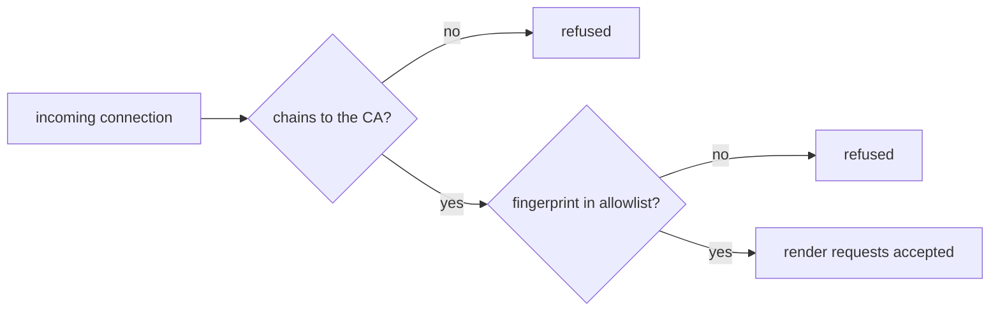
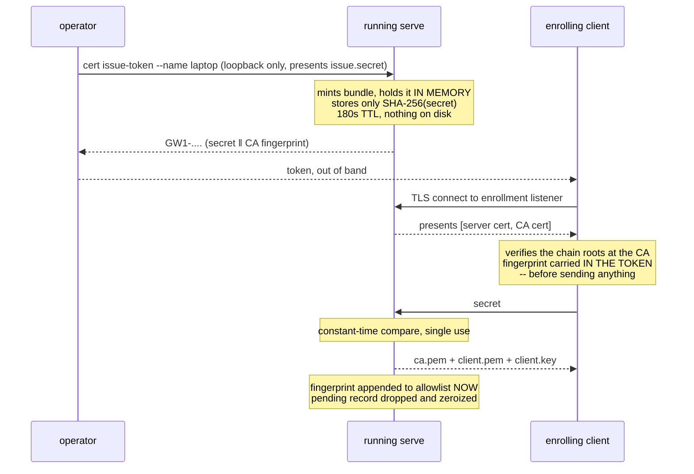

# pleochroma-worker — trust model (protocol 45)

What `serve` actually protects, what it doesn't, and what each security-relevant flag
costs you. For the commands themselves see [the README](../README.md); for how the
worker is built internally see [architecture.md](architecture.md).

`serve` is a network service that accepts caller-supplied geometry and traces it. That
makes two questions load-bearing: *who may connect*, and *what may they make this
machine do*. They are answered by different mechanisms and it is worth keeping them
apart.

This page describes wire protocol **45** (Pleochroma 0.12.1). Every app, the coordinator
and every worker must run the same version; a peer on another protocol is refused at
the handshake. The window (the default) and `--headless` use the same code paths, so
everything below holds for both.

## Who may connect

Two independent gates, both of which must pass:

1. **Chain of trust.** The client presents a certificate signed by the same private CA
   as the server's own. Mutual TLS — the client verifies the server too.
2. **The allowlist.** The client certificate's SHA-256 fingerprint must appear in
   the listener's own allowlist: `allowlist-viewers.txt` on the viewer port (a pre-role
   `allowlist.txt` keeps serving as that list until the new file exists),
   `allowlist-workers.txt` on the coordinator's worker port. Monitor and admin devices
   connect to the viewer port and have their own lists, `allowlist-monitors.txt` and
   `allowlist-admins.txt` (see [Remote administration](#remote-administration-monitor-and-admin)).
   A coordinator that starts with neither viewer file creates an empty
   `allowlist-viewers.txt`, so a new coordinator trusts nobody until the first device is
   paired. An `--allowlist` path given
   on the command line must exist.

The second is not redundant. The CA answers "was this certificate issued by me"; the
allowlist answers "is *this specific* certificate still welcome". Without it, every
certificate the CA ever signed is valid forever, because **there is no CRL and no
OCSP** — revocation *is* deleting a line from the allowlist. That file is re-read on
every connection, so a deletion takes effect immediately, with no restart.



### Two client roles, two ports (coordinator mode)

`serve` accepts viewers on the viewer port (7878) and `pleochroma-worker join` render
workers on a separate worker port (7880). A client certificate records its role in its
Common Name: `worker:<name>` for a worker, anything else for a viewer (a viewer
`--name` may not start with `worker:`, so the prefix only ever comes from an explicit
`--role worker`). Each listener checks the certificate against its own allowlist, but
only for a certificate of *its* role; the role itself is enforced at `HELLO`. A
certificate of the other role is not looked up in any allowlist at the TLS stage: it
completes the handshake, takes a connection slot and a database handle, and is then
refused with `ROLE_REFUSED` when its `HELLO` arrives (a `HELLO` claiming the wrong role
is refused the same way). The hold is bounded by the handshake deadline and the small
`HELLO` read limit, but for that time a CA-signed certificate that is on *no* allowlist
can occupy one connection slot. A leaked viewer certificate still cannot register as a
worker (and receive scenes to render), and a worker certificate cannot browse the
library or request renders, because neither gets past `HELLO`. `--trust-any-client-cert`
skips the allowlists, never the role check. Each role has its own enrollment listener
(7879 / 7881) with its own token registry; a token only claims on the listener that
issued it.

### The four roles

A certificate's role is written in its Common Name and signed by the CA:

| Role | Common Name | Allowlist | Connects to |
|---|---|---|---|
| Viewer | the label | `allowlist-viewers.txt` | viewer port (7878) |
| Worker | `worker:<label>` | `allowlist-workers.txt` | worker port (7880) |
| Monitor | `monitor:<label>` | `allowlist-monitors.txt` | viewer port, only with remote administration on |
| Admin | `admin:<label>` | `allowlist-admins.txt` | viewer port, only with remote administration on |

A viewer label may not start with `worker:`, `monitor:` or `admin:`, so a prefix only
ever comes from an explicit role. The role in the `HELLO` must match the certificate's.

### What a joined worker is trusted with

An allowlisted worker receives the scenes viewers render — geometry, material and, for
an HDR-lit scene, the HDR map's bytes — and its returned samples are summed into
viewers' images. The coordinator checks the shape of what comes back: each chunk's
frames must lie inside the chunk and, once the chunk is complete, tile its sample range
exactly (sorted, contiguous, non-overlapping) or the whole chunk is discarded; buffer
sizes must match; and a pixel with a non-finite or negative value is dropped (and
counted) rather than summed. It does not check whether the numbers are *right*: a
malicious or broken worker that passed both gates can spoil the images it contributes
to with plausible-looking values.

The build check at pairing time compares what the worker *reports about itself* — a
hash of its crate version and a hash of its physics source tree. A modified worker can
report anything, so this catches mismatched installs, not a hostile peer; and an unknown
source hash only logs a warning and pairs (a peer with no build at all is paired
library-only). Only enroll machines you control as workers, and revoke one by deleting
its line from `allowlist-workers.txt`.

### HDR maps on disk

Scenes lit by an HDR map carry only the map's SHA-256. A node that lacks the bytes asks
its peer (the viewer, or the coordinator) and stores them in its bounded asset cache
(`PLEOCHROMA_ASSET_CACHE_DIR`, see the README). A cached file is named by its hash
alone — a peer never supplies a path or file name — and its bytes are verified against
that hash when written and re-verified when read. The cache is capped
(`PLEOCHROMA_ASSET_CACHE_MIB`, least recently used files evicted first), and a single
map is limited to 256 MiB on the wire. A viewer's maps therefore persist on the
coordinator and on every worker that rendered them until evicted; delete the cache
directory to remove them.

### Message size and idle limits

An authenticated peer is still bounded. Every control message (a request, a `CANCEL`, a
`PING`, a stream-event header) is read with a 1 MiB cap, and a declared length never makes
the process commit memory before the bytes arrive: payload buffers grow as data is
received. The large payloads (radiance frames, HDR assets, viewer contributions) keep
their own, separate bounds. A connection that sends no message for five minutes between
requests is closed, with the reason logged; during a request the worker's heartbeat and
liveness deadlines apply instead.

## Enrollment: how a client gets its certificate

Two paths, both supported, with different trade-offs.

### Manual (`cert issue-client`)

Writes `ca.pem`/`client.pem`/`client.key` to a directory and appends the fingerprint to
the allowlist **immediately**. You copy the directory to the viewer's machine yourself.

Kept deliberately: air-gapped and offline setups have nothing to dial out to. It is also
the only path where the allowlist gains an entry before anyone has actually taken
delivery of the certificate — which is the thing the token path improves on.

### Token (`cert issue-token` → `cert claim`)

The operator asks a *running* `serve` process for a one-time token and reads it out. The
enrolling machine redeems it and receives the same three-file bundle.



Three properties are what make this safe, and each was a deliberate choice:

**The token is not the certificate's fingerprint.** It is a fresh 256-bit CSPRNG secret.
The fingerprint is a *public* value — it crosses the wire in the clear on every
handshake and is the allowlist's permanent identifier for that client. A bearer secret
and a long-term public identifier must never be the same value.

**The server never stores the secret.** Only `SHA-256(secret)`, compared in constant
time against every pending entry with no early exit, so a compromise of the running
worker yields nothing redeemable and the comparison's duration doesn't reveal which
entry matched.

**The token commits to the server's identity.** This is the subtle one. An enrolling
client has no CA certificate yet — that is the bootstrap problem. If it trusted whatever
answered, an attacker could impersonate the worker, relay to the real one, and walk away
holding a **valid client certificate**. So the token carries the CA's SHA-256 fingerprint
alongside the secret, and the client verifies the presented chain against it *before*
sending anything. Pinning is trust-anchor *selection* only: once the anchor is chosen,
the whole chain/signature/validity check is delegated to `rustls`'s own
`WebPkiServerVerifier`. Nothing is skipped.

### What a stolen token gets an attacker

A client certificate for your CA, if they redeem it before the legitimate holder does
and within 180 seconds of issuance. That is the real exposure and it is why the window
is short and the token single-use.

Mitigations already in place: the token expires, a successful claim consumes it, and the
allowlist entry appears **only on claim** — so an unclaimed or expired token leaves no
trace and grants nothing. If you suspect a token was intercepted, the legitimate holder
will find their claim fails (single use), which is itself the signal.

### Known limitation: the private key transits

The bundle contains `client.key`, so the worker generates and transmits the client's
private key. A private key ideally never leaves the machine it belongs to.

The stronger design is a CSR flow: the client generates its own keypair and sends a
signing request; the worker returns only the signed certificate, and no private key ever
crosses the wire. It needs the client side (`apps/pleochroma-cut`) to generate keypairs.

Until then (a CSR flow comes later), the client key still travels inside the
TLS-protected claim response, in every app including the phone apps. Treat the
enrollment connection as carrying key material: it is TLS-protected and
server-verified, but a compromise of the coordinator at that moment is a compromise of
that client's key.

### Other properties worth knowing

- **`serve` needs `ca.key` when enrollment is enabled** — minting a certificate
  requires signing. `--no-enroll` avoids this entirely.
- **A `serve` restart drops every pending enrollment.** Fail-closed, and intended:
  pending bundles live only in memory.
- **`cert issue-token` needs loopback and the operator secret.** The peer must be on
  loopback, enforced against the real `peer_addr()` rather than by how the listener is
  bound. Loopback alone is not authority — any local user, and any port forward onto the
  loopback listener, looks like a loopback peer — so the request must also present the
  **operator secret**: `issue.secret` in the PKI directory, 32 random bytes as hex,
  created the first time `serve` starts an enrollment listener, written with owner-only
  permissions (the same protection as `ca.key`; on Windows an `icacls` ACL), and
  compared in constant time. `cert issue-token` reads it from the PKI directory, so it
  must run as a user who can read that directory. A local user who can read the PKI
  directory is trusted: they could equally read `ca.key` and mint certificates
  directly.
- Key material is held in `Zeroizing` wrappers so ordinary `Drop` overwrites it. Nothing
  protects against an abrupt process kill.

## Pairing links and codes

The coordinator window and `cert issue-token` present a code as a **pairing link**, also
shown as a QR code, so a phone or another computer does not have to type it.

```
pleochroma://pair?v=1&r=viewer&n=Studio+PC&a=192.168.178.20:7878&a=10.0.0.5:7878&e=7879&t=GW1-...
```

| Key | Meaning |
|---|---|
| `v` | Link version. This build reads `1`; any other value is refused with "needs a newer Pleochroma". |
| `r` | `viewer`, `worker`, `monitor` or `admin`: the access the code grants. |
| `n` | The coordinator's display name. |
| `a` | One to three IPv4 `host:port` addresses, the default-route interface first. |
| `e` | The enrollment port, on the same host as whichever address answered. |
| `t` | The `GW1-` token. **A secret.** |

The link is about 217 characters and fits a QR code at error correction M. The parser
refuses anything over 2048 characters before looking at it, never panics, and its error
messages never contain any part of the link. The link holds exactly what the token path
above needs and nothing more: the token already carries the CA fingerprint, so the link
adds addresses and a role, not trust.

### The code lifecycle

- **180 seconds, one TTL.** Every code, whatever its role, lives 180 seconds from issue.
- **Single use.** A successful claim consumes it; the allowlist entry appears only then.
- **Expired and used look the same.** A claim with a wrong, expired or already used code
  gets the one answer "invalid, expired, or already used" (on screen: "This code has
  expired or was already used."). The difference is deliberate: telling them apart would
  let a guesser learn which codes once existed.
- **At most 64 pending codes** at a time per listener; a restart drops all of them.
- **The window cancels its own codes.** Closing the pairing dialog, switching tabs,
  refreshing and pairing all cancel the code that was live, so no old code stays valid.
  Refreshing stops after five automatic renewals ("Code paused") and waits for a click.
- **Paired from an address.** A claim carries only the code, never a name, so the window
  shows the address that claimed it and keeps "Not my device — remove access" one click
  away.

### The fixed certificate name

Phones and desktops dial an address that changes (Wi-Fi to Ethernet, a new network). A
certificate that lists only IP addresses would stop matching. Every coordinator server
certificate issued since 0.12.0 therefore also carries the DNS name
`coordinator.pleochroma.invalid`, and a pairing client verifies the server against that
name whatever address it dialed. The `.invalid` domain is reserved (RFC 2606) and never
resolves; the name is only compared against the certificate, never looked up.

This does not weaken the check. The client uses `rustls`'s own `webpki` verifier, so the
chain, the validity period and the signature are all checked as before, and trust still
comes only from the CA the token pins. Only the name that is matched differs. A
certificate without the fixed name (a coordinator that has not migrated) is checked
against the dialed name, exactly as before.

The first 0.12.0 start reissues a `server.pem` that lacks the fixed name, with the same
CA, so every paired device keeps working. Reissued certificates list `localhost`,
`127.0.0.1`, the LAN IPv4 addresses of the physical adapters (virtual adapters such as
Hyper-V, WSL, Docker and VPN tunnels are left out unless nothing else exists) and any
extra names the owner added.

### Hot certificate swap

A running coordinator reads its LAN addresses every 10 seconds. When the set changes it
mints a new server certificate with the same CA and swaps it into the listeners without a
restart. Established connections are not touched. A machine with no usable address keeps
its current certificate. Nothing about trust changes: the CA stays the same, so no device
has to pair again.

### Addresses in a claim

`claim_any` dials every address of the link in parallel, each with a 3-second connect
timeout. The first handshake that passes the CA pin is the only connection that sends
the secret. The others are dropped without sending anything, so a code is never spent on
a connection that lost the race, and an address that is not the real coordinator never
receives it.

### Discovery on the local network (mDNS)

A coordinator can announce itself as `_pleochroma._tcp` so an app can list it. The TXT
record has two public values and no secret:

- `v`: the protocol version (45);
- `ca`: 16 hex characters, the first 8 bytes of SHA-256 over the CA fingerprint.

The tag lets an app skip coordinators of other owners without revealing the CA
fingerprint. It is a filter, not a check: anyone on the network can read the name, the
address and the tag, and the real check is still the TLS handshake against the pinned CA.
Announcing is on by default (the settings file has a `discovery` switch); turn it off
if the network should not see the coordinator.

## Remote administration (Monitor and Admin)

A paired phone or computer can watch and, with more access, manage a coordinator over the
viewer port. It is **off by default**: switch it on in the coordinator window (settings)
or start `serve --allow-remote-admin`. While it is off, a monitor or admin certificate
is refused, and `cert issue-token --role monitor|admin` is refused too.

A session passes these checks on every connection: remote administration is on, the
`HELLO` role equals the certificate's role, and the certificate is on that role's
allowlist (read afresh, so removing a line takes effect at the next connection). The
session needs the same protocol but not the same render build.

| Request | Monitor | Admin | Local window |
|---|---|---|---|
| Watch status, log and jobs; fetch a result | yes | yes | yes |
| Issue a code for a viewer or a render computer | no | yes | yes |
| Issue a code for a monitor or an admin | no | **no** | yes |
| Everything else (revoke, rename, cancel or delete a job, disconnect a computer, apply the safe settings, restart) | no | yes | yes |

Monitor is look-only: a change is answered "You have monitor access, so you cannot …".

### Never remote

Some actions exist only on the coordinator's own computer. They are not in the protocol
at all, so no request can carry them, and a peer that asks for one another way gets a
plain "own computer" refusal:

1. changing ports, addresses or who can connect (network);
2. switching remote administration on or off;
3. resetting all pairings (the CA);
4. rotating the issuing secret;
5. exporting a backup;
6. stopping the coordinator;
7. making a monitor or an admin code.

The last one means a stolen admin device cannot create more admin devices. It can still
issue viewer and render-computer codes, revoke devices and change the safe settings, so
treat an admin device like a key to the coordinator and remove its access (Devices page)
if it is lost.

### Audit

Every command from a remote device is recorded twice: as an event pushed to every
subscriber (the coordinator window included) and as one `info` log line:

```
admin action: <name> (<short fingerprint>) <action> <target>
```

Connects and disconnects are logged as `admin session: …`, and a refused request as a
`warn` line (`admin request refused: … may not …`). A code appears only in the reply that
carries it to the administrator who asked, never in the log line or the event. Names in
these lines lose control characters. An unsubscribed session is closed after five silent
minutes; a subscribed one gets a heartbeat every 15 seconds.

## Handling secrets

A token, a pairing link, the operator secret and a private key must not reach a log, a
panic message, a window title or the clipboard history. What enforces that:

- **Redacted `Debug`.** The types that hold a secret (the pairing link, the
  enrollment request and response, a claimed bundle) print `<redacted>` for it, and the secret itself sits in
  a zeroizing string that is wiped on drop. No pairing dialog type derives `Debug`.
- **The log scrubber.** Every message passes `scrub` before it reaches the Log page or a
  log file: a `pleochroma://pair` link becomes `pleochroma://pair?[removed]`, a `GW1-`
  token becomes `GW1-[removed]`, and a private key block becomes `[private key removed]`.
  A field whose name says secret, password or token is replaced as well. It is a second
  line of defense; no code is meant to log these in the first place. Log files are
  `coordinator-YYYY-MM-DD.log` in the data folder's `logs/`, kept 14 days.
- **Pairing dialogs and the clipboard.** The window shows a link with its code masked.
  The phone tab never offers Copy. The computer tab copies with the platform's
  clipboard-history exclusion (Windows `ExcludeClipboardContentFromMonitorProcessing`,
  the history-exclusion hint on macOS and Linux) and, when the code expires, is cancelled
  or is used, clears the clipboard if it still holds that link. The title of a window
  never contains a code.
- **Deep links on the phone.** The Pleochroma app on Android never logs the link it is
  handed. The system, though, may print the data of an intent when it starts an activity,
  and a debug build or a bug report can then show the `pleochroma://pair` link in the
  system log. The code in it is one-time and short-lived, and the app asks before it uses
  it, but treat a bug report taken during pairing as sensitive until the code has
  expired or been used.
- **The encrypted backup.** A backup is one file with the CA key, the server certificate,
  the allowlists and the settings. It is sealed with a password you type (at least 8
  characters): the key comes from the password with Argon2id (64 MiB, 3 passes, one lane;
  the values are stored in the file and checked on restore so a damaged file cannot
  exhaust memory) and the archive is sealed with AES-256-GCM, with the header
  authenticated too. A wrong password and a changed header fail the same way. A backup
  holds the CA's private key, so keep it where you would keep `ca.key`. Export is
  **never remote**: only the coordinator's own window offers it.

## What each flag weakens

| Flag | What you give up |
|---|---|
| `--trust-any-client-cert` (the window's "Accept any client certificate") | Both allowlists (viewers and workers). Any certificate the CA ever signed with the port's role is accepted, forever — you lose per-client revocability entirely, keeping only "was it signed by my CA". **"Remove access" then does nothing that lasts**: it deletes the allowlist line, but the allowlist is not consulted, so the device still connects. The Devices page shows a red "Any client certificate is accepted" banner while this is on. |
| `--allow-remote-admin` | Monitor and admin devices may manage the coordinator over the viewer port, within the permissions above. Off by default; without it such devices are refused and no monitor or admin code can be issued. |
| `--allow-remote` | Loopback-only binding. Required for any real remote worker; it exists so that exposing the machine is a visible, deliberate act rather than a default. |
| `--insecure-no-tls` | Everything: no TLS, no authentication, no client identity. Refused on a non-loopback bind, and every accepted connection logs a warning. Local debugging only. |
| `--no-enroll` | The token path, for viewers and workers alike. The manual `cert issue-client` workflow still works; this just opens no extra port. |
| `--no-workers` | Nothing — it *removes* exposure: no worker port and no worker enrollment listener are opened. |
| `--max-job-memory-mib` | Raising it lets allowlisted viewers make the coordinator hold more memory for in-flight jobs spread over workers. Each job is charged `width × height × 48` bytes, but that is only its base cost: every joined-worker lane also holds several full-frame buffers of its own, so the real memory of a job spread over many workers is a multiple of the charge. |

## What this does *not* protect against

Stated plainly, because a trust model that only lists its strengths is misleading:

- **A compromised CA private key.** Whoever holds `ca.key` can mint certificates that
  pass both gates. It is ACL-restricted at rest (on Windows, via `icacls` to the current
  user, SYSTEM and Administrators), but there is no HSM and no key ceremony.
- **A local user who can read the PKI directory.** `issue.secret` is what authorises
  `cert issue-token`, and it is readable by exactly the users who can read `ca.key`.
  Anyone with that access — or who can run code as the account that runs `serve` — can
  mint viewer and worker certificates; the enrollment listener's loopback check does
  not separate them. Keep the PKI directory owner-only (the tools set this for the files
  they create; a directory you created yourself is yours to secure).
- **A malicious but allowlisted client.** Authorization is binary. An accepted client can
  submit any scene within [the validation limits](../README.md#limits-and-validation) —
  which is exactly why those limits exist and are enforced before geometry reaches the
  tracer.
- **Someone who sees or photographs a code.** A pairing link or QR code is a bearer
  secret for 180 seconds. Show it only to the device you are pairing, and cancel it if
  it was seen.
- **A lost admin device.** It keeps its access until you remove it (the never-remote
  list limits what it can do, not how long it can do it).
- **Seeing that a coordinator exists.** The mDNS announcement is public on the local
  network: name, address and the CA tag.
- **Traffic analysis.** TLS hides content, not the fact or size of a render.
- **Certificate expiry as revocation.** Client certificates last five years. The
  allowlist is the revocation mechanism; do not rely on expiry.
